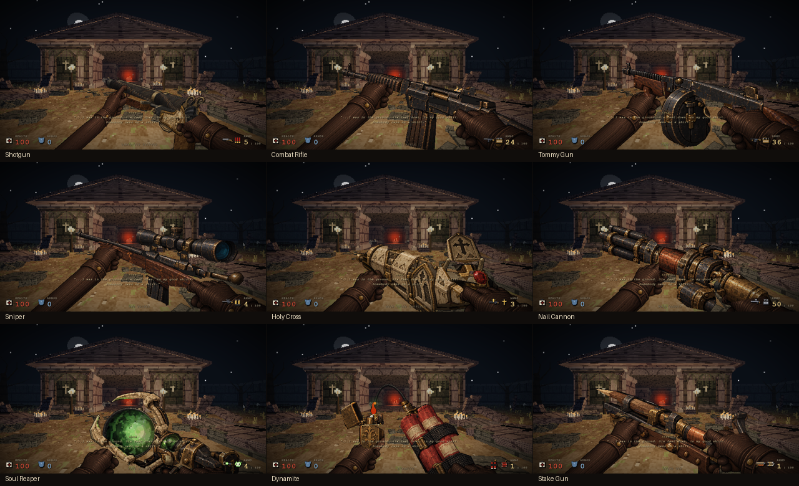

# Reference-led arsenal proportions — 26 October

Final HTML: `56394da38ad2dff02bffb5a32900daa40cf7c6cd319be7e6a1b850145e6e376d` (24,886,358 bytes). Viewmodel source: `fac2821077fe86e235207797d3a7a7bcd024e77f00a44c0bec744271d05d89fa`.

The handgun retains its existing appearance. The other nine weapons have revised model proportions and presentation using the repository's existing reference artwork. Their local model scale now gives receivers, magazines, scopes and chambers more weight relative to the unchanged leather glove assets. This is an extension of the existing articulated textured meshes, not nine newly authored full-3D assets.

| Weapon | Visible change |
|---|---|
| Shotgun | More side-facing hold, narrower rear crown and a taller shaped lockplate using the existing high-resolution skull/brass artwork. Real barrels and break-open hinge remain. |
| Combat Rifle | Longer and fuller receiver/fore-end; the magazine and loading hand remain together in the revised reload presentation. |
| Tommy Gun | Larger receiver and drum relative to the hand; extraction and seating retain their shared rig. |
| Sniper | Longer stock/barrel/scope profile, with additional magazine-stage presentation lift confined to the existing `.25–.76` window. |
| Holy Cross | Larger reliquary body, darker structural brass, a raised upper lid and two solid hinge connections. The loading gesture is lifted into view. |
| Nail Cannon | More substantial copper receiver and separate barrel cluster; canister/hand servicing is presented higher. |
| Soul Reaper | Larger orb and bone cradle; the carried core and support hand remain visible during reload. |
| Dynamite | Larger bundle and lighter, a twelve-segment cubic fuse curve and warmer flame silhouette. |
| Stake Gun | Longer timber/pressure-chamber proportions and a right-grip anchor adjustment to retain palm contact with the enlarged stock. |

Right glove/sleeve quads now use the existing side-canvas continuation for the shotgun and weapons 2–8 on ultrawide screens. The Stake already used that route; a suspected new Stake cutoff was independently checked and was not reproduced. Weapon artwork stays in the native weapon canvas. The center depth mask prevents duplicate hand painting.

Reload-only presentation adjustments move complete assemblies and their hands together. The first and last six percent blend to the idle presentation offset, addressing the visible return jump introduced by the larger idle offsets. Native reload durations, ammo rules, seat/charge events, firing and audio timing remain unchanged.

## Actual game captures

These are rendered game frames, not the reference boards. The full-view thumbnails preserve the whole viewport; the sheet does not crop barrel ends.

[Actual nine-weapon reload recording, with game audio](arsenal-model-oct26/arsenal-reloads.webm) — 41.8 seconds of uninterrupted native RAF and keyboard reloads. QA supplies ammunition and removes enemies. The preroll is trimmed; video is 25 fps, so audio synchronization is only measured to video-frame granularity. [Media provenance](arsenal-model-oct26/provenance.json) records exact inputs and hashes.

[Nail before](arsenal-model-oct26/nail-before.png) / [after](arsenal-model-oct26/nail-after.png), [Rifle](arsenal-model-oct26/rifle-after.png), [Cross](arsenal-model-oct26/cross-after.png).

## Verification and limits

- Weapon-only deterministic comparison: baseline `4b03db10…` versus `4baca569…`, both exact inputs recorded. All 660 cases passed their scope: 120 handgun/standalone kick/finisher cases are identical; 540 cases for the intentionally changed nine weapons differ. This is not a claim that changed models are visually identical.
- Independent native aspect checks used immutable intermediate V5/V7 candidates and preserve those hashes. Final V7 has the same viewmodel source as the delivered combined build. Idle, reload, ammo endpoints and critical ultrawide hand continuation were inspected; final V7 delta scope was 38 frames and 13 endpoints.
- Final combined build passed all ten real reload/fire/switch/kick/cache checks, zombie audio routing/lifecycle checks and the environment route/resource smoke. Original engine and Village bytes remain intact; two rebuilds were identical and eight malformed inputs were refused without writing.
- The presentation-envelope test confirms equal idle offsets at both reload endpoints and zero endpoint slopes. It is not a proof of every articulated animation's velocity.

Serial ABBA observations at 1280×720, chapter-0 starting camera on this host:

| Reload | Previous / final frame FPS | Previous / final raster CPU |
|---|---:|---:|
| Shotgun | 48.70 / 49.60 | 16.34 / 16.14 ms |
| Sniper | 56.13 / 56.34 | 10.31 / 12.13 ms |
| Nail | 49.37 / 53.31 | 14.32 / 12.96 ms |
| Soul | 42.63 / 41.33 | 18.86 / 19.92 ms |

These short host-specific observations do not establish a general FPS improvement. The larger Sniper and Soul presentation costs more raster work; Soul frame p95 remained approximately 36.1 / 36.2 ms. The reference surfaces remain partly view-dependent 2.5D artwork with volumetric backing, rather than complete models designed for arbitrary camera rotations. Full-campaign and every hardware/aspect combination are outside this validation scope.
