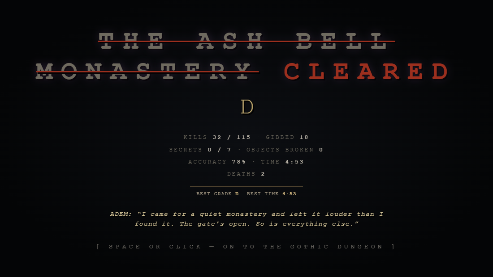

# Ash Bell Monastery oynanış testi

Test çevrimdışı Chrome’da, SHA-256 değeri `452b55c7d328f913eeb1ebb075433cfb4c0439f49bc75d6dc230bcaae477c04e` olan tek dosyalık sürümde yapıldı. Başlangıçta yalnızca Chapter Select erişimi açıldı. Oyuncu 100 can, sıfır zırh ve başlangıç tabancasıyla girdi. Karşılaşmalar canlıydı. Hareket, nişan alma ve etkileşimler klavye ve fare girdileriyle yapıldı.

- Rampart merdivenlerinden çan odasına ulaşıldı. **E** ile çan çalındı, dört niş açıldı ve asansör 6,0’dan 1,2’ye indirildi.
- Bell Seal ve Ash Seal yürüyerek alındı. İki mühürle ana geçit **E** ile açıldı. İki ölümün ardından sırasıyla Chapel ve Crematorium tapınaklarında oyunun kendi Rise düğmesiyle yeniden doğuldu.
- Gravedigger üç evre sonunda yenildi. Dövüşte aynı anda altı mermi küresi, bir şok dalgası ve bir zemin saldırısı gözlendi. **E** ile çıkış kullanıldı ve bölüm kartından **Space** ile Gothic Dungeon’a geçildi.

Bölüm kartı 4:53 süre, 32/115 düşman ve %78 isabet kaydetti. Tarayıcıda oyun sayfası hatası veya harici HTTP isteği gözlenmedi.

