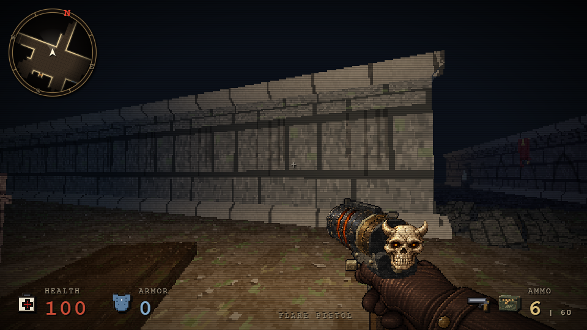
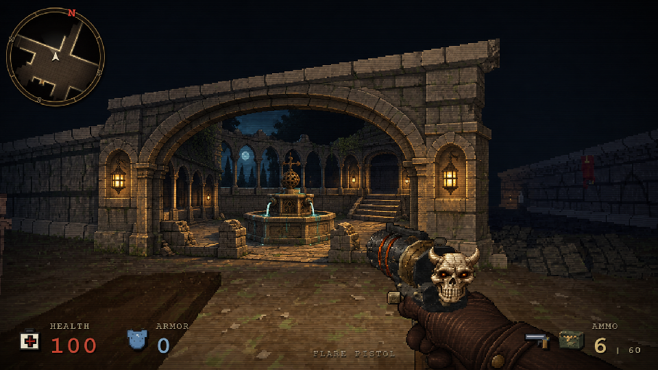
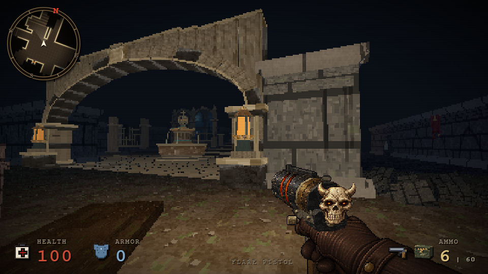
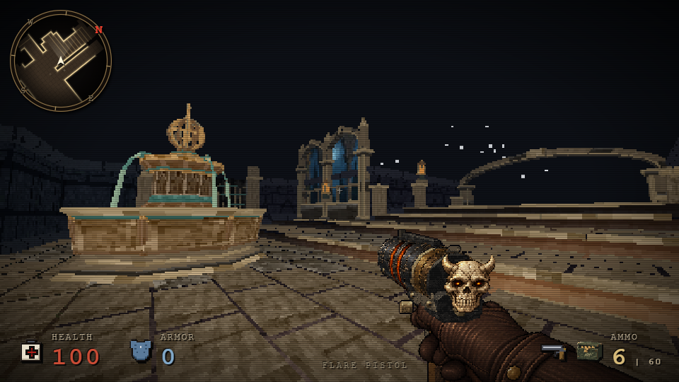
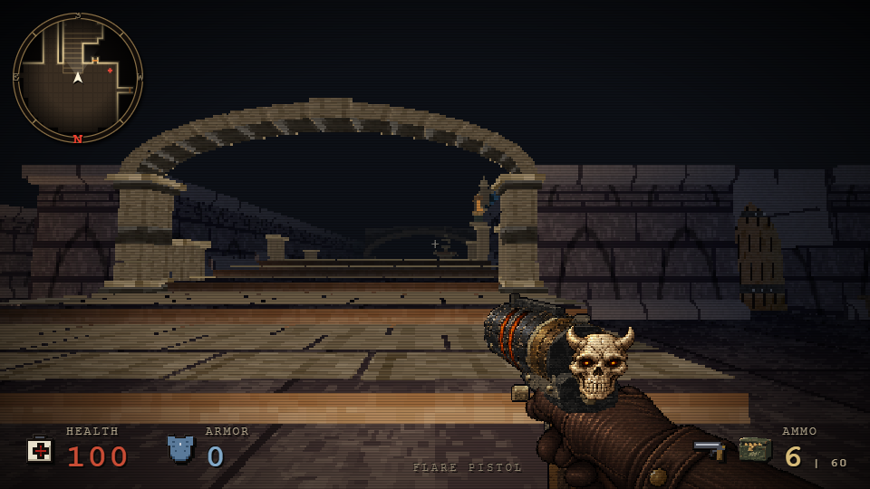

# The monks' wash court

In the Ash Bell Monastery, the graveyard used to feed the nave through a twenty-metre straight passage. The western wall now opens onto the monks' lavabo. The lanterns frame the entrance from the burial ground, and a bronze armillary finial marks the basin. The player can pass the fountain on either side, climb to the raised northern walk and enter the nave west of the old processional entrance.

The new branch has two choices during combat. The wide southern end gives room to circle the octagonal basin, whose lower stonework blocks movement and low shots. The eastern edge of the court keeps a straighter line to the crest. At its highest point the stair stands 1.2 metres above the graveyard and looks into the nave. The existing eastern passage remains the direct level-floor approach. A wall between the passages keeps their sightlines distinct until the nave.

## DreamLoop study

| Original arrival | Target | In-game arrival |
| --- | --- | --- |
|  |  |  |

The target was generated from the original native view at world position (99, 140). Its carved stone, bronze panels, oxidised lips and flagstones supplied small texture samples. The moonlit churchyard is a distant view through the two openings in the back arcade. The gate, fountain, grille, lamps, balustrade, stairs and surrounding room are game geometry.

An independent review of the first build found that a change in ceiling height created a solid strip across the entrance. The revised mesh shares the adjacent ceiling height, and the rear arcade sits above the fountain's sightline. The last review led to narrower paving joints, brighter step noses, and a taller blue opening behind the basin.

| Inside the wash court | Returning from the nave |
| --- | --- |
|  |  |

## Gameplay verification

The added floors occupy 59 previously solid tiles. The work extends from grid x41 to x48 and z56 to z67, including two rows of existing nave floor used for the return grade. Both entrances use the native grid, per-tile height map and ordinary movement. The level's original ash seal, bell seal, ambush niches, bell lever, lift and north gate retain their existing scripts. The fountain's body and piers use the same mass index as other solid scenery.

Run the fixture on the compiled standalone from the project root.

```powershell
node tools/ash-cloister-tests.cjs THE-BLACK-SILENCE.html
```

The fixture stages the player at the entrance, stuns enemies, holds W with the normal controls and turns toward successive waypoints. It exercises both sides of the basin and the old eastern passage in both directions, compares the original gates and elevation bounds, tests shot clearance above the rim and checks that a native level reload releases and replaces the court resources.

All six traversals passed on the final court. The native grade climbed from 1.20 to 2.40 metres in steps of 0.30 metres or less. A level reload disposed both textures, both materials and both geometries, then created fresh replacements. The wash court adds two render batches with 6,416 masonry triangles and 72 distant-view triangles. Its lamps use baked colour and add zero dynamic lights.
