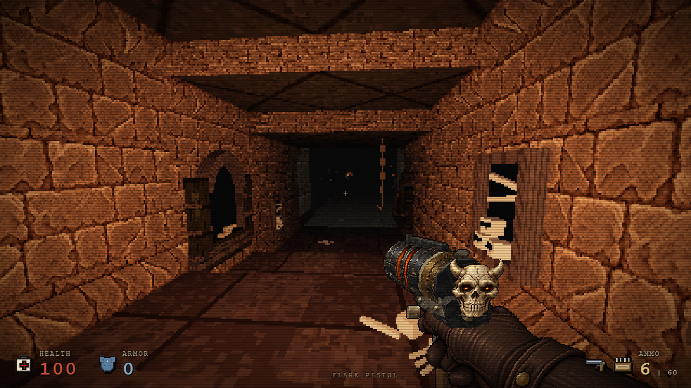
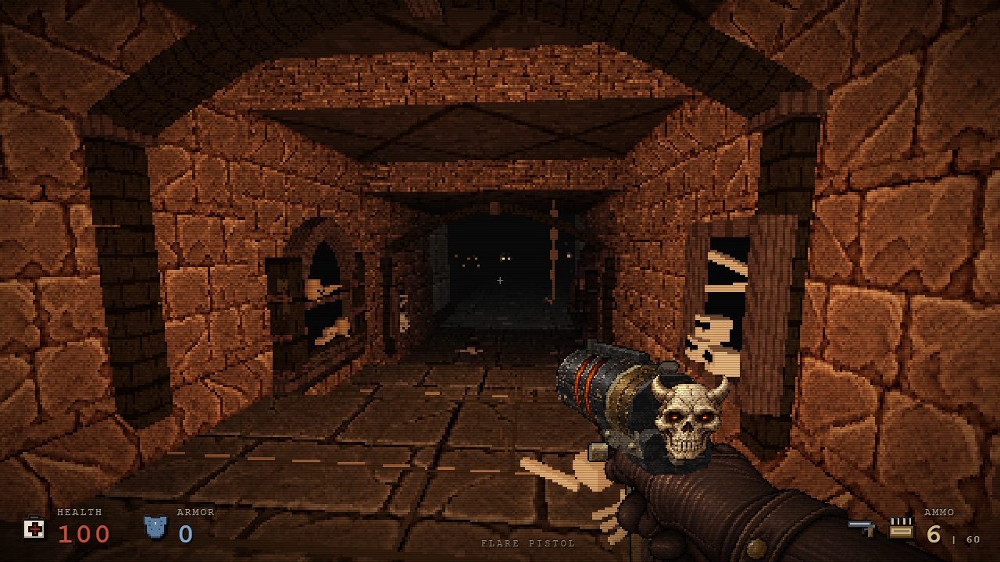
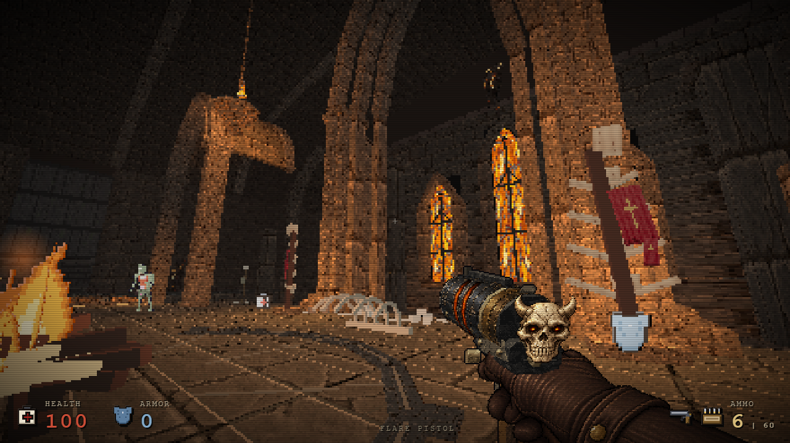
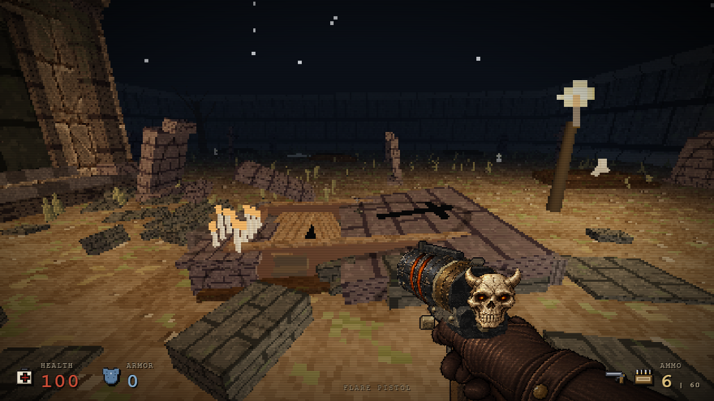
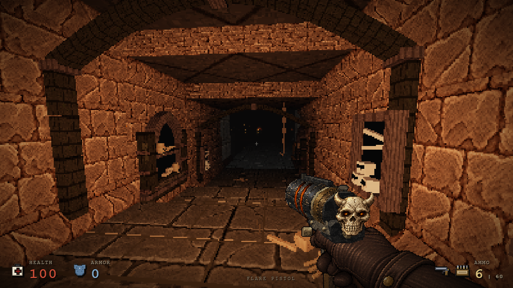
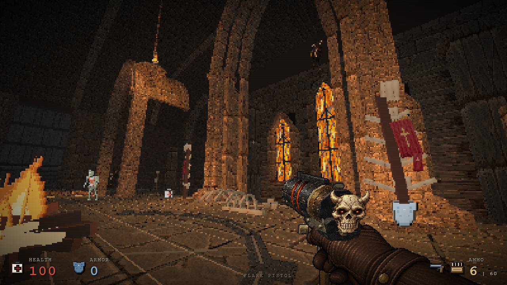
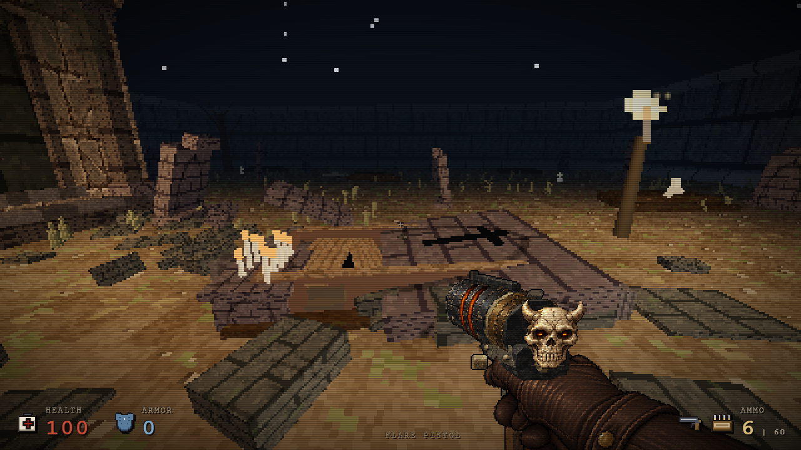
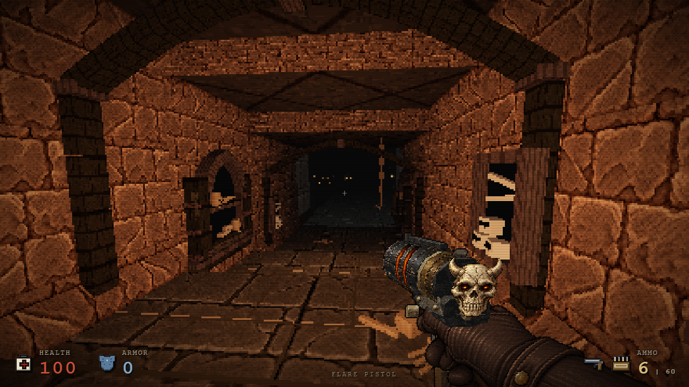
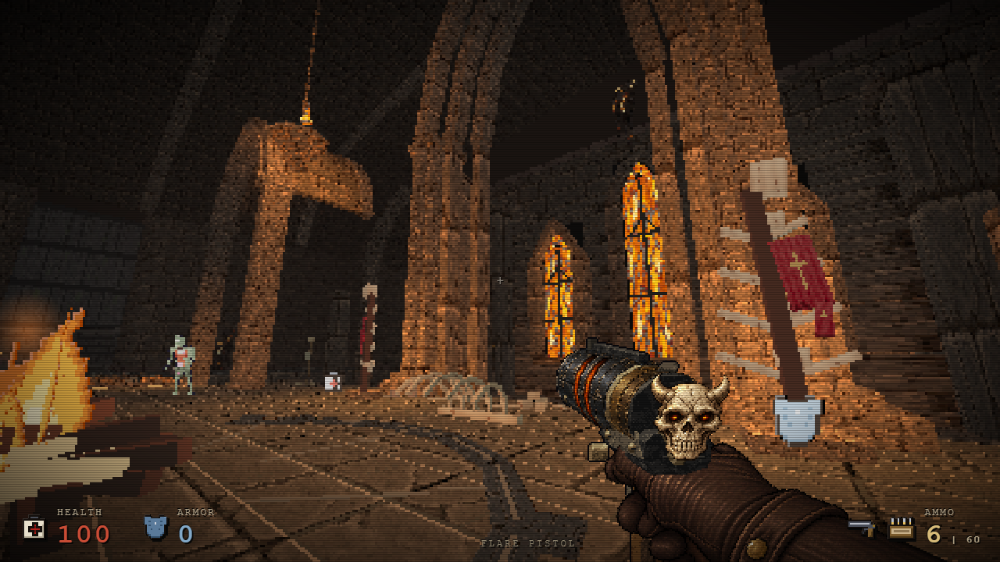

# Prologue: funerary crypt and worn hell paving — 2 November 2026

The descent now has human-scale staggered flagstones, three low masonry ribs and different burial states: sealed memorial, open ossuary shelves and a breached tablet. Two broken graves expose coffin boards and iron handles. The hell nave and arena share worn ash-coloured flagstones; a broken, nearly flush stone seal around the existing pyre gives the arena a ritual centre without a separate raised platform.

## Visual study and DreamLoop

The team directly inspected official [Blood: Fresh Supply screenshots](https://atari.com/products/blood-fresh-supply) and [Blood: Refreshed Supply screenshots](https://atari.com/products/blood-refreshed-supply). Specific lessons were readable floor regions, contrasting material scales, wall-attached objects with a clear purpose, dark recesses and local firelight. These informed the existing gothic art direction alongside the approved [hell target](../assets/hell/reference-target.png).

The DreamLoop sequence used native baseline captures, source candidates, independent visual criticism and repeated same-camera captures. A solid dark ritual disk and then an isolated noisy patch were rejected: both looked pasted onto the room. The accepted version changes the shared hell floor material and leaves only worn inset stones and thin spokes around the pyre. The skulls also gained tapered crania, cheek/jaw planes, smaller sockets and a subdued textured bone material. Independent final visual review rated the crypt 7.8/10 and arena 7.9/10; those are review judgments, not a claim of reference-perfect art.

## Scope and provenance

Baseline HTML SHA-256: `3d58959919c4b673aa7643dd1237ecaf98eb21654f89f87a5b007f7d745a69e9` (GitHub release 5673285). Environment-only candidate SHA-256: `7efcd339a5b6c1bd45accc4dc5da55a5b7cd680d49aa6318d83c1beac28cf4cb`. Source SHA-256: `99208d79415f9b2776836153c5b14ea1fea3be0d6e495ffd378f5d72389d4671`.

All images above are actual native 1280×720 renders from those exact inputs, using the same standing camera coordinates and native zone fog/lighting. Candidate images retain the baseline weapons, preceding concurrent weapon work. They are not concept images or captures of the final combined binary. The original main HTML remained untouched during this lane.

The full map descriptor is byte-equivalent as parsed data except for exactly four static decorations (three crypt ribs and one ritual floor), the crypt ground material name and two coffin-detail flags. Floor/ceiling height grids, collision topology, enemies, items, existing props, existing lights, zones and exits remain exact. Later-chapter uses of the grave and crypt bay builders retain their original geometry. The shared hell ground image changes only its appearance. One added pyre contribution is evaluated once by the existing static light bake; it adds no runtime light or animation update.

## Verification and measured cost

- Native navigation passed all 15 checkpoints, optional shotgun collection, the first live enemy encounter, ladder E interaction, next-chapter arrival and return. Later traversal isolates geometry rather than full combat balance.
- Native movement through all three ribs passed in left, centre and right lanes: 330 movement frames total. The eye position plus a 20 cm head margin and 12 cm lateral envelope had at least 0.702 m clearance against the actual rotated rib lower edges (centre lane 1.237 m).
- Five leave/return cycles disposed both native crypt-floor texture handles each time, reused none, and leaked no tagged materials/textures into the next chapter. Zero browser runtime errors.
- Scene resource counting uses object identity rather than deterministic UUIDs: both builds have 60 texture handles and 49 image objects. Materials increase from 235 to 237. The new crypt floor image replaces a previously used ground image in the scene, so the unchanged image total is not a claim that no new image was authored.
- At the matched crypt view, submitted geometry increases by 2,632 triangles and two draw calls; the arena view adds 1,320 triangles and one draw call. Across eleven camera views the call delta ranges from zero to three. Existing engine batching submits some off-screen geometry; these counts are observations from each native frame, not a unique-triangle asset census.

All other test browsers/encoders were closed for serial ABBA scene observations. Each run used the unchanged handgun, native zone and standing camera, a paused scene, 1.5 seconds warmup and five seconds RAF sampling. Render CPU measures JavaScript/WebGL submission, not GPU completion or full combat.

| Scene | Baseline FPS | Candidate FPS | Baseline render CPU ms | Candidate render CPU ms |
| --- | --- | --- | --- | --- |
| crypt | 56.10 / 56.12 | 56.07 / 56.15 | 1.60 / 1.56 | 1.58 / 2.29 |
| bridge | 56.13 / 56.08 | 56.10 / 56.04 | 2.53 / 2.38 | 2.58 / 2.53 |
| arena | 56.17 / 55.94 | 56.15 / 56.64 | 1.65 / 1.93 | 1.09 / 1.39 |

Frame-time p95 stayed 18.1–18.2 ms. One candidate crypt run had higher render CPU (2.29 ms versus baseline 1.56–1.60 ms); its other run was 1.58 ms. No general FPS improvement or hardware-independent performance guarantee is claimed. The extra geometry and two materials have a real cost despite similar measured scene frame times on this host.

Reproducible tools: `blood-prologue-tests.cjs`, `blood-prologue-render-tests.cjs`, `crypt-rib-clearance-tests.cjs`, `blood-prologue-performance.cjs`, plus the existing native prologue navigation suite. Reports are in `verification-data/blood-prologue-nov02-*.json`.

## Final scoped bone material polish

A later fresh review rated V6 crypt 7.3, arena 7.4 and grave 6.5/10. These independent judgments are retained separately from the earlier 7.8/7.9 review. Remaining limitations include uniform warmth, sparse niche contents, primitive bone geometry and a shallow-looking coffin. An attempted larger displaced coffin lid was rejected: it dominated the foreground. The original V6 coffin builder was restored exactly.

The accepted follow-up only maps existing prologue bone/oldbone surfaces to the existing textured ossuary material. All five unmarked native bone builders remain exact for other chapters; all 71 marked primitives preserve geometry, transforms, mode and mass. No new placements or collision changes were added. The fresh reviewer judged a modest material improvement (crypt 7.4, arena 7.5, grave unchanged 6.5), not improved sculpting or reference parity.

Final environment source SHA-256: `44369f2a1f6f455992cc9d3bdc647bab32ccd290f97008f5413a2e81e6b1f547`. Native polish proof HTML: `38f1fb1bcff2c68f58a4581d4b77e865f2899a68e62094eddcb38bec96d89f66`; this includes the two-chamber combat correction but precedes final weapon art. Eleven fresh views and five resource cycles passed with zero errors: 60 texture handles, 49 images and 238 materials. The original V6 navigation/clearance evidence above applies to unchanged geometry; it is not relabeled as a new run. The earlier ABBA table measures V6, before this one additional material, and is not a final-polish performance claim.

Final scope, native bone parity and resource reports: `verification-data/blood-nov02-map-polish-*.json`. Images are native captures of the explicitly named polish proof, not the later combined release.

## Combined release proof

The final combined candidate `5e5ceb0cb354945067ef71cfa5600fd9836a4236cf20258aff548bea3ec1a3cc` retains the exact final environment source. Fresh native navigation passed all 15 checkpoints, live first encounter, optional Shotgun pickup, E exit, next chapter and return. Eleven native visible views and five resource cycles passed, zero errors. Capture setup lets the original intro finish before pausing; an attempted reload while paused retriggered the title card, so those obstructed captures were rejected and recaptured.

Final provenance and reports: `blood-final-nov02/provenance.json`, `verification-data/blood-nov02-final-navigation.json` and `blood-nov02-final-map-lifecycle.json`.

Final combined exclusive ABBA (unchanged handgun, paused native scene; 1.5 s warmup + 5 s sample):

| Scene | Baseline FPS | Final FPS | Baseline render CPU ms | Final render CPU ms |
| --- | --- | --- | --- | --- |
| crypt | 56.26 / 56.39 | 56.57 / 56.26 | 1.84 / 2.56 | 1.61 / 1.71 |
| bridge | 56.08 / 55.99 | 56.61 / 56.20 | 2.66 / 2.74 | 2.36 / 2.95 |
| arena | 55.89 / 56.14 | 56.01 / 55.86 | 1.12 / 1.24 | 1.01 / 1.64 |

Frame p95 remained 18.1–18.2 ms. Final geometry/materials have a cost: no general speedup is claimed, and render CPU is submission time rather than GPU completion. Full raw samples and exact input hashes are retained in `verification-data/blood-nov02-final-map-performance.json`.
