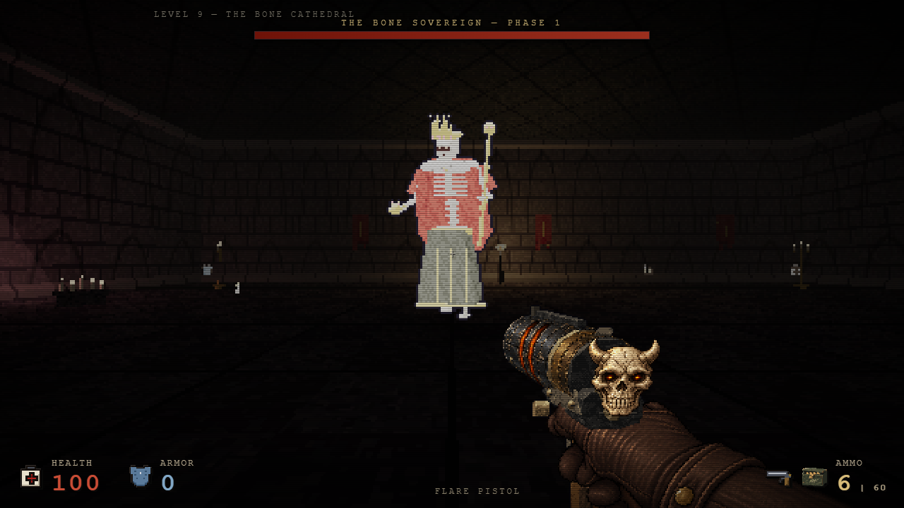
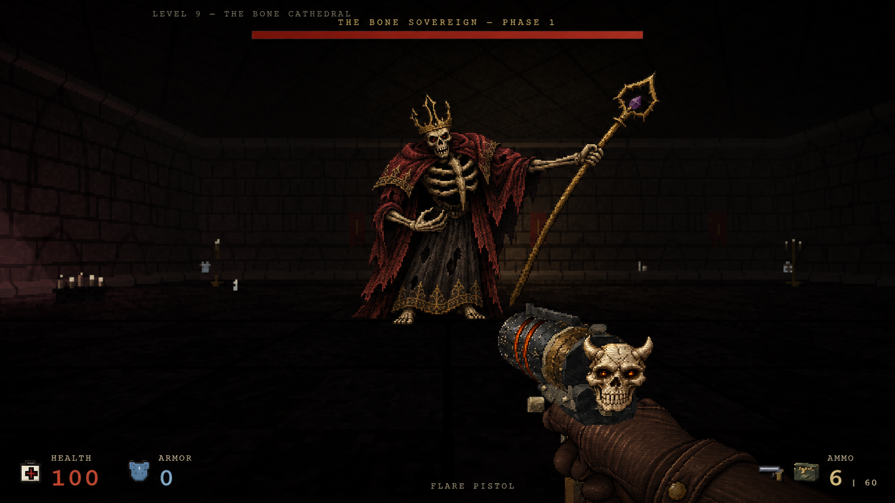
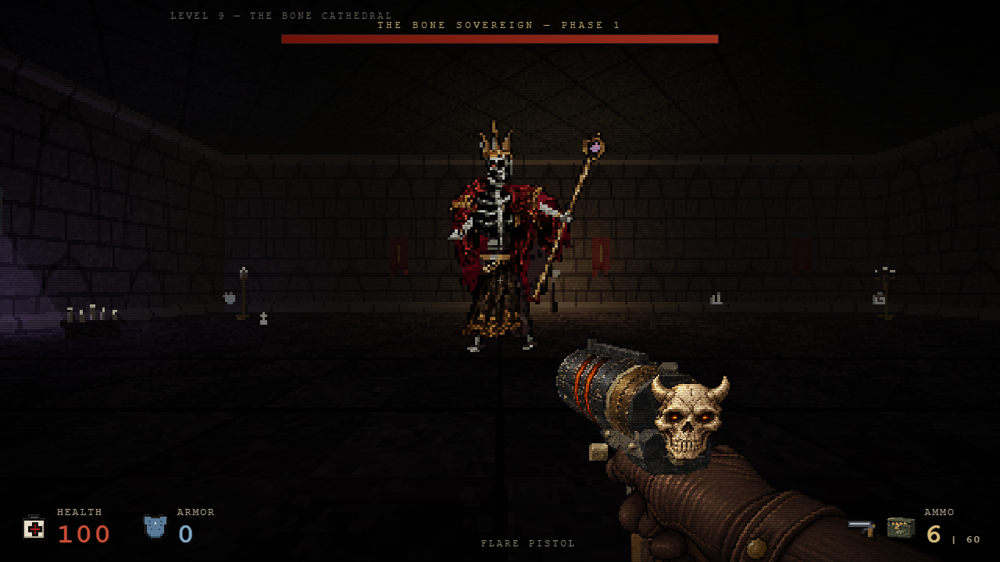
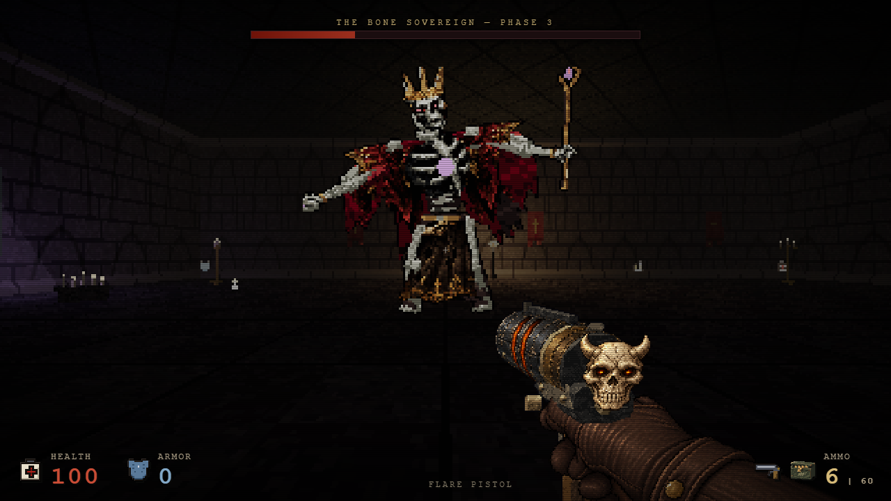

# The Bone Sovereign

The king in the Bone Cathedral raises his crozier before firing. The supporting palm draws inward for a single orb, then opens wide for the second phase’s five-orb fan. In the last phase the enlarged skeleton grips a snapped crozier. The lavender orb at his sternum is the native projectile leaving its spawn point.

The native screenshots use a position on the Cathedral floor 4.8 game units from the boss at a 1280 × 720 viewport. The capture holds the same viewing distance while the king advances. The reference is a generated paintover of the first screenshot. The playable model samples its skull, ribs, embroidered hem, sleeves and hands, then projects those indexed pieces onto the original animated joints. Sculpted prongs, bone forearms and the crozier coexist with the depth-tested paint. The sprite has transparent side margins for the raised staff. Its native radius, scale, position and damage regions still come from the original actor.

## Rebuilding

1. Edit the model and poses in `src/bone-sovereign.js`. The named source regions, masks and color reduction live in `tools/compile-bone-sovereign.cjs`.
2. Run `node tools/compile-bone-sovereign.cjs` to regenerate `src/bone-sovereign-art.js` from the paintover and the jointed scene. Playwright with Chrome renders the original software atlas offline.
3. Run `node tools/build-game.cjs` to rebuild the standalone game. Both the paint and the packed poses travel inside the HTML.
4. Run `node tools/compile-bone-sovereign.cjs --check` and `node tools/bone-sovereign-tests.cjs THE-BLACK-SILENCE.html`.

## Combat and rendering checks

The comparison loads the same playable Cathedral twice with fixed gameplay randomness. The stock priest AI retains its raised attack flag after a volley. The new presentation listens for the actual projectile emission, plays its follow-through, and resumes the appropriate walk or idle without changing that flag.

The test stages two volleys in each phase, including a second warning with the native attack flag still raised. It compares all 480 sampled simulation states, native projectile positions and velocities, resulting damage, boss movement, counters and RNG consumption. Reload checks cover the replacement actor and shared artwork. The compiler produces 52 intact poses. Their normal and mirrored images must match the native joint renderer byte for byte in all 104 comparisons. Sever masks continue through the native renderer.

On the Windows Chrome release machine, the 18 first-time cast texture builds took 0.9–2.8 ms each against a fresh atlas. All 18 cached lookups completed within the timer's 0.1 ms resolution. These timings cover CPU-side unpacking and canvas texture creation. The full encounter test exercises rendering and simulation separately.
