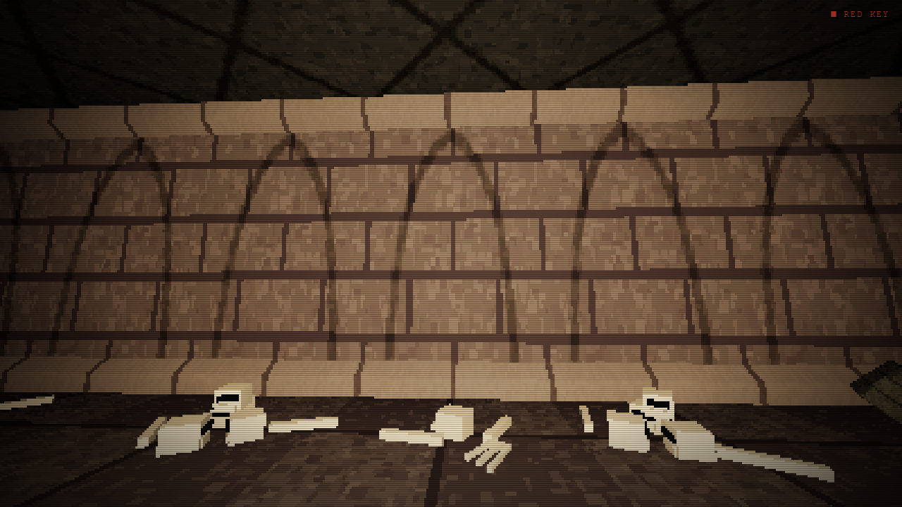
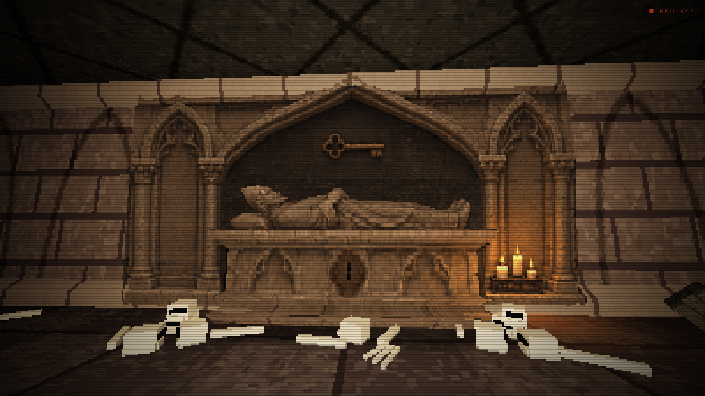
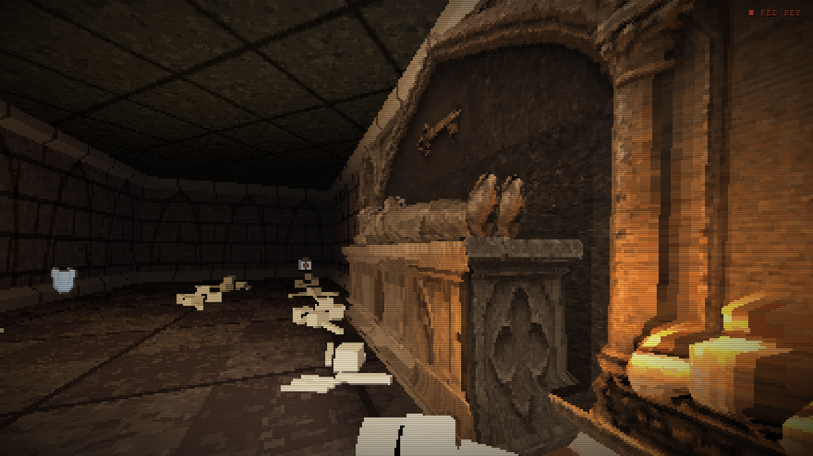

# The key keeper’s tomb

The charnel room behind the southern vaults of Bone Cathedral holds the original red sanctuary key. A recumbent stone bishop now lies against its back wall. A bronze key hangs over the effigy and a matching keyhole marks the fixed stone next to the sanctuary door. The player can see the carved end of the sarcophagus, its thick lid and the separate stone boots from the side aisle. Three votives light the right lancet.

| Original camera | In-game model | Right flank |
| --- | --- | --- |
|  |  |  |

The camera pair uses world position `(36.8, 1, 86.48)` and aims at `(37, 1.52, 90)`. The weapon and minimap are hidden in those two pictures. The separate approach and sanctuary pictures retain the gameplay HUD. [Approach from the doorway](approach.png) · [Sanctuary seal](sanctuary.png)

## Art and gameplay

The first DreamLoop pass reproduced the pointed arch and effigy as a shallow wall relief. The independent review scored it 7.2/10 and found the side silhouette too flat. The second pass added a solid sarcophagus, separately textured end and lid, a mitre, cushion, face, folded hands and two boots. Chipped cornice stones join the recess to the existing courses. The second independent review scored it 8.6/10. [Original camera target](../../assets/cathedral/charnel-vigil-target.png) · [Sculpture surface study](../../assets/cathedral/charnel-stone-atlas.png)

The joined stone mesh contains 14,934 triangles. The 82 cm projection of the chest has a native movement hull. Shots strike the 1.06 m lid. Above it, horizontal shots can hit individual sections of the effigy or pass through the open recess. The statue is behind the original key at `(37,87)`. Opening the sanctuary still requires that pickup and the normal E interaction.

The two ImageGen source studies supply the carved stone, figure, bronze, dark backing, lid and decorated end. The compiler builds an indexed surface atlas, closed geometry and matching shot cross-sections. The original study is embedded as sampled surface texels in the map’s offline geometry. Rebuild the source asset with `node tools/compile-cathedral-charnel.cjs`.

## Verification

Run the native comparison with two standalone files. The first must predate the tomb. The test stages the player on the charnel approach and holds enemies for repeatable measurements. W and E open the original door, collect the key, press against the front, pass along the side and open the sanctuary. It also loads a checkpoint written by the earlier game in a new document, checks movement and finite-height shot samples, compares horizontal rays against the rendered triangles and counts resource disposal across two departures. The alternating visibility measurement uses the same camera and renderer.

Both builds completed the 15-action route. Of 11,461 grid positions with nine queries each, 267 changed within the stone footprint or its player clearance. All eight rays aimed at the modeled chest or the recumbent figure met its triangles within 3 mm. Two further shots cleared the upper and side openings to reach the original wall. The player stopped at `z=88.82` against the lid and reached `z=89.65` beside it. Continue restored the old key, both doors and shrine 0. Each of seven owned resources retired once on departure to the Womb and once on departure to the Factory. The camera submitted three additional draws. The scoped timing run shared the machine with other test browsers. [Native pickup](pickup.png) · [Scoped verification](verification.json)

```powershell
node tools/cathedral-charnel-tests.cjs previous.html THE-BLACK-SILENCE.html
```
