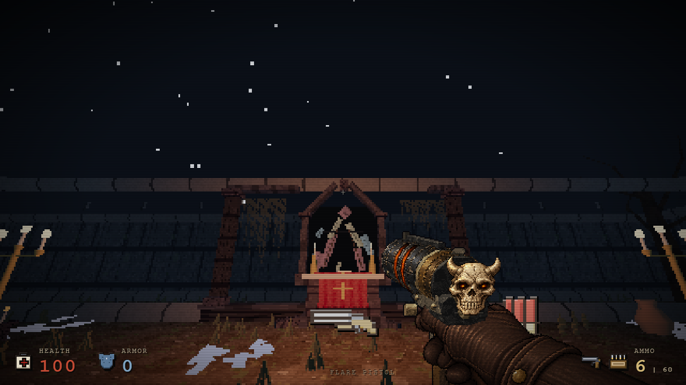
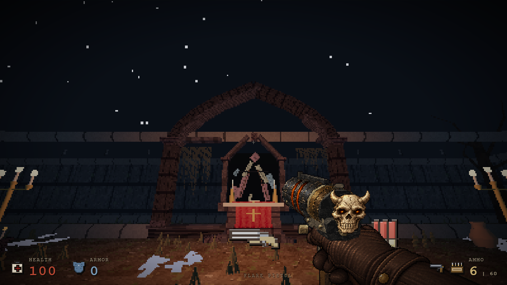
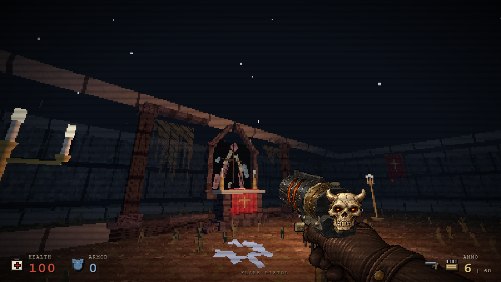
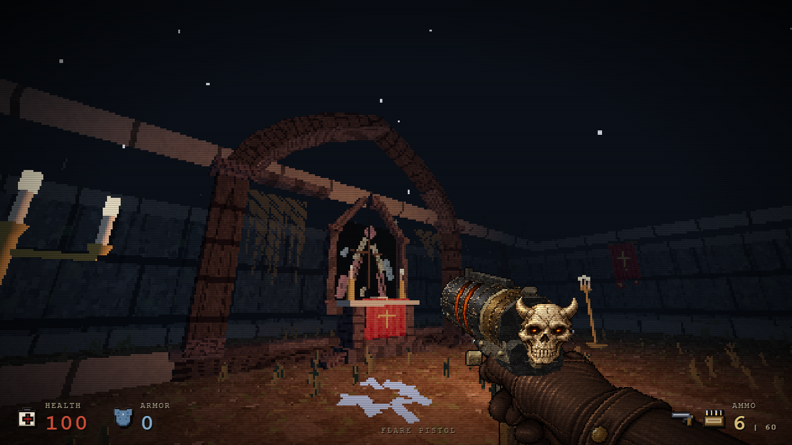
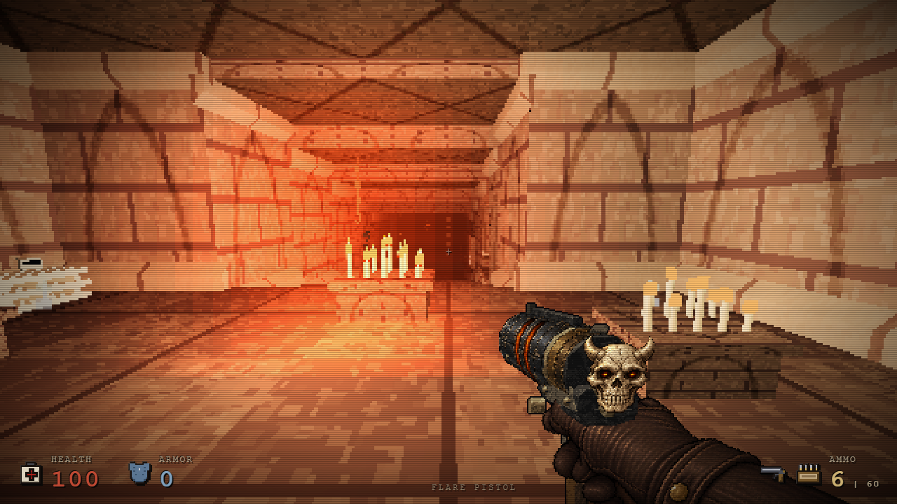
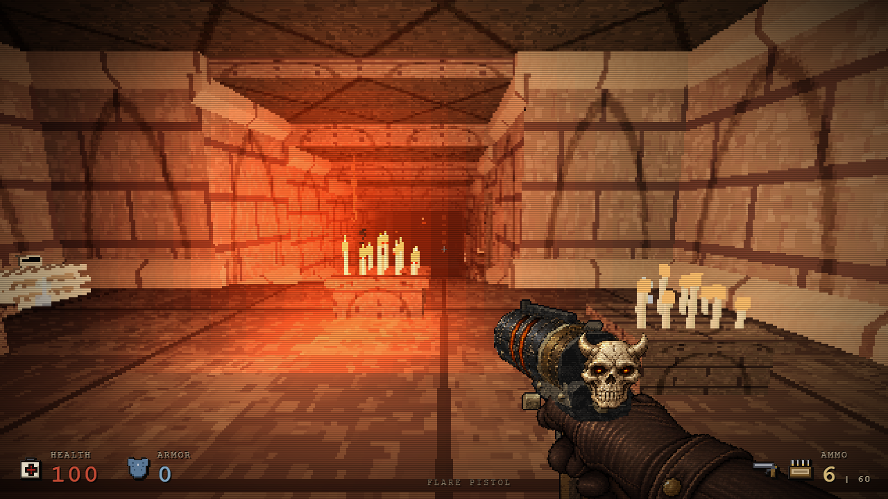

# Şapel kemeri ve crypt ışık dengesi — 25 Ekim

Altarın iki ince ayağına bağlı, tek sivri kemer olarak okunan taş bir çerçeve eklendi. Dış kemer tamamlanır; iç silmenin küçük asimetrik eksikleri ve düşmüş taş harabe görünümünü korur. Mevcut kırık vitray, pencere açıklığı ve açık gökyüzü silueti korunur.

17 statik primitive ve iki mevcut ayağın genişlik/derinlik ayarı, mevcut stone/slate/patinated malzemelerini kullanır. Üç eş kamerada draw call sayısı sırasıyla 62/92/69 olarak aynı kaldı; her karede 204 üçgen eklendi. Yeni ışık, materyal, doku veya kare başına animasyon işi yoktur. Bunlar kaynak sayımlarıdır, FPS ölçümü değildir.

| Önce | Sonra |
| --- | --- |
|  |  |
|  |  |

Crypt içinde yalnız üç mevcut sıcak ışığın şiddeti/menzili azaltıldı. Mum çevresindeki sıcak renk korunurken geniş taş yüzeyleri daha az parlak kalır. Işık konumları, renkleri, yükseklikleri, halo/pool yüzeyleri ve global ortam ışığı değişmedi. Bu küçük bir ışık dengesi düzenlemesidir; native malzeme hatası düzeltmesi değildir.

| Grid konumu | Önce şiddet / menzil | Sonra |
| --- | --- | --- |
| 9.5, 10.5 | 4.2 / 12 | 2.3 / 10 |
| 9.5, 13 | 2.4 / 10 | 1.55 / 9 |
| 9.5, 15 | 1.2 / 8 | 0.9 / 8 |

Crypt'in dört eş kamerasında draw call (173/153/64/133), üçgen ve doku/materyal sayıları birebir aynı kaldı. Kameralar native göz yüksekliğini, gerçek bölge ışığını ve sisi kullanır; resimlere sonradan parlaklık veya zoom uygulanmadı. Düşman/pickup ve rota verileri aynıdır.

## Kanıt kapsamı

- Altar-only kaynak `26e7d667…`, HTML `911050d9…`: tüm harita verisi eşit; yalnız dekor geometrisi değişir. Pencere/cam/leadwork birebir aynı. Beş gerçek bölüm geçişinde scoped dokuların 9/9'u temizlendi; sonraki bölümde 0 ilgili etiket, 0 temizlenmiş doku yeniden kullanımı; dönüşte resident texture sayısı 49 olarak sabit.
- Son çevre kaynağı `a887a17a…`, çevre-only HTML `e2d734d2…`: altar-only sürümüne göre yalnız yukarıdaki üç ışık parametresi değişir. Geometri, çarpışma, rota, düşmanlar, eşyalar, diğer ışıklar ve bütün zone temaları eşittir.
- Son çevre adayında gerçek hareketle 15 nokta, ilk canlı düşman karşılaşması, eşya alımı, merdivende E, bölüm kartı ve sonraki native bölüme varış geçti. İlk karşılaşma sonrasındaki yürüyüş geometri/çıkış kontrolüdür; tam savaş dengesi testi değildir.
- Son birleşik `38b1a9aa…` dosyasında beş bölüm geçişi ayrıca geçti: map-owned 9/9 doku temizlendi, sonraki bölümde 0 ilgili etiket ve 0 temizlenmiş doku yeniden kullanımı. Dönüşte renderer resident sayısı 49 olarak sabit kaldı. Bu sayı, yeni global enemy rig cache'indeki bütün CPU bitmap nesnelerinin sayısı değildir; global cache ayrı raporlanır.
- Bu ortam adayları, birleşik son dosyada yeniden koşulmuş gibi etiketlenmez. Tam girdiler ve dosya hashleri `chapel-architecture-oct25b/provenance.json` ve `verification-data/` raporlarında bulunur.

Tekrar çalıştırma araçları: `tools/chapel-architecture-tests.cjs`, `tools/crypt-lighting-tests.cjs`, `tools/chapel-material-resource-tests.cjs` (`altar`/`crypt` presetleri) ve `tools/prologue-navigation-test.cjs`. İlk iki araç eski/yeni kaynak ve immutable baseline HTML alır; geçmiş kaynaklar Git geçmişinden ayrı dosyalara çıkarılabilir. Kaynak testleri gerçek authored map builder'ını kullanır.
