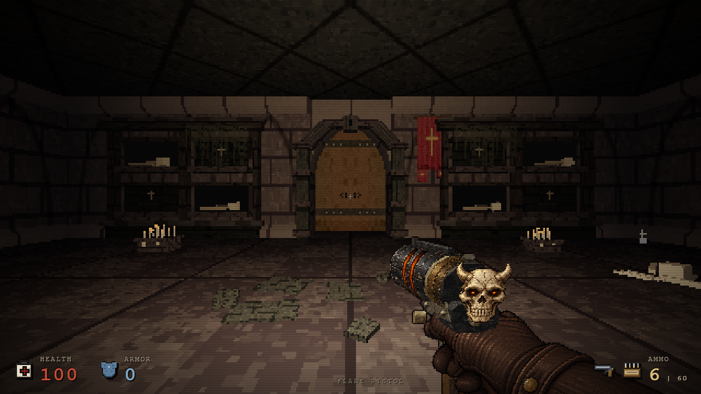
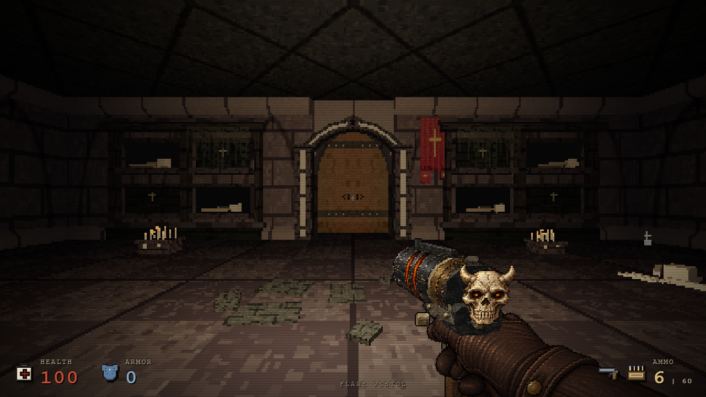
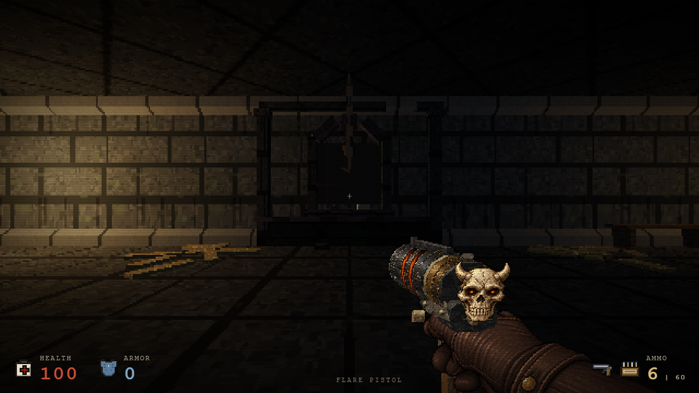
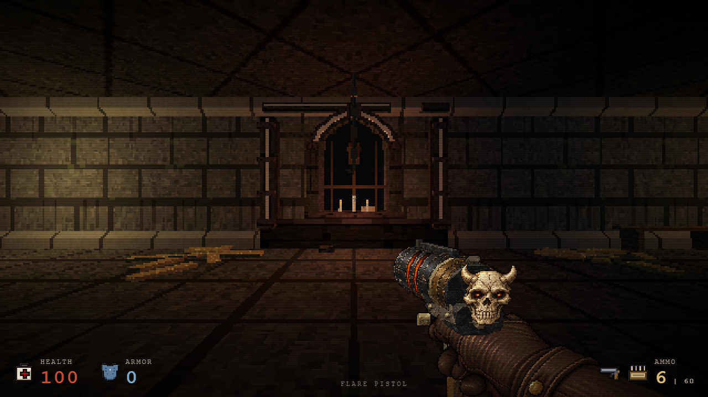

# İki bölümde taş mimari — 27 Ekim 2026

Ash Bell Monastery'nin mezar odası girişine katmanlı dikmeler ve sürekli sivri kemer verildi. Gothic Dungeon'ın üç mevcut hücresinde daha derin söveler, koyu iç yüzeyler ve seyrek açık kesme taş kenarları kullanıldı. Merkez hücrenin mevcut rafına üç küçük mum ve tek, kısa menzilli sıcak ışık eklendi. Genel aydınlatma değişmedi.

Bu alanlar motor listesinde 9 ve 1 indeksleridir; oynanış sıralamasında prologue'dan sonra **Level 1 — The Ash Bell Monastery** ve **Level 2 — The Gothic Dungeon** olarak görünür.

## Önce / sonra






Kareler 1280×720 native viewport, aynı oyuncu konumu/eye yüksekliği ve native kamera ile çekildi. Önce HTML SHA `d6101272e6d34d5635d1a75745ad971c4ab07e9d85d5bec7b721e5a7f0813c87`; sonra çevre-only aday SHA `bb65a06355775d22ec9ffe7d874bf5b4a4d8d1c96f0b5dae913e4f21dce3b6df`. Dinamik düşman/partikül karelerinin pixel eşitliği iddia edilmez. Bu çekimler final birleşik adayında yeniden yapılmış gibi etiketlenmez.

## Kapsam ve maliyet

Kaynak `prologue.js` SHA `66b89378273e83b09f178e1ce27319454daf89136e05d0ab9bdcf9a7fecd3c79`. İki mevcut dekor builder değişir. Mevcut portalın başka Dungeon yerleşimi de aynı mimariyi kullanır. Diğer map/kapı/encounter/eşya tanımları, prologue/crypt/hell geometrisi ve global materyal/ışık kodu korunur. Tek istisna Dungeon merkez bay'inin görsel bayrağı ve native ışık kaydıdır: `(17,1.85)`, intensity `1.2`, range `4.2`, yerel yükseklik `1.02`; gölge üretmez.

Native geometri ölçümü portal başına **+324 üçgen**, hücre başına **+324**, yalnız merkez hücredeki mumlar **+96** verir. Monastery toplamı **+324**, Dungeon toplamı **+1392**; farklı haritaların maliyetleri aynı anda çizilmez. Yeni resim/doku/shader yoktur. Dungeon scene materyali 185→186, ışık sayısı 19→20, referanslanan texture 25→25. Monastery materyal 518 / ışık 21 / texture 33 aynı kalır. Eş Dungeon gallery/cell karelerinde draw calls 52/39→55/42; rendered triangles 78270/77888→79718/79336. Render sayısı authored üçgen sayısından farklıdır; bunlar FPS ölçümü değildir.

## Doğrulama

- Portable source/geometry testi iki builder dışındaki kaynak farklarını yalnız tam bir merkez bay flag/ışık kaydıyla sınırlar. Portal açıklığı ve eski duvar footprint'i korunur; mumlar rafın üzerindedir.
- Paired native test, önce iki map ve sonra altı dönüşümlü map yüklemesinde aynı gerçek W hareketiyle noktaları yürür. Baseline 8 / aday 24 waypoint geçer; başlangıç konumuna yerleştirme sonrası hareket native fizikle yapılır, AI bu rota ölçümünde izole edilir.
- Monastery 775 ve Dungeon 1587 native collision/elevation örneği aynı; bütün map/grid/kapı/encounter/pickup tanımları izinli görsel ekler dışında exact. Kapı açma veya tüm bölüm oynanışı testi iddia edilmez.
- Her map rebuild'inde eski light nesneleri yeni sahnede yoktur; yeni sıcak ışık Dungeon'da bir, Monastery'de sıfırdır. Texture sayıları aynı; page error sıfır. Bu test scene lifetime'ı ölçer, global enemy cache'i map leak saymaz.

Raporlar: [kaynak/geometri](verification-data/chapter-architecture-oct27-scope.json), [paired native hareket ve lifecycle](verification-data/chapter-architecture-oct27-native.json). Komutlar:

```text
node tools/chapter-architecture-tests.cjs BEFORE_PROLOGUE.js src/prologue.js REPORT.json
node tools/chapter-architecture-native-tests.cjs BEFORE.html AFTER.html OUTPUT_DIRECTORY
```

İkinci araç Playwright ve Chrome ister; iki HTML'yi değiştirmez, fixture ve raporu ayrı dizine yazar. Yeni ışığın kısa yerel zamanlama ölçümü ayrı raporlanır; genel FPS artışı vaadi yoktur.

## Son birleşik kimlik ve kısa zamanlama

Final birleşik `17ebe0d27fdcef2eea80b54fbc68ebf0cfa96b51c0244bd2a56e85ac22155d61` aynı çevre kaynağını byte-identical içerir; [kimlik raporu](verification-data/chapter-architecture-oct27-final-identity.json) paired native kanıtın kapsamını açık tutar. Son birleşik üzerinde navigation/lifecycle tekrar koşulduğu iddia edilmez.

Tek tarayıcıda seri temel→son birleşik, aynı Dungeon gallery/native camera/korunan Handgun ve 1280×720 viewport ile her girdide 1,5 sn yerleşme ardından 6 sn RAF ölçüldü. FPS 55,96→56,03, frame p95 her ikisinde 18,1 ms; renderer.render ortalama CPU 0,684→1,105 ms. Bu kısa sahnede frame-rate kötüleşmesi görülmedi; ek ışık ve mimarinin CPU maliyeti vardır. Bu bir genel FPS garantisi veya ışık shader'ını tek başına izole eden benchmark değildir. [Ham kayıt ve yöntem](verification-data/chapter-architecture-oct27-performance.json).

İki portable aracın input/output çakışma ret testleri girdiyi değiştirmeden geçti: [guard raporu](verification-data/chapter-architecture-oct27-tool-guards.json).
