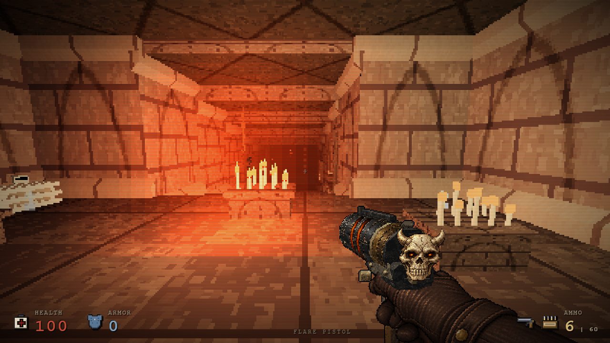
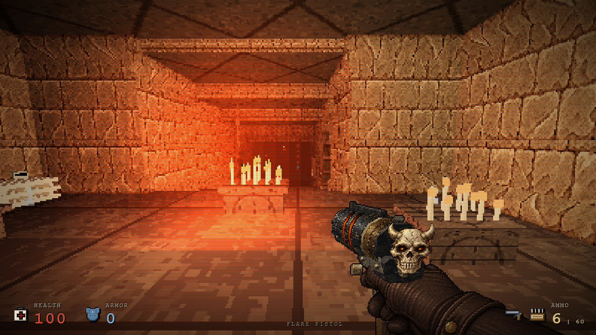
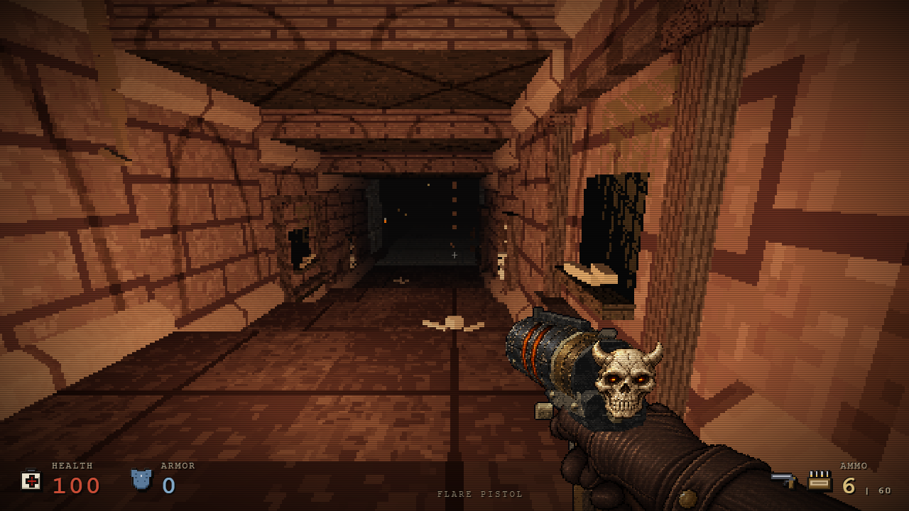
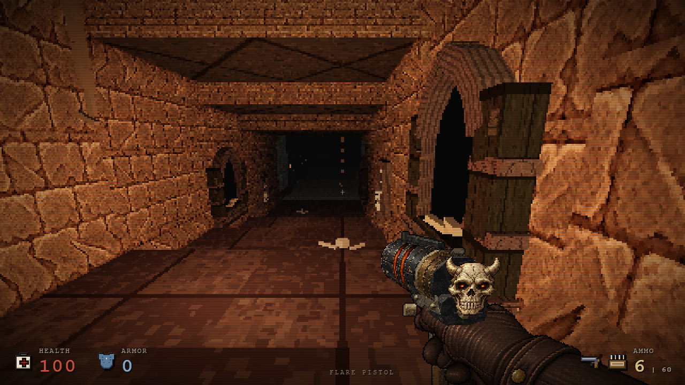

# Crypt taş yüzeyleri ve mezar nişleri

Üç mevcut mezar nişinin ince çerçevesi, daha derin sivri ağız ve kademeli taş söveyle değiştirildi. Crypt duvarları, kiriş kenarları ve kaideleri mevcut cehennem taş resmini kullanan ayrı bir crypt dokusuna bağlandı. Sıcak amber ışık, kırık geçişler ve oynanış rotası korunur; yeni ışık eklenmez.

| Önce | Sonra |
| --- | --- |
|  |  |
|  |  |

Bu eş kamera PNG'leri `56394da3…` temel sürümü ve `d18df141…` çevre adayından alınmıştır; son yayın dosyasında çekilmiş gibi etiketlenmez. Yeni `821bd0a3…` ortam kaynağı, çevre adayı ile sonraki birleşik adaylarda aynıdır. Tam hashler [provenance](crypt-depth-oct26b/provenance.json) içindedir.

Üç niş toplam 45 primitive / 540 üçgen ekler. Dört eş native kamerada draw call sayıları 173/153/64/133 olarak aynı kaldı. Sahne tarafından referanslanan dokular 54→54, materyaller 234→234, resim nesneleri 50→49 oldu. Buna rağmen bir yeni map-owned texture clone vardır: eski band dokusunun kullanımı kalktığı için net texture sayısı artmaz. Clone mevcut taş image nesnesini paylaşır; yeni resim veya shader üretilmez.

Yalnız üç nişte görsel `cryptDepth` bayrağı ve crypt temasının `wall`/`band` alanları değişir. Grid, ışıklar, eşya/düşman yerleşimi, çarpışma ve diğer temalar aynı kalır. Yeni kütleler eski duvar tarafındaki sınırın dışına çıkmaz. Genel niş ve sonraki bölümün nişleri değişmez. [Kapsam testi](verification-data/crypt-depth-oct26b-scope.json).

Çevre adayında 15 native rota noktası, ilk canlı karşılaşma, E çıkışı, Space ile sonraki bölüme geçiş ve geri dönüş geçti. Beş gerçek map döngüsünde crypt dokusu 1/1 temizlendi; sonraki bölümde crypt etiketi ve disposed yeniden kullanım sıfırdı. Ayrı texture nesnesi/ortak image, görünür ceilingRisers ve wallCourse doğrulandı. Ara `7ff91371…` birleşik adayda dört kamera ve aynı beş döngü tekrar geçti; hata sıfır. [Native rota](verification-data/crypt-depth-oct26b-navigation.json), [birleşik aday kaynak döngüleri](verification-data/crypt-depth-oct26b-final-7ff91371.json).

Portable kontroller `tools/crypt-architecture-tests.cjs` ve `tools/crypt-material-resource-tests.cjs` içindedir. Dört input/output çakışma reddi ve input SHA korunumu ayrıca doğrulandı. Eski prologue testinin tema beklentisi yalnız onaylı crypt wall/band için güncellendi; diğer tema ve davranış korumaları devam eder. Bu çalışma genel FPS artışı iddiası taşımaz.
