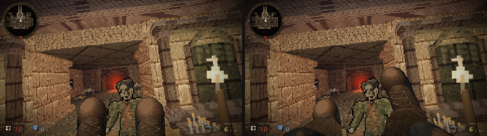

# Dropkick animation

Sprint forward and right-click to dropkick. The right boot reaches the target first. The left leg stays bent, then follows the right as the weapon returns. The viewmodel framing eases with the kick so the leading boot can rise into view at contact. Both boots use the existing game models.

The action still lasts 0.72 seconds, with its first hit check at 0.19 seconds. The animation uses the same camera, hit direction, damage and enemy launch as the previous build.

The clip uses the normal game clock from launch through weapon return and includes the game's mixed audio. [Dropkick in motion](dropkick-choreography-nov19/dropkick-native.webm)

## Verification

- A staged regular zombie took one dropkick hit and entered flight. The previous and revised HTML matched 64 samples of camera, movement, aim, hit, enemy flight and ammo. A separate empty-corridor pass matched another 65 samples. Both used actual **Shift** + **W** + right-click and a controlled frame clock.
- The regular right-click kick matched 214 samples. All 81 sampled idle, equip, reload, ordinary-kick and finisher rasters matched, including their color, depth and part data. All three finishers returned normal movement, fire and mouse look after **E**.
- At 960×720 with the 320 render preset and at 1600×650 with the 640 preset, the framing held during pause and faded before the weapon returned. The wall fixture stopped the player's horizontal motion, and the player landed and regained the weapon with the boot layers cleared. The paused foot anchor moved less than one quarter of a display pixel.

The comparison uses released `dd6cf26` and a private build containing the dropkick viewmodel change (`e7460bfaa7f1668d16eb037d8170cab2b0777a7488a1947563622c95ce848863`). The opening position and target were supplied by the fixture. The game handled the input and hit.

[Integrated build test results](verification-data/nov19-afternoon-release.json)
