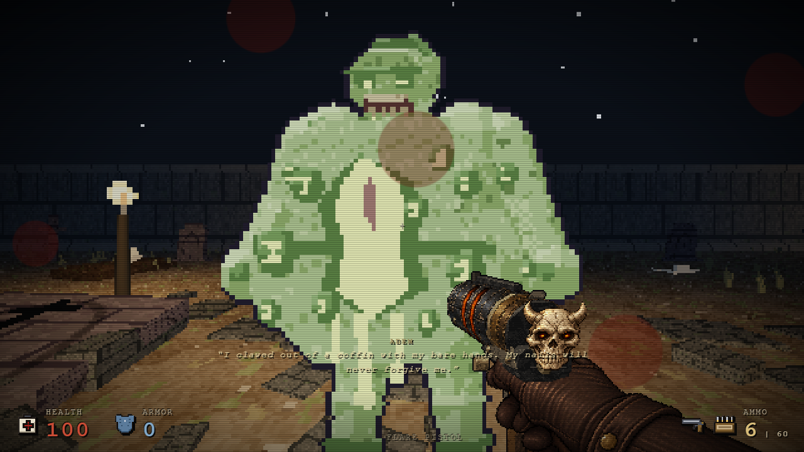
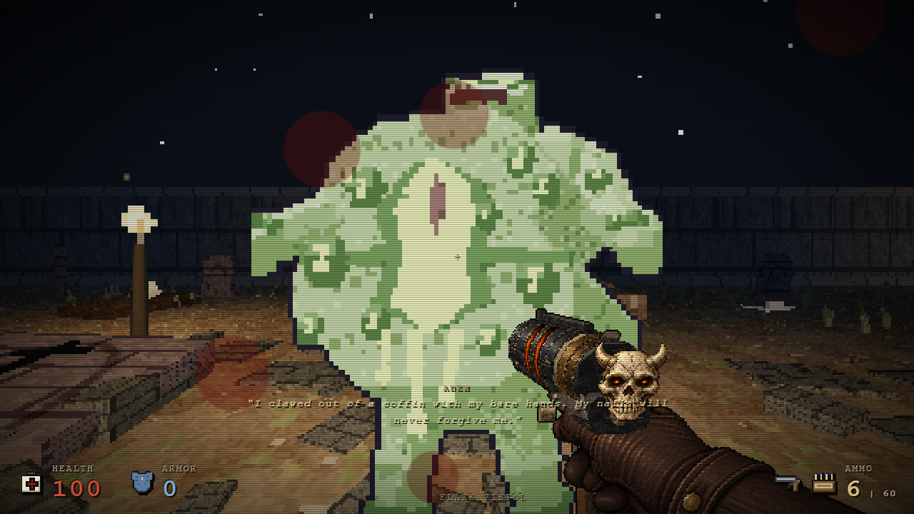

# Close melee anticipation — October 26

Ranged enemies also use the native melee attack below 1.55 units. Their presentation previously selected anticipation only in the distant firing band, so a close toxic zombie remained idle until damage occurred. The same native attack preparation frame now appears in its close melee band. Normal zombie reach, distant firing, the 1.55–3 unit gap, damage, cooldowns, movement and priorities remain unchanged.

Only the ranged branch of `anticipate` in `src/enemy-animation.js` changed. Source SHA256: `977a4a425dedb5a48cce43592986a058f1c390641f529660f048dd71a9be0d3e`. The private candidate HTML SHA256 is separately `280de70147dfa830fbbd4c543dac11306f25c671a1d51858a74d02f4378c7a78`; its baseline HTML is `56394da38ad2dff02bffb5a32900daa40cf7c6cd319be7e6a1b850145e6e376d`.

- [Native encounter evidence](verification-data/enemy-close-melee-oct26-native.json): live RAF/cooldown and actual enemy melee damage. Toxic zombie remains 12 damage and cultist remains 9 damage, both resetting cooldown to 1. The player has 100 HP during preparation. Fixture placement/awareness and paused screenshot capture are identified in the report.
- [67 deterministic checks across 33 cases](verification-data/enemy-close-melee-oct26-parity.json): baseline and candidate have identical enemy root, dimensions, HP, cooldown, hurt/stun/stagger/attack state and player HP at matched simulation steps. Includes normal/ranged distance bands, hurt/stun/stagger/unaware/height/active-attack priority, and actual map LOS obstruction. These are controlled native `enemyStep` calls, not a live playthrough.
- [39 regression checks](verification-data/enemy-close-melee-oct26-regression.json): the existing enemy animation runner additionally checks toxic zombie and cultist close contact, unchanged melee damage/cooldown, the dead zone and distant band. Existing landing, hit response, boss, death, execution and reset cases remain passing. Reproduce with `GAME_HTML` set to the candidate and `node tools/enemy-animation-tests.cjs`.

The separate baseline real sprint/RMB → wall landing → stagger → E chain was clean; no new wall, dropkick or finisher fix is claimed.

[Intermediate combined native smoke](verification-data/enemy-close-melee-oct26-final.json) passed on HTML `7ff9137196f2aba929c920312847c1e21bf8b5bda5d76be2f5263cfefe9e62b3`: toxic zombie/cultist preparation and actual 12/9 damage, then real sprint/RMB → wall landing → living 10 HP stagger → E → dead target and execution completion. There were no page errors. The chain uses fixed RNG to reproduce stagger. The earlier 67 parity and 39 regression checks retain their private candidate provenance; they are not represented as rerun on the later build.

The later V5 build `d6101272e6d34d5635d1a75745ad971c4ab07e9d85d5bec7b721e5a7f0813c87` contains the exact same combat, enemy-animation, finisher and prologue modules, verified by the [source identity guard](verification-data/enemy-close-melee-oct26-v5-identity.json). Its last changes are weapon presentation; the native enemy chain above was not repeated on V5.
