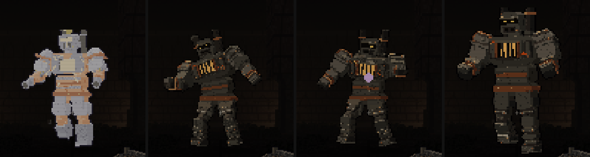

# Factory Foreman zırhı ve saldırı animasyonu

Foreman’ın eklemli modeline döküm zırh katları, bakır perçinler, dar vizör ışıkları ve iki baca işlendi. Fırının karanlık panjurları açıldıkça içerideki ışık ortaya çıkıyor. Üçüncü evreye geçince zırhtaki çatlaklar ve yana yüklenen duruş belirginleşiyor.

Atıştan yaklaşık 0,42 saniye önce Foreman ağırlığını ayağına veriyor ve kollarını hazırlıyor. Mermi çıktığında gövde doğruluyor. Yaklaşık 0,32 saniye sonra yaklaşma veya bekleme animasyonu geri geliyor.

## Oyun içi doğrulama

Chrome’da çevrimdışı açılan 1.280 × 720 oyun görüntüleri aynı Factory koridorunda alındı. Kameranın başlangıç uzaklığı 6,4 metreydi. Foreman kendi karşılaşmasından alındı ve diğer düşmanlar test sahnesinden çıkarıldı. Evreler ve başlangıç anı test aracıyla ayarlandı. Mermileri ve hasarı oyunun kendi döngüsü üretti.

| Evre | Atıştaki mermi sayısı | Atış aralığı | Ölçülen isabet hasarı |
| --- | ---: | ---: | ---: |
| 1 | 1 | 3,4 sn | 15 |
| 2 | 5 | 2,8 sn | 15 |
| 3 | 3 | 3,6 sn | 15 |

351 eşleşmiş adımda evre geçişleri, mermi konumları ve hızları, can, hasar ve 23.474 rastgele sayı çağrısı `1c4ce79` sürümüyle eşleşti. `node tools/factory-foreman-tests.cjs --warm-abba` bu sürüm ile Foreman eklentisini tek başına içeren denemeyi yeniden karşılaştırır. Rapor `.dream-loop/factory-foreman-test` klasörüne yazılır.

Foreman’ın 13 yeni karesi iki Chrome ölçümünde 13 ayrı görüntü karesine yayıldı. İşler toplam 205–208 ms aralığına yayıldı ve tek iş en fazla 7,2 ms sürdü. Bölüm değiştirilince bekleyen işler durdu. Hazırlık bitmeden zorlanan ilk atışta oyun gereken kareyi anında üretti. Bu durumda tek kareyi oluşturmanın maliyeti 5,7–8,9 ms aralığındaydı. İkişer soğuk denemede bölüm yüklemesi eski sürümde 253–364 ms, yeni sürümde 260–294 ms sürdü.
