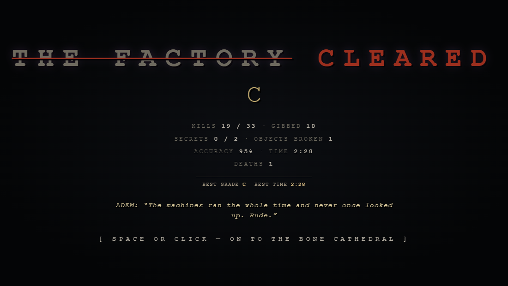

# Factory canlı bölüm doğrulaması

Son HTML, Chrome’da çevrimdışı açıldı. Test profiline yalnızca Chapter Select’te Factory’yi açan ilerleme bilgisi aktarıldı. Oyun 100 can, sıfır zırh ve standart tabancayla başladı. Sürücü oyun durumunu yalnızca okudu ve gerçek fare, hareket, ateş, şarjör değiştirme ve etkileşim tuşlarını kullandı.

Koşuda basınç manifoldu odasından geçildi, kırmızı anahtar ve Stake Gun alındı, casting kapısı açıldı. Bir ölümden sonra oyunun açtığı Rise Again ile sığınaktan devam edildi. Cathedral Guardian, Mutant Executioner ve Factory Foreman yenildi. Foreman 2.600 candan başladı, 1.520 canda ikinci evreye ve 570 canda üçüncü evreye girdi. Sürücü kısa görüş kesintilerinde Stake Gun’ı elinde tutup yenilemenin tamamlanmasını bekledi. Son darbeyi BMG Sniper vurdu.

Çıkış gerçek **E** girdisiyle açıldı. Sonuç ekranı **C**, **%95 isabet**, **2:28**, **19 öldürme** ve **1 ölüm** gösterdi. Oyuncu 49,8 canla tamamladı. Sonuç ekranında gerçek **Space** girdisi Bone Cathedral bölümünü yükledi. Tarayıcı çalışma hatası kaydedilmedi.

Oynanan HTML’nin SHA-256 değeri `452b55c7d328f913eeb1ebb075433cfb4c0439f49bc75d6dc230bcaae477c04e`.

