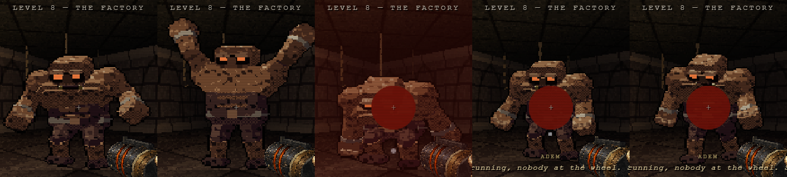

# The Factory coal store

The coal store has a slower, heavier opponent with square shoulders, iron wrist bands and two glowing eyes. The other two hammer carriers in the Factory keep their original locations. Both types dip their knees, raise their arms, strike the ground and recover. Backing out of the impact radius during the windup avoids the hit.

The five frames show preparation, high hold, impact, recovery and return to motion. The camera sits at normal standing eye height. The close sequences isolate the actor in its Factory room. The wide view includes the surrounding actors. [Previous sprite](brute-before.png) · [Hammer carrier](carrier-slam.png) · [Wide coal-store view](coal-store.png).

At a controlled 60 Hz, both old and new builds apply 24 HP on frame 29. A retreat using the native backward movement input avoided the hit. The stronger coal-store actor replaces one carrier. The chapter retains both other carriers, the office key and the Foreman that opens the exit. The route check uses map connectivity and a real Foreman death. [Verification](verification.json).
