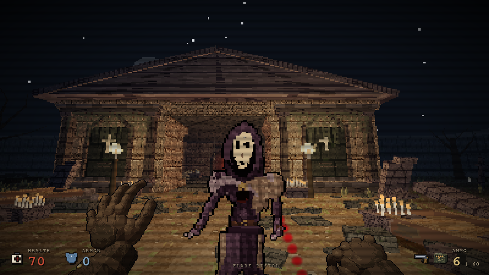

# First-person finishers

Press **E** when the stagger prompt appears. The three executions use separate hand poses and timing. The first reaches with an open glove and braces low. The second keeps one hand on the target and draws the other back between strikes. The third holds the detached prop beside the view until the normal release. The matte leather, stitched cuffs and layered fastenings use the same software renderer as the player viewmodels.

The hands follow the enemy's visible shoulders and head through the approach. Close effects are capped in screen pixels, and the headless target drops below the center of the view sooner during the two applicable recoveries. The corpse's collision path and the retained player camera keep their original timing. Sleeve Foley and a floor scuff follow the animation clock. The native animation remains 1.25 seconds with beats at 0.32, 0.56 and 0.82 seconds. A successful finish still awards 15 health up to the cap.



[Earlier native gameplay clip with game audio](finisher-choreography-nov19/finishers-native.webm)

The still uses a staggered Screamer to compare against the design reference. The video uses the regular zombie, with QA positioning the actor and selecting each of the three variants before a real **E** press. The game advances each execution and supplies the audio through its own master output. [Original DreamLoop pre-contact target](../assets/hand-reference/finisher-precontact-target-nov19.png)

In the latest pass, the second execution separates the bracing hand from the drawn-back hand before contact. The comparison at 0.190 seconds uses native **E**, the same camera and an exact animation clock. Samples from the first and third executions and from 0.28 seconds onward in the second matched the preceding build. [Matched pre-contact frame](finisher-choreography-nov19/pre-contact-stance-0190.png)

The new clip stages a regular zombie and selects the second variant. Real **Enter** and **E** input lead into the execution, followed by the weapon returning to view and native game audio. [Current gameplay clip](finisher-choreography-nov19/stance-v8-native.webm)

## Verification

The comparison uses the finisher-only HTML (`095d4e04552534736886df9cfdc7566a5cb1e9777b9ca3f31546f1eb8f0e4d7f`) built on `b8b77ff`.

The browser tests also ran against the published standalone HTML with the campaign and mouse capture fixes. [Current build results](verification-data/nov19-execution-final.json) · [Earlier finisher integration results](verification-data/nov19-finisher-campaign-release.json)

- Three Chrome runs verified **E**, return of **W** movement, held fire and pointer-lock mouse look.
- The timeline test paused all three variants, repeated **E** and **R**, and resumed each for one kill and one 15-health reward. A wall inserted after the first beat cancelled a separate run with no kill, health reward or ammunition loss.
- 132 checks across 15 isolated scenes matched 1,275 baseline gameplay samples exactly, including the retained camera, collision, target trajectories, native impact counters and healing. Visual pose and effects were evaluated separately.
- All ten idle weapon raster hashes matched the baseline. Across 180 isolated finisher raster draws, median and 95th-percentile draw time were 9.1 ms and 13.0 ms on the test machine. The corresponding baseline times were 10.0 ms and 13.5 ms.

```text
node tools/finisher-camera-tests.cjs GAME.html OUTPUT_DIRECTORY
node tools/finisher-camera-native-tests.cjs GAME.html OUTPUT_DIRECTORY
node tools/finisher-timeline-tests.cjs GAME.html OUTPUT_DIRECTORY
```
