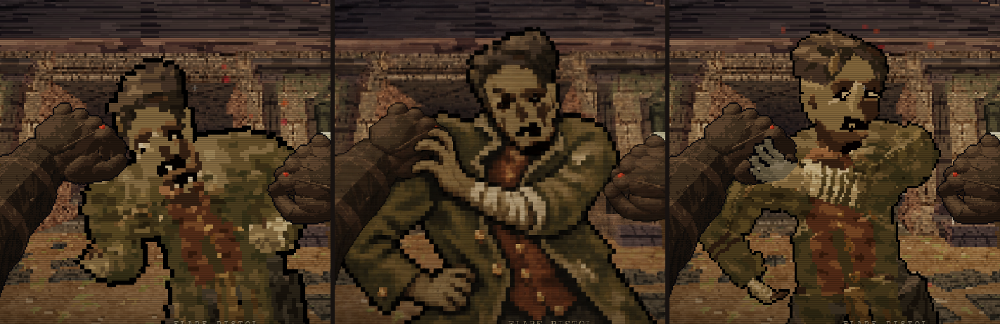
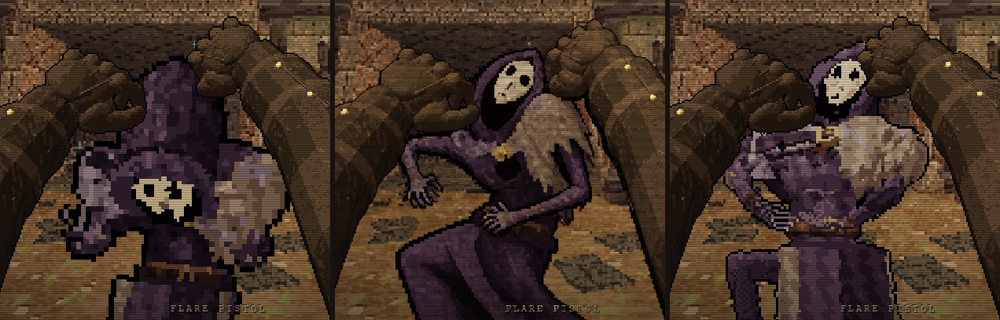

# Two stagger reactions

Press **E** near a staggered enemy. During the collar grab, the Groundskeeper brings his bandaged forearm across his chest, catches the edge of the player’s left glove, and loses his hold. During the three-strike execution, the Screamer raises one shoulder and folds a knee. Its ivory mask stays visible through the recoil. The player’s hands, the opponent’s joints and the existing game audio follow the same execution clock.

**Groundskeeper at 0.550 seconds.** The three panels show the previous game, the generated target and the playable update. [Native clip with game audio](groundskeeper.webm) · [Full target](../../assets/hand-reference/groundskeeper-grapple-target-nov21.png)



**Screamer at 0.315 seconds.** The hood, uneven shawl and open elbow follow the first contact. The following strike sends the mask back across the gloves. [Native clip with game audio](screamer.webm) · [Full target](../../assets/necropolis/screamer-recoil-target-nov21.png)



## Playback

The Groundskeeper has 13 reaction frames and the Screamer has 15. The reduced-motion setting uses two held poses for each. An already severed arm stays missing. Both enemies retain the three existing impact times at 0.32, 0.56 and 0.82 seconds, the 1.25-second duration and the 15-health reward.

The game decodes the intact pose sheet when its actor is present in the loaded chapter. When an arm is missing or the sheet is still decoding, the native renderer draws the pose. Leaving the chapter releases the cached reaction textures and hand overlays.

## Verification

The paired stills use the same courtyard camera and fixed animation time in both versions. Each clip starts with a staged staggered opponent and uses a real **E** press, the regular animation clock and the game’s master audio output. A separate test staged full-health opponents and a combat rifle. Ordinary shots triggered the native random stagger at 18 health for the Groundskeeper and 14 for the Screamer. The game selected these two executions on its own. Each awarded a kill and took player health from 74 to 89. [Recorded checks](checks.json)

Eight further input runs covered both reactions, reduced motion, an absent arm, an earlier execution variant and removal of the target mid-grab. The tests paused and resumed play, counted impacts and health rewards, and verified movement and gunfire after control returned. All 28 intact frame bitmaps and six missing-arm examples matched the native renderer pixel for pixel. [Test runner](../../tools/finisher-reaction-tests.cjs)

In a dedicated desktop Chrome session at 960 × 540, first-use CPU time at the 95th percentile fell from 8.4 to 0.2 ms for the Screamer and from 7.7 to 0.3 ms for the Groundskeeper. These measurements compare two ways of drawing the same animation. The corresponding 95th-percentile intervals between live browser animation frames were 35.2 and 34.9 ms for the Screamer, and 18.3 and 18.2 ms for the Groundskeeper.

```text
node tools/compile-finisher-reactions.cjs --check THE-BLACK-SILENCE.html
node tools/finisher-reaction-tests.cjs THE-BLACK-SILENCE.html
```
