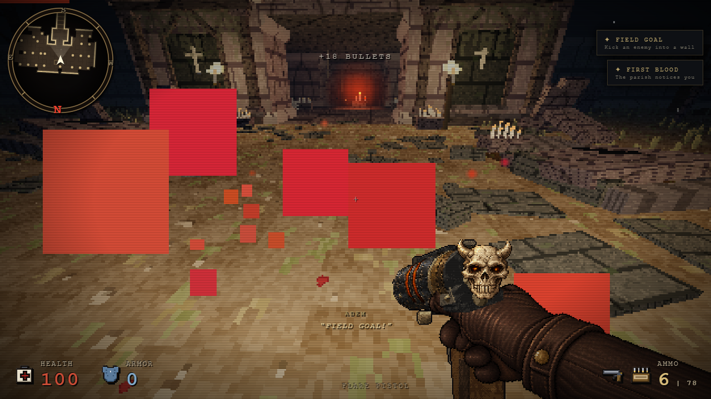
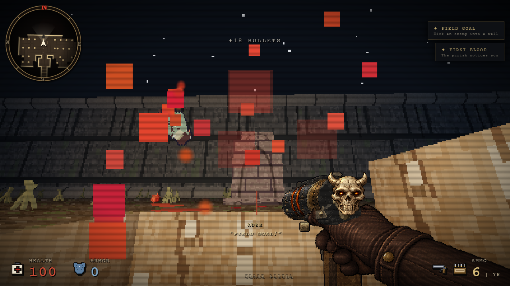

# Finisher recovery direction — 25 October

A close-range execution could turn the camera 180 degrees after its final strike. The native recovery camera continued tracking the dead target relative to the player's original approach position; corpse knockback could carry that target across the origin and reverse the direction. The reproduced sprint/dropkick → wall impact → stagger → E sequence changed yaw from approximately +0.058 to −3.083 radians after the kill.

The final strike now records the collision-valid player position and viewing direction. During the remaining recovery, the native finisher still advances its impacts, timer and cleanup, while the same execution retains that view. Enemy coordinates, knockback, vertical motion, health, rewards and kill timing are unchanged. If a new obstacle invalidates the recorded position, horizontal movement falls back to native collision handling; looking direction remains steady. Removing that obstacle does not snap the player back. The retained view is cleared on completion, cancellation, death, reset or target/scene change.

The tear finisher's single held arm is released below the camera relative to the player's retained position and direction. Its spawn calculation also handles the native completion tick, which occurs before the outer camera correction. No additional arm is created on cancellation.

## Verification scope

- Actual native input: sprint/right-click wall launch, natural 88 → 50 → 10 HP damage, controlled successful stagger roll, then E. The original π rotation disappeared across the terminal recovery frames.
- Three near-distance, real E/RAF executions completed; native W movement, held fire and pointer-lock mouse look worked afterward. These fixtures select choreography and spawn a staggered target; they do not claim an unmodified random encounter for all three types.
- 132 isolated checks cover three types at near, normal, near-zero, wall and obstacle distances; final-tick clearing; sequential executions; newly blocked and cleared positions; native death/map reset; and correct arm origin. Geometry-driven native aborts were preserved rather than forced into kills.
- Matched deterministic baseline/candidate runs preserved 1,275 enemy/health/reward/impact/timer/vertical state samples exactly, including 843 living-target camera samples. The only intended camera change is after the final kill.
- The existing 32 held-arm lifecycle checks passed, including one normal release, zero cancelled releases, native damage death and native chapter load. Test runners reject input/output containment and preserve their input HTML.

The combat source is `5f8c099867ca971387f21de80fecc9a83f6ab0b498b82ca153c2ccfe0d18514c`. Private HTML `ee6dca45de46e21dc70090e558e6cb764eb6e48e4aa86556e6ed583cc42cbf1d` supplied the tests above. [Private candidate evidence](verification-data/finisher-recovery-oct25c-private.json) distinguishes real-time input from isolated stepping; [tool guards](verification-data/finisher-recovery-oct25c-tool-guards.json) record refusal checks.

The final combined HTML `4b03db10fcf7433e90e2f21e662224d79ce356f3e2bac392ab7ab21cd09c6198` repeated all three actual E/RAF executions and W/fire/mouse-look recovery, plus the native dropkick/wall/stagger/E chain. The chain uses a real backward step when launch momentum carries the player past the target before E. Its post-kill root and yaw/pitch remained constant. [Final combined evidence](verification-data/finisher-recovery-oct25c-final-4b03db10.json) records these runs separately from the private deterministic suite. The after screenshots below are from this final HTML.

Reproduce with `node tools/finisher-camera-tests.cjs GAME.html OUTPUT_DIRECTORY` and `node tools/finisher-camera-native-tests.cjs GAME.html OUTPUT_DIRECTORY`. Both use explicit QA fixtures. The first drives native functions deterministically; the second uses real input and RAF.

The following screenshots show the actual dropkick/execution sequence before and after the correction; separate real-time runs are not pixel-matched comparisons. The compass changes from south-facing after the original bug to the retained north-facing view after the fix.

