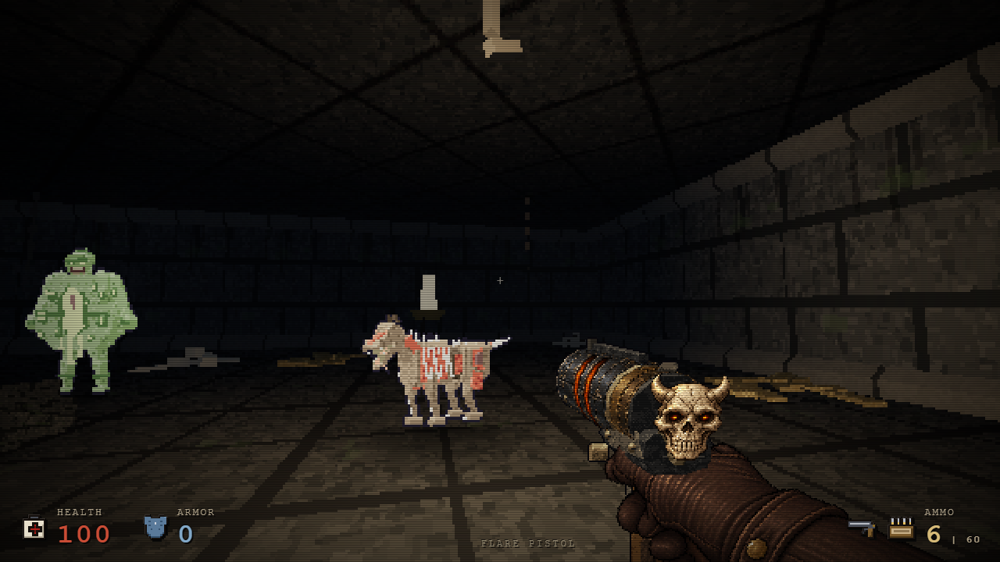
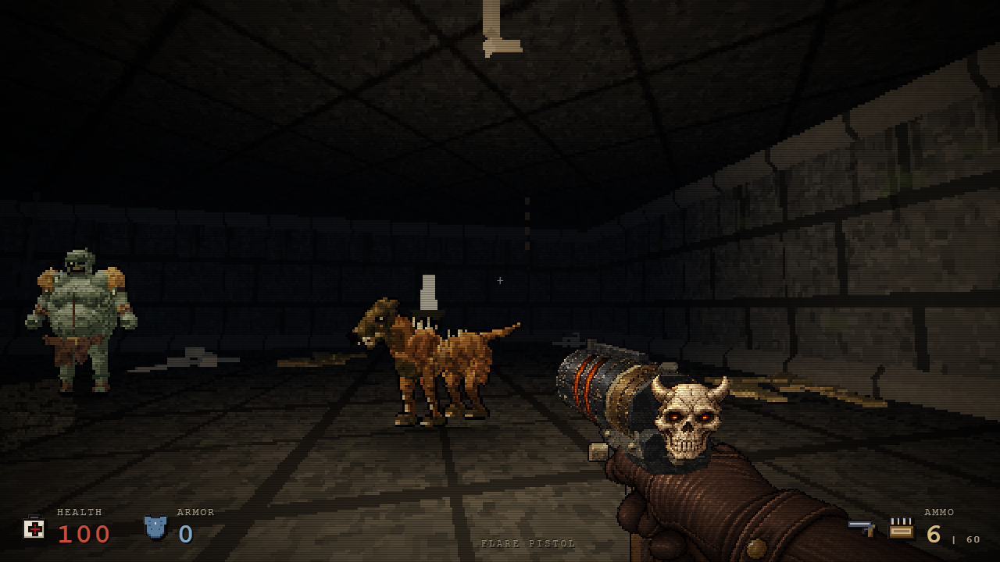
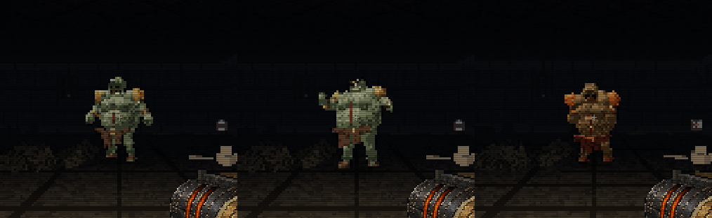
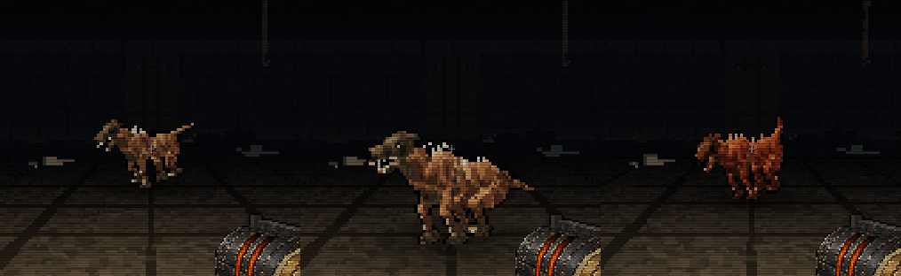

# Gothic Dungeon creatures

The Dungeon warder has a stitched olive abdomen, ochre shoulder plates and a split leather apron. Its head, shoulders and arms move independently as it gathers itself to spit. The carrion hound has a dark muzzle, short lower jaw, curved brindle ribs and an ivory dorsal ridge. It drops one shoulder and closes its jaw as its hind legs compress for the pounce.

The original [Dream Loop visual target](../../assets/dungeon/creature-keyward-target.png) informed three gameplay comparisons. The first pass set the color space and separated materials. The second replaced the square torsos, and the third shortened the hound's lower jaw and darkened the muzzle. The two sprite atlases retain their original pixel dimensions.

The following captures use the same camera in the key ward, with the player lamp settled for 48 movement ticks. The encounter strips show walking, the attack beginning and a second encounter in which a four-point hit interrupts the approaching actor. The last image is captured when the white impact flash clears.

| Earlier build | New build |
| --- | --- |
|  |  |

Run `node tools/dungeon-creature-tests.cjs` against the bundled game. To save screenshots and the complete per-tick trace, set `CREATURE_PROOF` to an output directory. The [verification results](checks.json) cover the original hitboxes, movement, first attack tick, independently cached damage and mirrored sprites, and detached-part color handling.
