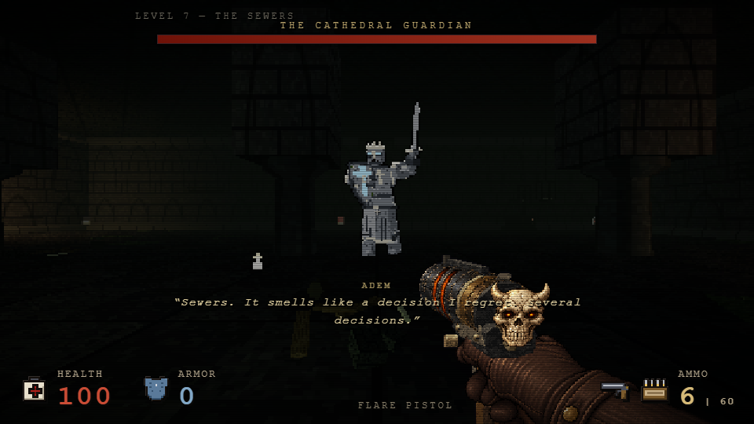

# Cathedral Guardian

The Guardian now braces behind its shield, raises its sword and drops its shoulder before its three-stone volley. The dark slate, moss, limestone bevels and blue visor use the original palette. The raised sword has additional sprite space so the tip remains visible throughout the windup.

The Sewers contact sheets use the same camera, enemy placement and six simulation ticks. The Church and Factory checks also use the guardians already present in those chapters. The test controls the initial cooldown and holds the camera fixed. Each volley released three stones on tick 32 with matching velocities, enemy position, health and collision dimensions. [Earlier Sewers sprite](sewers-before.png) · [Revised sequence](sewers-after.png) · [Factory release](factory-release.png) · [Eight-chapter texture and gameplay checks](verification.json).
