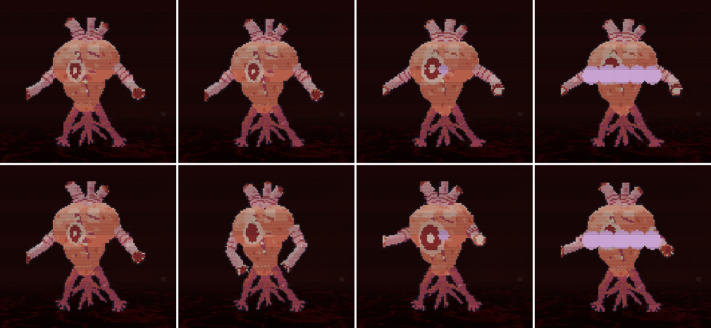

# The Living Heart

Heart, atışa hazırlanırken gövdesini sıkıştırıp kollarını içeri çekiyor. Mermiler çıkarken öne açılıyor. Ardından toparlanıp bekleme veya yürüyüş pozuna dönüyor. Hazırlık hareketi, arenadaki oyun kamerasından hazırlanan DreamLoop referansını izliyor. Mevcut renk paleti, eklemler ve sprite boyutları kullanıldı.

Üst sıra önceki sürümü, alt sıra yeni sürümü gösteriyor. Soldan sağa bekleme, hazırlık, atış ve toparlanma. Kareler ikinci evrede aynı kamera ve oyun adımlarında alındı.



Önceki sürüm ilk atıştan sonra hazırlık pozunda kalıyordu. Görsel adayın karşılaştırmasında Chrome her evreyi 268 sabit oyun adımı boyunca ölçtü. İki atışın zamanı, mermi sayısı ve yönü, can ve hasar, kamera, hareket ve rastgele sayı çağrıları eşleşti. Heart vurulduğunda renk tepkisi, atışla aynı ana denk gelen darbede de hasar pozu eşleşti. İki gövde biçimi 93×100 ve 109×100 çözünürlüğünde. [Levhanın çekildiği görsel adayın ölçümleri](verification.json)

Oyuncu atış menzilinin dışına çıktığında veya sütun görüşü kestiğinde Heart bekleme ya da yürüyüş pozuna dönüyor. Test iki durumda da tekrar görüşe girildiğinde poz geçişini ve mermi sayısını ölçtü.

Birleşik HTML’de ayrı hazırlanmış kayıt noktasından devam edildi ve karşılaşma gerçek fare ile klavye girdileriyle tamamlandı. [Canlı zafer ve koşullar](native-win.md) · [Birleşik HTML’nin doğrulaması](../verification-data/nov19-afternoon-release.json).

```sh
node tools/heart-animation-tests.cjs previous.html THE-BLACK-SILENCE.html .dream-loop/heart-animation-proof
```

`previous.html`, Heart animasyonu güncellemesinden önceki bağımsız oyun dosyasıdır.
