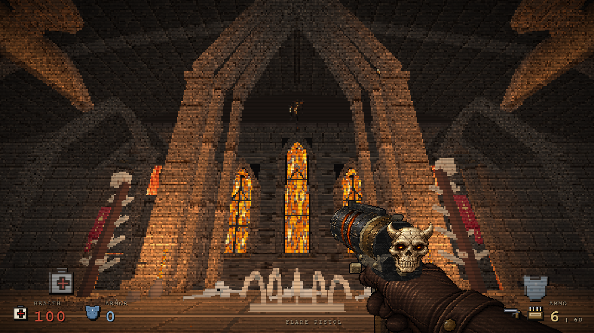
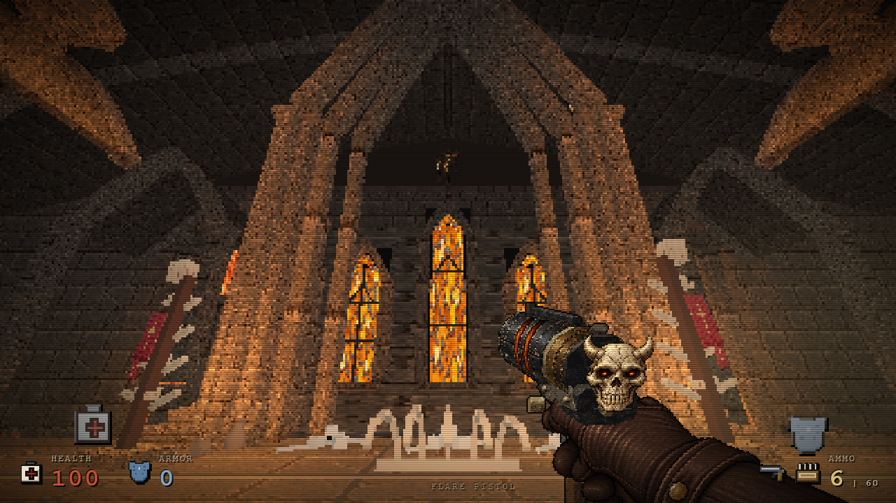
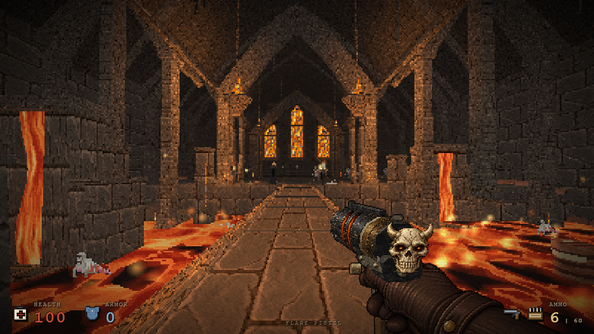

# Cehennem taşıyıcı mimarisi — 26 Ekim

Dört büyük kemerin ayakları kademeli geniş kaideler, üçlü taş sütun yüzeyi ve arkaya oturan basamaklı payandalarla yeniden biçimlendirildi. Sıcak pencere odağını çevreleyen taşıyıcı kütle ve koyu iç açıklık daha belirgin. Kemer tepesi, camlar, bölüm rotası ve önceki mimari korunur.

| Önce | Sonra |
| --- | --- |
|  |  |
|  |  |

## Kapsam ve maliyet

Yalnız `hellGreatArch.build` değişir. Dört kemerde sırasıyla 38/36/32/36, toplam 142 ek primitive vardır; bütün haritanın çiziminde +2.640 üçgen. Mevcut stone/edge/bronze/glass materyal grupları kullanılır. Yeni ışık, doku, shader veya kare başına çalışma eklenmez.

Altı eş native kamerada draw call sayıları 68/57/63/72/199/195 olarak aynı kaldı. Doku54, materyal234 ve renderer geometry159 sayıları eşittir. Bunlar kaynak maliyeti ölçümleridir; FPS kazancı iddiası değildir. Kaideler açıklığın dış tarafına genişler; arka payandalar önceki derinlik sınırı içinde kalır.

Tüm harita/grid/yükseklik/çarpışma/rota/ışık/düşman/eşya verisi ve `hellGreatArch` dışındaki kaynak birebir aynı. Gerçek native hareketle 15 rota noktası, ilk canlı düşman karşılaşması, eşya alımı, E çıkış kartı, Space devamı ve sonraki bölüme varış geçti. İlk karşılaşmadan sonraki rota kontrolü bütün savaş dengesini ölçmez.

Test aracındaki sabit 1.500 ms bekleme, native kartın devam tuşunu kabul ettiği gerçek koşulla değiştirildi; oyun kodu değiştirilmedi. Böylece yavaş RAF sırasında erken gönderilip yok sayılan Space nedeniyle oluşan test timeout'u giderildi.

Beş gerçek bölüm geçişinde izlenen sekiz hell/ritual dokusunun 8/8'i temizlendi; sonraki bölümde ilgili etiket ve temizlenmiş doku yeniden kullanımı sıfır. Bu kapsam mevcut chapel glass ve global enemy rig CPU cache'ini saymaz.

## Provenance

Önceki HTML `4b03db10fcf7433e90e2f21e662224d79ce356f3e2bac392ab7ab21cd09c6198`; çevre-only aday `4d7b584c8fcac153b37b1e1d7c0dd477f9995e372fb81cc441aec62166f7d258`; prologue kaynağı `e5c3bb8e0978876f1cfc824f37b8e2c13bfb8ce64c1355920d1a187ad0141d0f`.

Görüntüler native göz yüksekliği ve özgün bölge ışığı/sisiyle alındı; zoom/renk düzenlemesi yapılmadı. [Görsel hashleri](hell-architecture-oct26/provenance.json) ve önce/sonra kapsam raporları belirtilen çevre adayına aittir; birleşik sürümde tekrar çekilmiş gibi etiketlenmez.

Tekrar kontrol: `tools/hell-arch-tests.cjs` eski HTML/eski prologue/yeni prologue/rapor yollarını alır. Native kamera/lifecycle için `tools/hell-material-resource-tests.cjs GAME.html OUTPUT after lancet`, yürüyüş için `tools/prologue-navigation-test.cjs GAME.html OUTPUT` kullanılır.

## Birleşik aday kontrolü

`56394da38ad2dff02bffb5a32900daa40cf7c6cd319be7e6a1b850145e6e376d` üzerinde aynı prologue kaynağıyla 15 native rota noktası, E/Space geçişi, bölüm 9 ve geri dönüş tekrar geçti. Dar kaynak smoke testinde sekiz scoped dokunun 8/8'i temizlendi, sonraki bölümde etiket ve disposed yeniden kullanım sıfırdı. Üç kamera doğru native göz yüksekliği ve bölge ışığı/sisiyle doğrulandı. [Birleşik aday raporu](verification-data/hell-architecture-oct26-final-56394da3.json).
