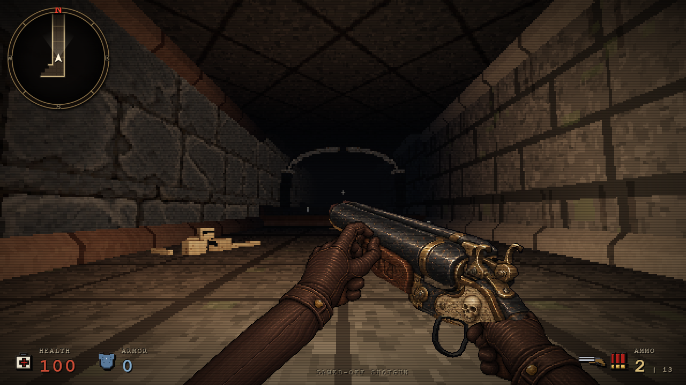
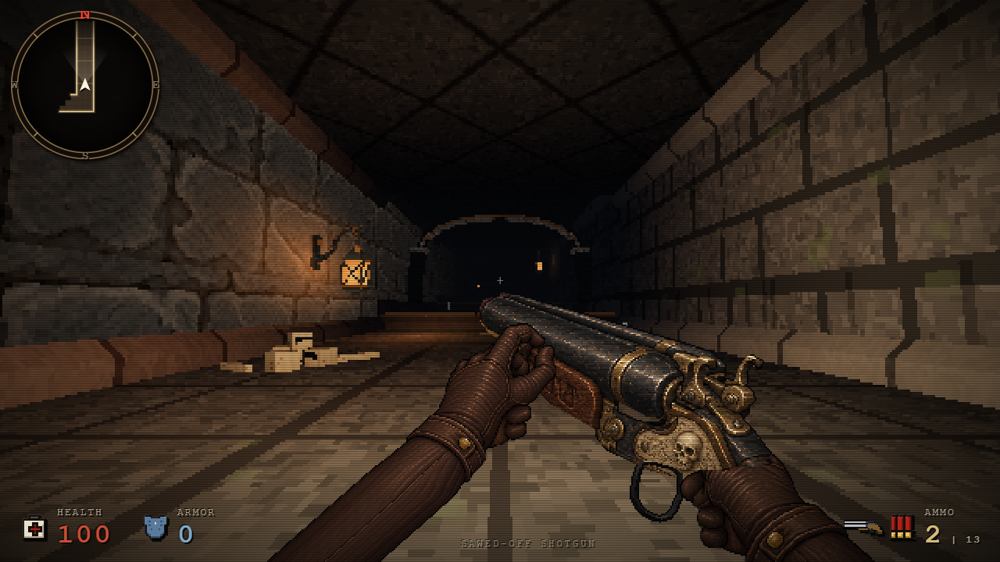
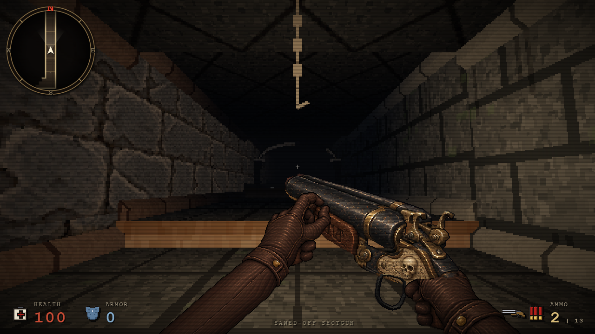
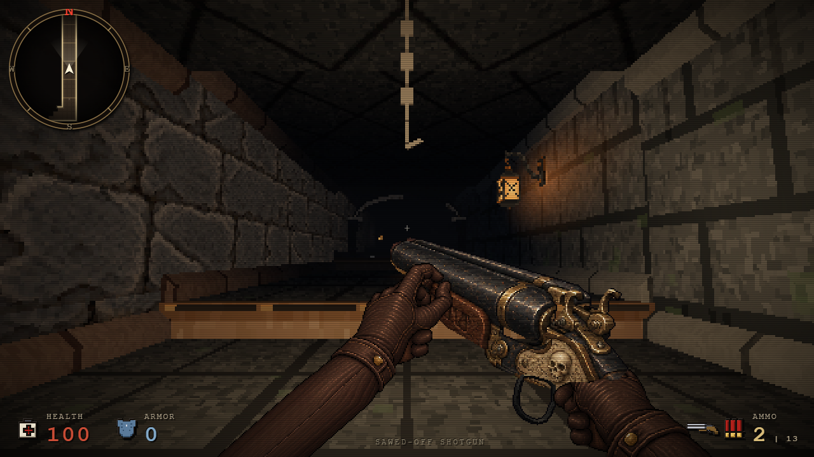

# Cehennemden dönüş basamakları

Lav arenasından doğuya çıkınca taş koridorda üç demir fener sırayla karşı duvarlara asılıyor. İlk fener yıpranmış kademeyi ve kemerin içini kehribar tonuna boyuyor. İkinci fener üst kemerin sağında beliriyor. Dikdörtgen camları koruyan çapraz çıtalar, eğri kancalar ve fenerin halkaları gerçek 3B hacimlerden oluşuyor.

19 saniyelik kesintisiz klipte oyuncu köz ocağının önünden geçiyor, lav köprüsünü aşıyor ve fenerleri takip ederek üst kemere kadar tırmanıyor. Kamera başlangıçta arenaya yerleştirildi ve yakındaki düşmanlar çekim boyunca bekletildi. Yürüyüş tuşları, yükseklikler ve stereo ses oyundan. [Sesli oynanış](arena-to-ascent.webm)

| Aynı oyun açısı, önce | Aynı oyun açısı, sonra |
| --- | --- |
|  |  |
|  |  |

Bu DreamLoop turunda mevcut yükselişin [sade oyun karesi](clean-before-foot.png) önce [ImageGen hedefine](../../assets/hell/ascent-lanterns-target-nov19.png), ardından [aynı kameradan son sahneye](clean-after-foot.png) dönüştü. Orijinal piksel stilini taşımak için hedefteki beş küçük malzeme parçası demir, eskitilmiş pirinç, cam, taş kenarı ve kemer yüzeylerinde kullanılıyor.

## Doğrulama

Chrome'da **W** basılıyken oyuncu altı yükseklik seviyesini sırayla geçti ve 4,20 birim yüksekliğindeki [sığınağa](after-refuge.png) ulaştı. Önceki sürümle 46.200 gövde, oyuncu ve mermi çarpışma denetimi eşleşti. Kayıt şapellerinin ve küçük zemin mumlarının yerleri değişmedi. Her iki sürümde de bölümdeki nokta ışığı sayısı 35. Fenerlerden gelen yerel duvar, basamak ve kemer rengi birleştirilmiş dokulardan geliyor.

Zindana geçerken üç yeni mesh'e ait toplam sekiz kaynak birer kez serbest bırakıldı. Prologue'a dönünce üç mesh yeniden kuruldu. [Kamera, yürüyüş ve kaynak raporu](verification.json)

```sh
node tools/compile-hell-ascent.cjs --check
node tools/hell-ascent-tests.cjs previous.html THE-BLACK-SILENCE.html .dream-loop/ascent-check
```

`previous.html` için `ded3e465` sürümündeki oyunu kullan. Ocak ve merdiven denemesinin HTML SHA-256 değeri `078c3e5fc4c496151731abbb5018e64b622442b13d38c142ab6c19b983418ee5`. Fener kaynağının SHA-256 değeri `44154df0f6039f9a1e2ec05340f76238842060382323277b2231b7b55d4f342b`.
