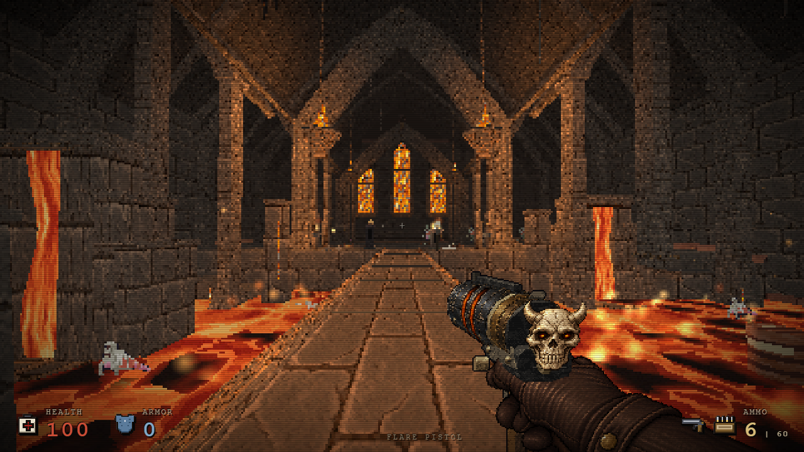
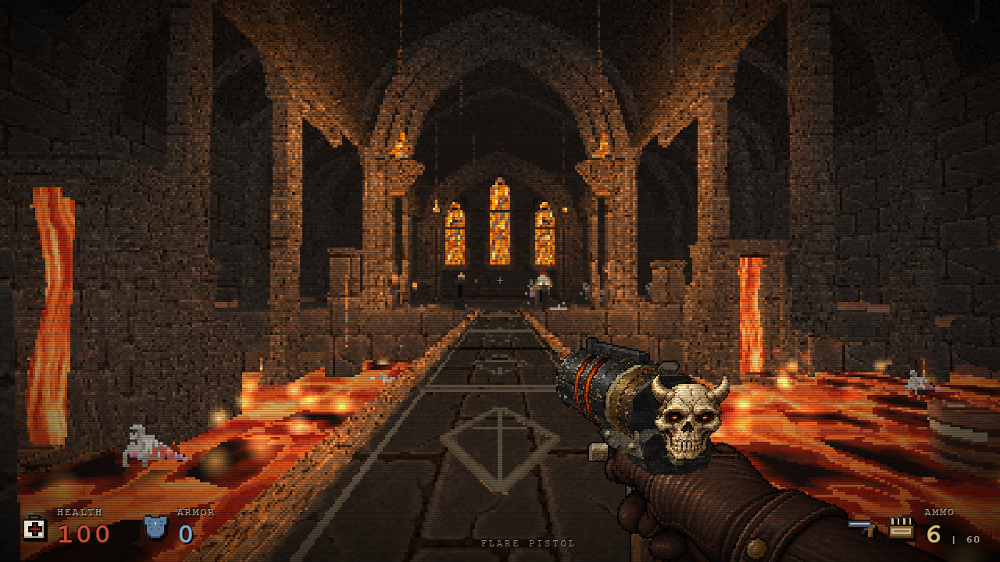
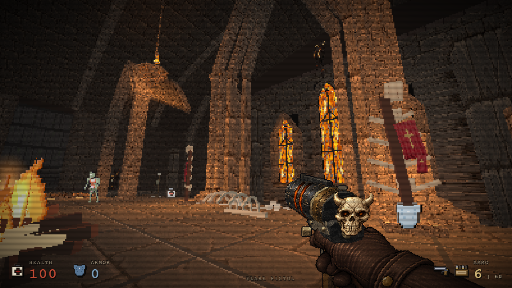

# Hell causeway and pointed vaults — 2 November

The prologue's lava bridge now has a charcoal runner, narrow interrupted stone inlays and warmer coping. The two lava cascade abutments have stone courses, engaged shafts, corbels, projecting lips and diagonal shoulders. Existing triangular-looking arch profiles were rebuilt as two centred circular arcs; the nave, side aisles and arena now have fuller pointed vaults with the same spring, span and apex.

These are real native runtime captures at identical camera/player positions, standing eye height and native zone lighting. The arena change is its vault profile and architectural shading; its floor and encounter were not rebuilt. The images use the GitHub baseline weapons, before the concurrent November weapon work.

## DreamLoop and scope

The existing approved [target](../assets/hell/reference-target.png) was reused through the [upstream DreamLoop workflow](https://github.com/achimala/dream-loop): capture, compare, implement, independent visual critique, repeat. Independent scores progressed from 6.3 to 6.7, 7.3 and 7.7 / 10. The first oversized grey inlay was rejected. A later architecture rethink replaced the arch's linear/sine profile instead of adding more decorative strips. The final result is closer to the target, not a pixel-identical match; the inlays still read flatter and the upper masonry is less detailed than the target.

The arch rise is `sqrt(t*(4-t)/3)`. Structural ribs retain seven faceted segments and the barrel roof shells use twelve. The new profile rises at least as much as the former curve at each of 1,001 checked horizontal samples, so it expands the opening rather than narrowing it. Added geometry remains decorative and collision-free. The gameplay grid, floor/ceiling heights, zone definitions, entire decor placement list, existing lights, enemies, items and exit descriptors are byte-equivalent as parsed data.

All texture/mesh additions follow native map disposal. The runner reuses the existing generated paving image; no external runtime assets or new lights are required. Runner firelight attenuation is baked once at construction. It does not add work to the animation loop. Arch surfaces retain the existing static-light limitation: native muzzle flashes do not illuminate these baked surfaces.

## Verification and measured cost

- Complete map descriptor parity and finite positive generated geometry passed in `tools/hell-causeway-tests.cjs`.
- Native navigation passed all 15 checkpoints, the first live enemy encounter, optional shotgun collection, ladder interaction, level card, next chapter and return. The later route isolates movement rather than testing full combat balance.
- Five leave/return cycles disposed tracked hell textures, reused no disposed objects and leaked no hell materials into the next chapter. Browser errors: zero.
- Six matched cameras kept the same draw counts: 68 / 57 / 63 / 72 / 199 / 195. Geometry adds 18,492 submitted triangles in each view, mainly from the smoother roof shells. This is a visual-quality cost, not an FPS improvement claim.
- Scene texture handles changed 54 to 53; images remained 49 and materials 234. The unused alternating slab batch was replaced by the inlay batch. These resource counts do not establish frame-rate gains.

Source SHA-256: `49647fbb295457cd5afec600420ebe1e2d32977b7a4cab8d4a6e7cdbbcd62c3c`.

Native proof candidate SHA-256: `8ed6b0dfb094b1c6ad42570efbd8bae287acf689fc76d96937f739661b5c6d0a`, with source `7a51b3bcb897e3e1e3b0b63e7657b4cfe0ce33cc3b9793bab8e3530ede816f56`. The final source differs only by correcting a geometry-bound wording comment; executable code is identical, recorded in `verification-data/hell-causeway-nov02-comment-only.json`. No test is represented as having run on a different binary.

Reports: `verification-data/hell-causeway-nov02-{scope,navigation,lifecycle,comment-only}.json`.

## Controlled scene performance

With all other test browsers and encoders closed, serial ABBA runs compared the immutable GitHub baseline with the final environment candidate. Each run used native handgun 0, matching bridge/arena camera and zone, a paused scene, 1.5 seconds of warmup, then 5 seconds of real RAF sampling. These are controlled scenery observations, not full combat performance or a GPU timer.

| Scene | Baseline FPS (two runs) | Candidate FPS (two runs) | Baseline render JS CPU ms | Candidate render JS CPU ms |
| --- | --- | --- | --- | --- |
| Bridge | 56.55 / 56.00 | 56.06 / 56.36 | 2.52 / 2.95 | 2.71 / 2.97 |
| Arena | 56.31 / 56.00 | 55.92 / 55.91 | 1.16 / 1.21 | 1.00 / 1.51 |

The frame-time 95th percentile remained 18.1–18.2 ms in both builds. The small average differences fall within the run-to-run spread on this shared host; no substantial regression was observed in these two controlled scenes. Render CPU is JavaScript/WebGL submission time, not GPU completion. The documented additional geometry still has a cost and may behave differently on other hardware.

`tools/hell-causeway-performance.cjs` reproduces the procedure. Full input hashes and raw frame durations are in `verification-data/hell-causeway-nov02-performance.json`.
