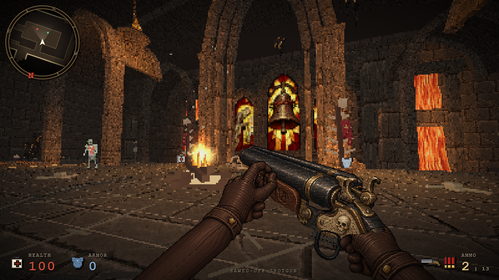
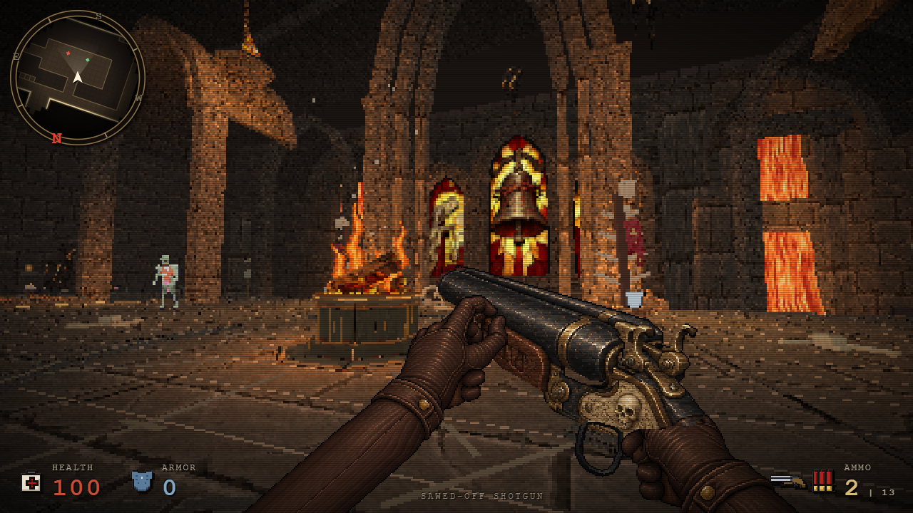

# Cehennem arenasının köz ocağı

İkinci lav köprüsünün sonrasındaki arenanın ortasında sekiz yüzlü bir cenaze ocağı var. Koyu taş gövdenin yarıkları, ince bakır kuşak ve taş taban birbirinden ayrılıyor. Odun kütüklerinin uçları ve altı kızarırken farklı yüksekliklerdeki alevler birbirlerinin arasından çıkıyor. Zemindeki turuncu yansıma ateşle değişiyor. Arenanın yakınında duyulan mevcut çıtırtı artık ocaktan geliyor.

| Aynı oyun açısı, önce | Aynı oyun açısı, sonra |
| --- | --- |
|  |  |

Silah ve arayüz çıkarılmış [önceki sahne](clean-before.png), [yeni sahne](clean-after.png) ve [ImageGen hedefi](../../assets/hell/arena-hearth-target-nov19.png) aynı cepheyi karşılaştırır. Üretilen çerçeveden alınan sekiz küçük taş, demir, bakır ve yanmış odun doku parçası 3B yüzeylerde kullanılıyor. Batıdan, [doğudan](after-east.png), [güneyden](after-south.png) ve [arena girişinden](after-entrance.png) gerçek kamera kareleri var.

## Doğrulama

Chrome, `ded3e465` karşısında arena ocağının etrafındaki 10.404 oyuncu, gövde ve mermi çarpışma örneğini karşılaştırdı. Geçiş grid'i ve yükseklikleri, kapılar, çıkış, eşya noktaları ve ocağın çarpışma kütlesi eşleşti. **W** oyuncuyu ocağın önünde durdurdu, **S** ile geri yürünebildi. Beş canlı karede ateş ve zemindeki ışık değişti. Duraklatınca iki etki de durdu. Arena dışına çıkınca alev çizimi kapandı. İki bölüm değişiminde izlenen dokular, materyaller ve geometriler birer kez serbest bırakıldı.

Ocak ve merdiven denemesinde dört eş açının çizim sayıları 67→67, 69→69, 223→230 ve 78→80 oldu. Karşılaştırma tarayıcısında hata kaydı yoktu. Bu sahne kareleri hareketli arka plan nesnelerini de içerir. [Sayısal sonuçlar](verification.json)

```sh
node tools/compile-hell-hearth.cjs --check
node tools/hell-hearth-tests.cjs previous.html THE-BLACK-SILENCE.html .dream-loop/hearth-check
```

`previous.html` için `ded3e465` sürümündeki HTML kullanılabilir. Ocak ve merdiven denemesinin HTML SHA-256 değeri `078c3e5fc4c496151731abbb5018e64b622442b13d38c142ab6c19b983418ee5`. Ocak kaynağının SHA-256 değeri `2d273d0cc3b7beb5a1fa590e233e1454bd0ad3fc72f1624ce934f88445d606ef`.
