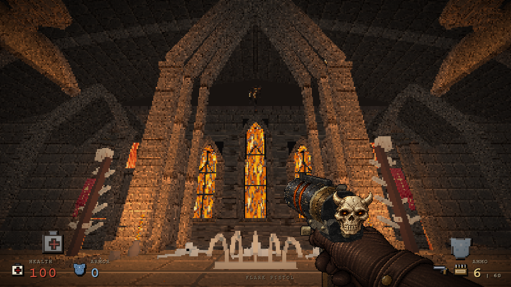
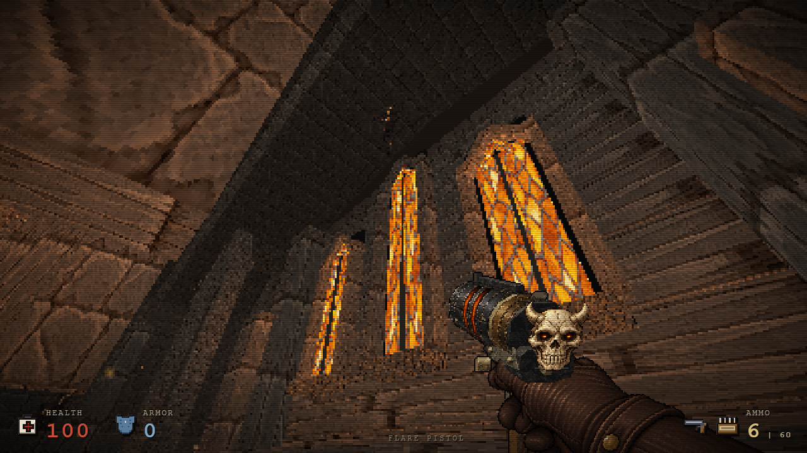
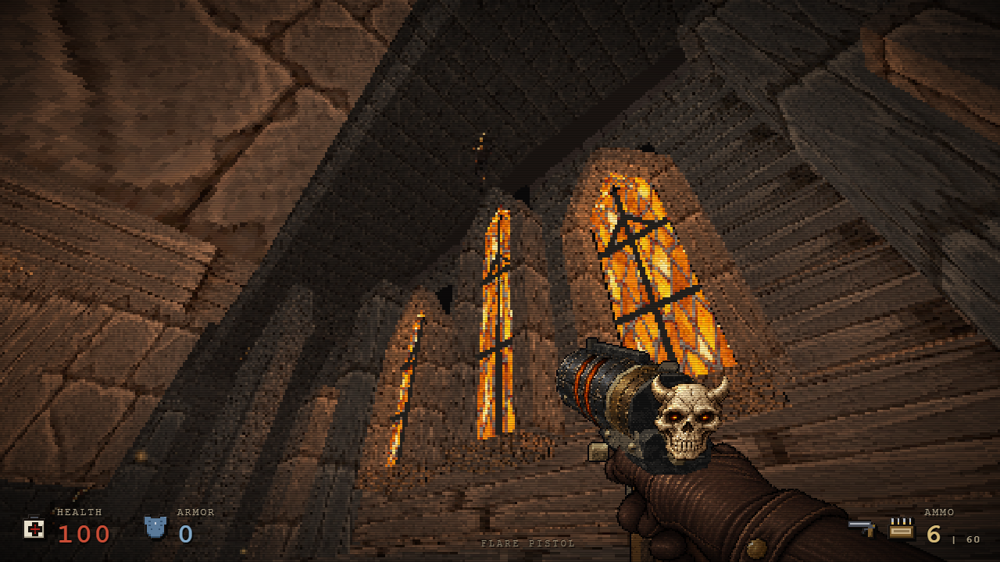
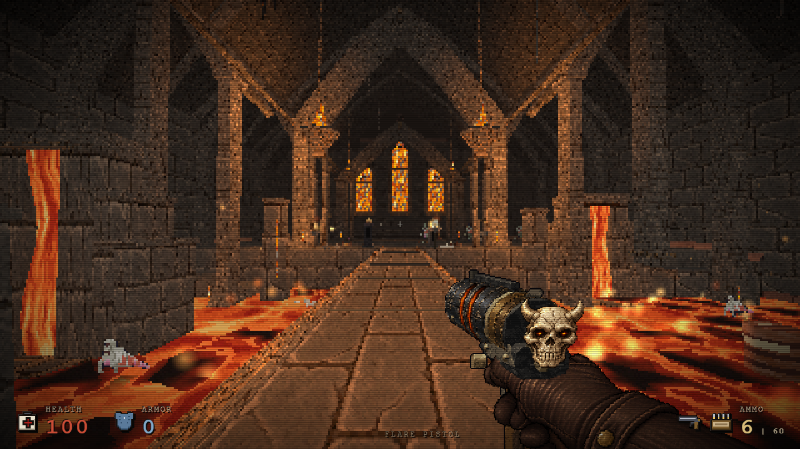

# Cehennem lancet pencereleri — 25 Ekim

Üç taş pencere grubunun ince kenarları derin sövelere ve sürekli sivri üst kemerlere dönüştürüldü. Seyrek koyu bölmeler, sıcak camı okunur panellere ayırır. Köprüden görülen üçlü turuncu odak korunur; yeni ışık veya cam dokusu eklenmez.

| Önce | Sonra |
| --- | --- |
|  |  |
|  |  |
|  |  |

## Kapsam ve maliyet

Yalnız `hellLancetShrine.build` değişir. Üç shrine'ın her birinde 24 ek küçük primitive, toplamda 72 primitive / 864 üçgen vardır. Mevcut stone/edge/wrought batch'leri kullanılır. Altı eş kamerada draw call sayıları 68/57/63/72/199/195 olarak aynı kaldı; her karede üçgen farkı +864'tür. Doku sayısı 54, materyal sayısı 234 ve renderer geometry sayısı 159 olarak eşittir. Bunlar bu sahnenin kaynak sayımlarıdır, FPS kazancı değildir.

Cam yüzeyleri, koyu arka plakalar, altar kaidesi, mevcut malzeme üretimi ve shrine yerleşimleri değişmez. Tüm harita/grid/yükseklik/çarpışma/rota/ışık/düşman/eşya verisi birebir aynı kalır. Şapel ve crypt'in önceki düzenlemeleri korunur.

## Doğrulama ve provenance

Önceki HTML `38b1a9aa2933d1523ba2607f3ae39d6d977b926b4d483d031112e085eb078b95`; çevre-only aday `fd74059e07504b1beb8812563b4b1deafc43dd82fb35e278bb83a21f90d8a936`; prologue kaynağı `cfa3f704eecf407002b506cd584d415d660ad4aad66d9d67f4db86db40238839`.

- Native göz yüksekliği ve özgün bölge ışık/sisi ile eş kamera görüntüleri alındı. Flare tabancası iki tarafta da aynıdır. Görüntülere sonradan zoom, renk veya parlaklık işlemi uygulanmadı.
- Gerçek hareketle 15 rota noktası, ilk canlı düşman karşılaşması, eşya alımı, E çıkış ve sonraki native bölüme varış geçti. İlk encounter sonrasındaki rota kontrolü tüm savaş dengesini ölçmez.
- Beş gerçek bölüm geçişi/dönüşte testin izlediği sekiz hell/ritual dokusunun tamamı temizlendi; sonraki bölümde ilgili etiket ve temizlenmiş doku yeniden kullanımı sıfırdı. Resident renderer sayısı 59 olarak sabitti. Bu sayı global enemy rig cache'indeki bütün CPU bitmap nesnelerinin sayısı değildir. Mevcut chapel glass bu sekizli sayacın kapsamı dışındadır.
- Bağımsız kaynak incelemesi yalnız shrine geometrisi sınırını ve mevcut materyal/kaynak yaşam döngüsünün değişmediğini doğruladı.

Görüntü hashleri [provenance dosyasında](hell-lancets-oct25c/provenance.json), kapsam ve sayımlar `verification-data/hell-lancets-oct25c-*.json` içindedir. Bunlar belirtilen çevre adayında çalıştırılmıştır; son birleşik sürümde yeniden çalıştırılmış gibi etiketlenmez.

Tekrar kontrol için `tools/hell-lancet-tests.cjs` eski HTML/eski prologue/yeni prologue/rapor yolunu alır. Eş kamera ve lifecycle testi `tools/hell-material-resource-tests.cjs GAME.html OUTPUT after lancet` ile çalışır. Eski girdiler Git geçmişinden ayrı dosyalara alınabilir.

Son birleşik `4b03db10fcf7433e90e2f21e662224d79ce356f3e2bac392ab7ab21cd09c6198` üzerinde altı native kamera ve beş gerçek bölüm geçişi ayrıca geçti; 8/8 scoped doku temizliği, sıfır yeniden kullanım ve aynı kaynak sayıları doğrulandı. Bu ayrı sonuç [final raporda](verification-data/hell-lancets-oct25c-final-4b03.json) bulunur. Yukarıdaki önce/sonra resimleri kendi gerçek ara aday provenance bilgilerini korur.
