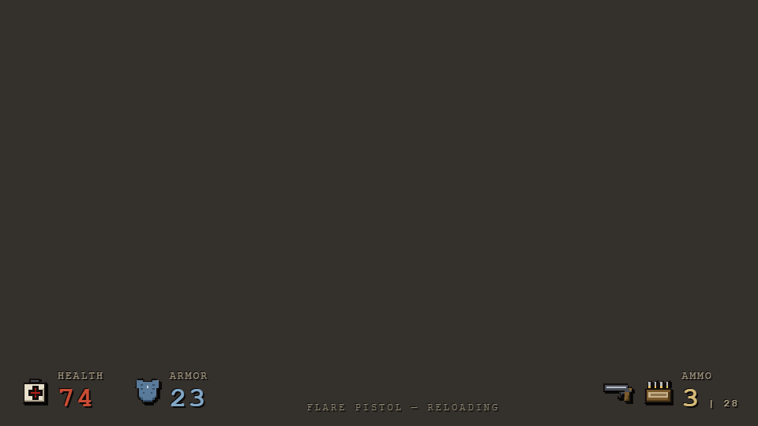
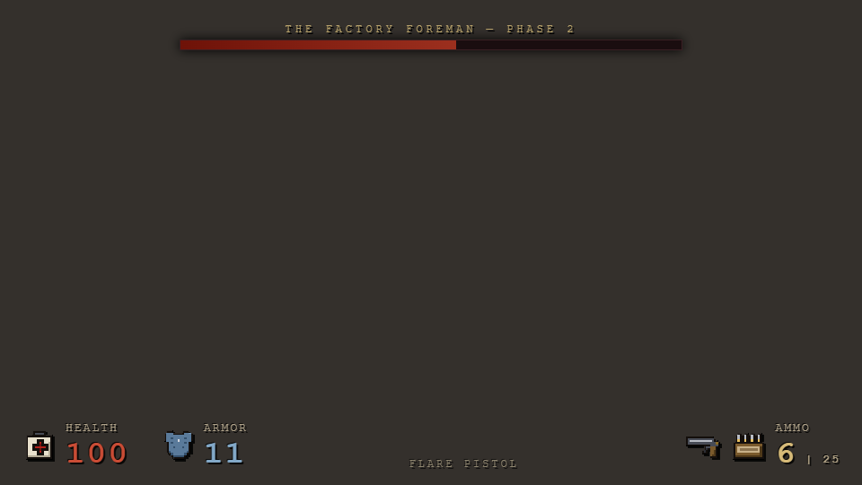

# HUD updates

The HUD now keeps the ammo span and both of its text nodes for the entire session. Health, armor, ammo, weapon name, key labels, and boss information update as their displayed values change. The native icon renderer still retries unloaded textures. Boss selection follows the living, awake actors in their existing order. The HUD retains only display values between chapters.

## Browser observations

The A/B used the exact HTML blob from commit `1b9f099` (SHA-256 `41e096b5c04dafd3e7159d25bf75433b55089fbc1354dfaa14753aa98d060b96`) and a private copy with the HUD extension inserted. A second run used the integrated standalone (SHA-256 `52933da3ee9e4a7ea9730653ab49b5e62e1df486d9eff1d32578f06f1fcb684c`) and removed just this extension for its control. Chrome 157.0.8103.52 ran both variants offline with the same seed and 960 × 540 viewport.

| Sequence | Native mutation records | Updated HUD |
| --- | ---: | ---: |
| 120 stationary HUD calls | 480 | 0 |
| One complete stationary game-loop frame | 4 | 0 |
| Mouse fire | 4 | 1 |
| Press R and step once | 4 | 1 |
| 160 subsequent weapon/HUD updates through reload completion | 640 | 3 |
| Player damage affecting health and armor | 4 | 2 |
| Pick up a placed health item | 4 | 1 |
| 120 stationary HUD calls with an awake boss | 600 | 0 |
| Change Foreman phase and health | 6 | 2 |

The observer watched six HUD subtrees. The native updater removed 600 direct children during 120 stationary HUD calls, or 720 with the boss visible. The updated version removed zero in both cases. These counts describe observed DOM churn. The probe did not measure GC pause time.

All 27 checkpoints matched in displayed values, markup and icon-canvas pixels. Coverage included the original ammo nodes, keyboard weapon switches, hidden HUD updates, a same-count seal replacement, a chapter load, the Factory Foreman's native intro, damage and phase changes, and two simultaneous bosses. Defeating the Foreman exposed the axe-wielding Mutant Executioner with a full bar. Defeating the Executioner hid the bar.

The reload and Foreman phase-two pairs below have identical decoded RGBA pixels. A neutral background isolates the HUD, including its proper typography, icon textures and boss bar. The browser let the game's opacity and fill-width transitions settle before capture.

| Native | Updated HUD |
| --- | --- |
|  |  |
|  |  |

## Isolated CPU timing

Two game pages ran serially in alternating AB/BA order. Each sample timed 512 calls to the HUD updater with observation disconnected. Each scenario got four warm-up blocks and 24 measured blocks per variant. “Periodic” changes magazine state once per 25 calls and includes reload intervals. Values are p50 / p95 of the **block averages**, in microseconds per call. They exclude layout, paint and the rest of the game loop.

| Scenario | Native on 1b9f099 | HUD injection on 1b9f099 | Native on integrated build | Integrated HUD |
| --- | ---: | ---: | ---: | ---: |
| Stationary | 20.70 / 37.30 | 0.59 / 0.98 | 15.43 / 21.88 | 0.78 / 2.15 |
| Periodic | 16.80 / 30.86 | 0.59 / 2.15 | 15.04 / 19.34 | 0.59 / 1.37 |

Run `node tools/hud-updates-tests.cjs THE-BLACK-SILENCE.html` to repeat the integrated check. The fixture uses an explicit game-loop frame and native weapon, pickup, damage and boss simulation steps under manual RAF. The reports include raw timing samples, per-field mutation counts, screenshot hashes and state snapshots. [Upstream A/B](report.json) · [Integrated A/B](integrated.json)
