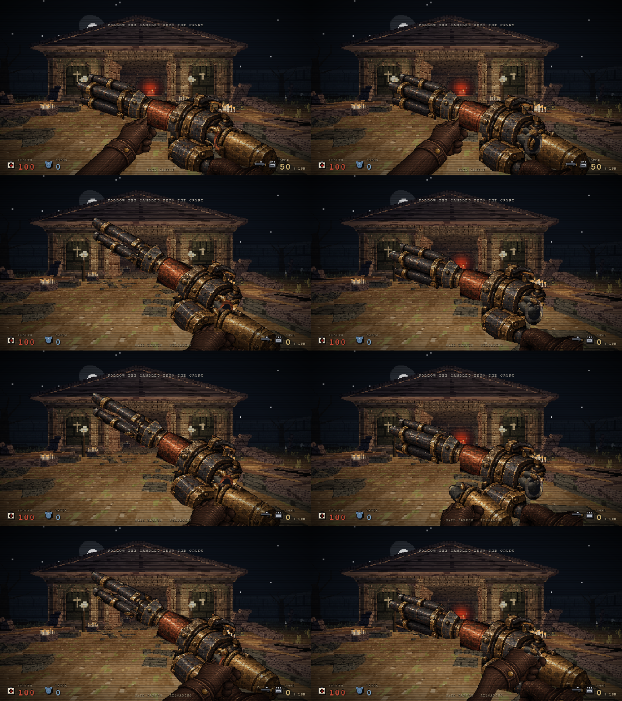

# Nail Cannon

**7** ile Nail Cannon’ı seç. **R** ile doldururken sol el mandalı kaldırıyor, eski pirinç hazneyi çekip kenara alıyor. Yeni hazne ayrı bir hareketle alttan geliyor, metal halkadaki yuvaya hizalanıyor ve mandal ikinci bir el hareketiyle kapanıyor. Boş yuvanın karanlık içi ile dışındaki çelik omuz, iki hazne arasında görünüyor.

Bakır basınç gövdesi, koyu mavimsi demir borular ve kahverengi eldiven bu turda da cephanelik levhasının sol üstündeki görünümü izliyor. Dört boru ateşle birlikte aynı mil çevresinde dönüyor. [DreamLoop model hedefi](../../assets/weapon-reference/arsenal-target-6-9-v1.png)



Solda önceki sürüm, sağda yeni sürüm var. Kareler yukarıdan aşağı hazır duruş, açık yuva, ayrı hazne ve mandalın kapanış anını gösteriyor.

Sesli kayıtta başlangıçtaki yedi mermi fareyle ateşleniyor. **R** sonrasında yalnız kalan 12 yedek mermi hazneye geçiyor. Karşılaştırma koşusu için avlu boşaltıldı ve başlangıç envanteri seçildi. [Sesli ateş ve doldurma videosu](reload.webm)

Üç ekran oranında gerçek seri ateş ve **R** sırasında nişangâh çevresindeki boşluk yalnız silahın görünür pikselleriyle ölçüldü. Animasyon, gerçek ses çıkışında mandal, mühür, çıkarma, kılavuz, oturma ve kapanış için altı ayrı temas kaydı çalıyor. [Ölçümler ve test koşulları](verification.json)

Windows PowerShell’de aynı nişangâh, mühimmat ve ses testini çalıştırabilirsin.

```powershell
$env:WEAPON_PRESENTATION_SLOT = '6'
node tools/rifle-presentation-tests.cjs THE-BLACK-SILENCE.html .dream-loop/nail-presentation
```
