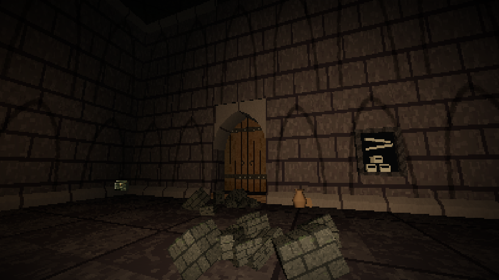
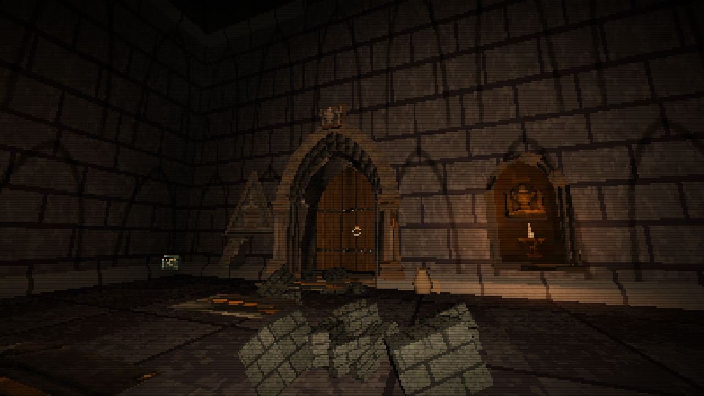
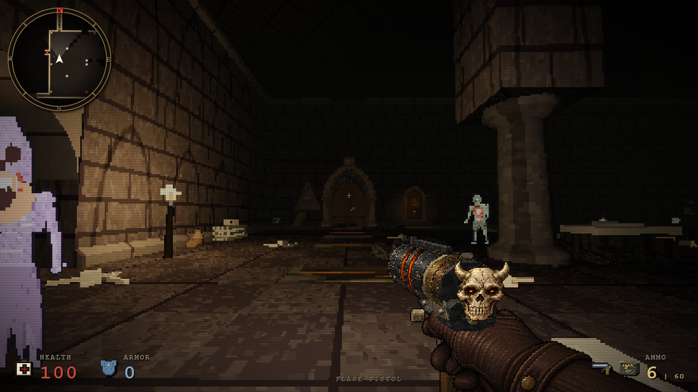
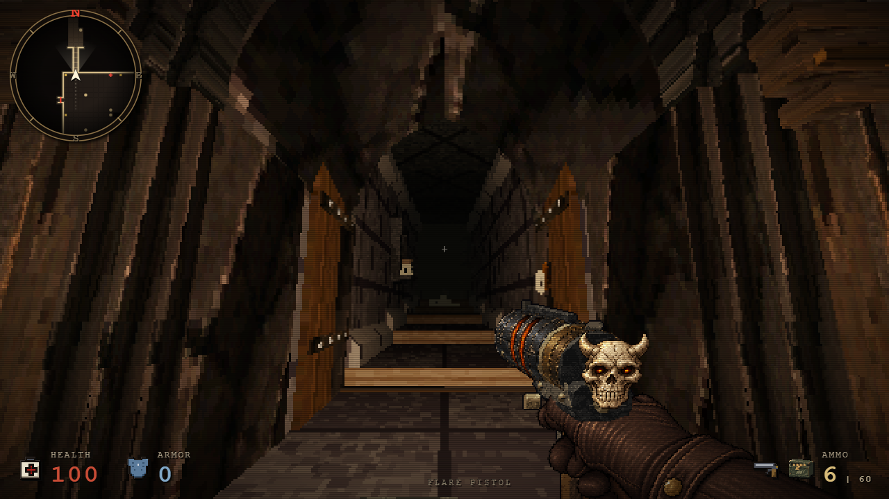

# Necropolis kemiklik girişi

Necropolis meydanındaki isli bronz kakmalar kırmızı anahtara giden kemiklik kapısında son buluyor. Koyu ahşap kanatlarda pirinç tokmak var. Taş kemerin kilit taşına bir kül vazosu işlendi. Sağ nişteki bronz kandilin alevi oynarken duvarın dip kısmı ve eşik kehribar tonunda kalıyor. Sol tarafta vazolu taş kabartma ve yontulmuş bir mezar levhası var.

Kapıya yaklaş ve **E** ile kanatları aç. İki basamak kemiklikteki kırmızı anahtara çıkar. Anahtarla meydana döndüğünde batı duvarındaki kırmızı kilidi açabilirsin.

## Oyundan görüntüler

| Önceki sürüm | Yeni görünüm |
| --- | --- |
|  |  |





Meydandan yürüme, **E** ile açma ve ilk basamağa çıkma, oyunun sesleriyle birlikte kaydedildi. [6 saniyelik oynanış](traverse.webm)

## DreamLoop

İlk hedef, 1280×720 çözünürlükte kemiklik girişinin gerçek oyun karesinden ImageGen ile üretildi. Aynı yakın ve uzak kameralardan alınan beş sürüm, kemerin iç rengi, kandil derinliği, pirinç kakmaların okunurluğu ve taş kabartmanın yerleşimi için karşılaştırıldı. Hedef görselden örneklenen yüzeyler kapı kanatlarına, işlenmiş taşa ve kandile kendi UV koordinatlarıyla uygulandı. Karşılaştırma çekimlerinde kamera konumu sabitlendi ve yakın iki karede HUD gizlendi. [Görsel hedef](../../assets/necropolis/ossuary-target-nov19.png)

## Oyun içi kontroller

Gerçek **E** ve **W** girdileriyle iki yönden açıp geçtik. İki basamağı tırmandık, kırmızı anahtarı aldık ve eski kilidi açtık. Önceki sürümden bir kaydı aynı `file://` konumunda **Continue** ile açtık. Konum, keşif ve kapı durumu korundu. Yeni kayıtta her iki kapının açık hâli ve toplanmış anahtar geri yüklendi. Test, normal oyun menüsünden başlar ve geçiş geometrisini ölçmek için sahnedeki düşmanları geçici olarak sabitler.

Kemer ve kandil 8 mesh ve 5.280 üçgen kullanıyor. Sahneye yeni dinamik ışık eklenmedi. Yakın ve uzak kameralarda çalışan WebGL profili görünür geometriye 4 çizim çağrısı eklendiğini gösterdi. [Doğrulama kayıtları](verification.json)

```sh
node tools/compile-ossuary-entrance.cjs
node tools/necropolis-ossuary-tests.cjs THE-BLACK-SILENCE.html previous.html .dream-loop/necropolis-check
```

`previous.html`, `4498556` commit’indeki tek dosyalı oyundur.
