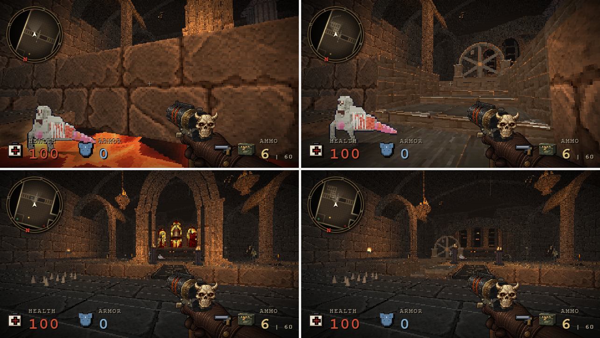

# The cinder sluice

The second Prologue bridge crosses the transept on its way to the southern arena. In the November 21 build, a player who fell east of the span at world position (84.91, 58.89) faced a bank 2.10 units above the trench. The old perimeter stairs led east. The new maintenance stair cuts into the bank ahead, turns east below the hoist and rejoins the arena approach.

## Camera comparison

Each row shows the November 21 build on the left and the November 24 release on the right. The top row faces the new stair from the trench. The bottom row shows the upper crossing. Both builds use the same world-space camera position, yaw, pitch and 640 × 360 viewport in each row.



The open, six-spoked windlass, counterweight, stone bearing blocks and chipped stair nosings follow the image study. Six small patches sampled from that study supply the in-game material texture. The three furnace dampers behind the wheel give this hall a different silhouette from the stained-glass nave and the arena. [Sluice study](../../assets/hell/cinder-sluice-study.png)

## Native route

- The bridge now has an upper lookout at (83, 59). The main span and the outer-bank escape are still usable.
- The lower route starts at (84.91, 58.89), climbs through (86, 61), (86, 63) and (86, 65), turns at (86, 66.85) and reaches the upper bank at (93, 66.85). Its successive floor heights are 0.15, 0.45, 0.75, 1.05, 1.40, 1.75 and 2.10.
- The working surfaces use the level's native height map. The renderer batches the stair dressing and ironwork into one static mesh of 3,098 triangles. The hoist base and posts use ordinary native collision masses. The material atlas measures 204 × 34 texels.

## Playback

The browser test opens the stock build from commit `97766ad`, walks the high bridge in both directions and records a shrine save. It then uses the release's Continue menu to restore the save, checks the equipment and automap, and walks the bridge, upper lookout and lower route using held W. It stages the start positions and holds actors still for this repeatable physics test. Chapter transition checks also cover disposal and recreation of the mesh, material and texture. The two camera pairs are part of the same replay. [Native route and renderer evidence](native-route.json)

```text
node tools/compile-cinder-viaduct.cjs --check
node tools/prologue-cinder-viaduct-tests.cjs previous-release.html THE-BLACK-SILENCE.html evidence-directory
```
