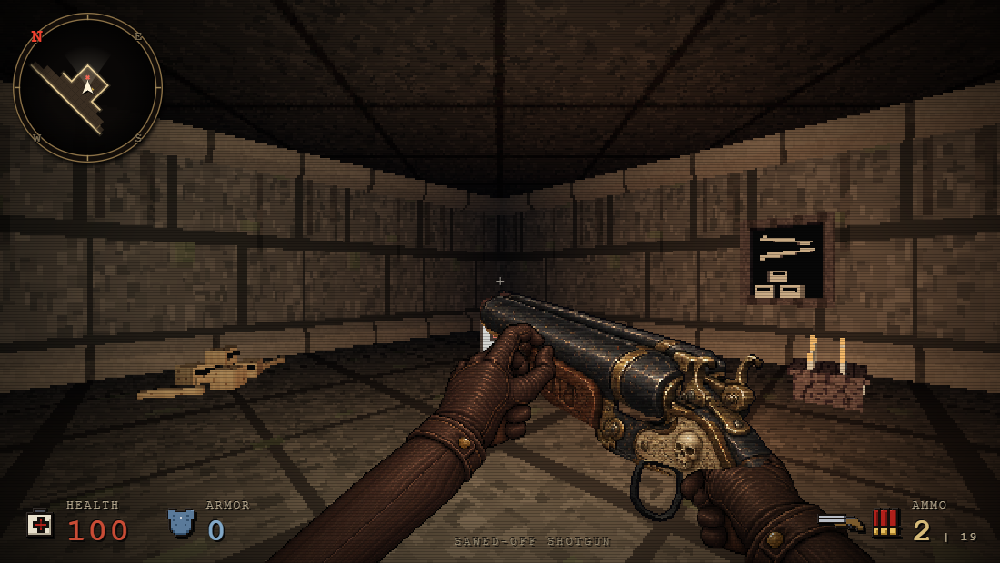
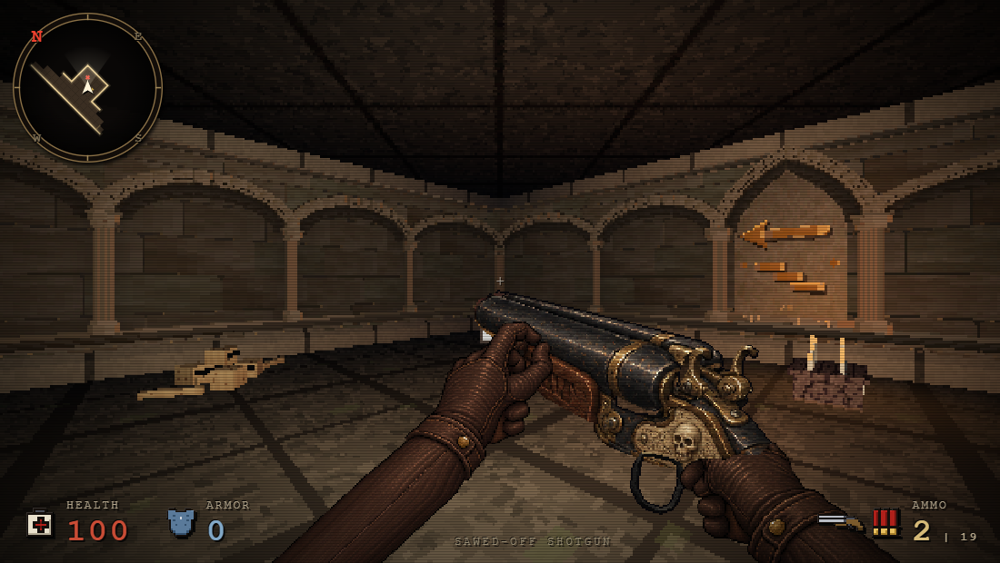
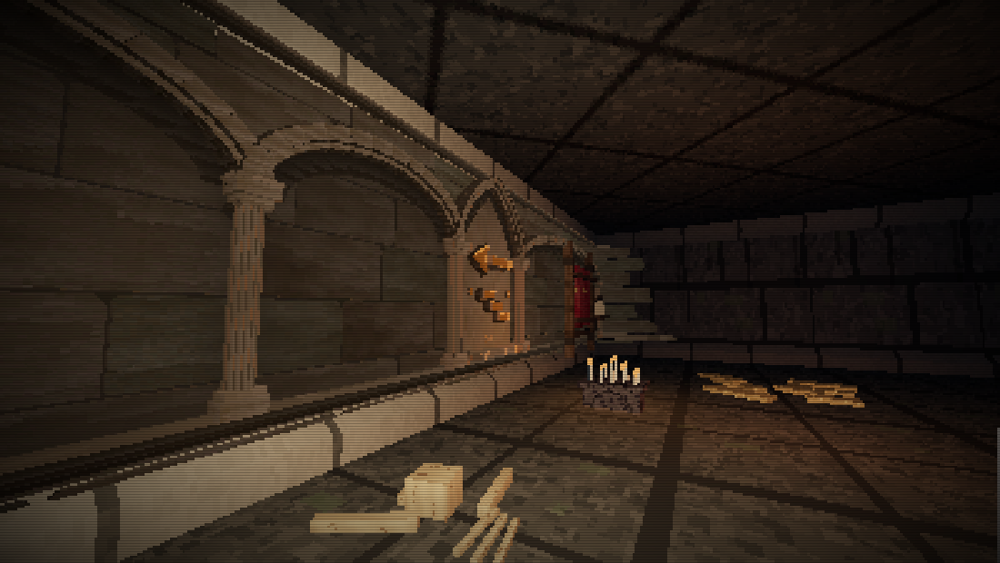

# The upper candle refuge

At the top of the Prologue’s hell ascent, the player steps into a small candle room beside the infirmary. A bronze stair marker now occupies the original ossuary recess in the east wall. Its arrow and three treads point left, toward the north passage to the chapel ladder. The camera study pointed right. Walking the route established the correct direction for the in-game sign.

| Original approach | Current approach | Oblique view |
| --- | --- | --- |
|  |  |  |

The comparison camera stands at `(118.48, 5.2, 53.53)` and looks at `(124, 5.2, 48)`. The new pointed niche has a wax-edged sill, a small paired-bone motif, and raised bronze steps and arrow. Stone courses join it to a blind arcade on the north wall. Tapered courses turn the south corner behind the original medical rack. The room retains its original health and supply pickups, candles and point lights. [Front elevation](front.png) · [Infirmary return](infirmary.png)

## DreamLoop iterations

The first independent review scored the in-game render 6.9/10. It found the arrowhead ambiguous and the masonry too bright and flat. The second pass triangulated the concave bronze arrow, added contact shadows under its treads, reduced the stone highlights, and built the carved cornice and terminal return. The independent review scored it 7.9/10. The third pass deepened shadow inside the arcade bays, graded the candlelight up the pointed recess, and staggered the south wall courses. Its fresh review scored 8.1/10. [Camera study](../../assets/hell/refuge-waymarker-target.png) · [Stone material study](../../assets/hell/refuge-cut-stone-study.png)

The game embeds eleven sampled material surfaces into an RGB565 atlas. To reproduce the bake, run `node tools/compile-refuge-waymarker.cjs`. To check the stored bake, use `node tools/compile-refuge-waymarker.cjs --check`.

## Native verification

The first argument below is a standalone game build predating the waymarker. The test opens both files offline in Chrome, stages the player on the original ascent, and holds combat for repeatability. W movement enters the refuge, collects its two original items, returns to the north corridor, and reaches the chapel. E activates the original ladder. The comparison also checks five movement and projectile queries on a 151 by 89 grid and observes resource disposal across two chapter departures.

Both builds passed the ten-action route. Health increased from 64 to 89, the bullet pickup was collected, and the original ladder entered its walking sequence. All 67,195 floor, movement and shot queries agreed. The stonework projects 0.251 m into the room, inside the existing 0.35 m player clearance. The approach submitted 54 draws against the original 52. The stone and bronze use 8,240 triangles and the light and occlusion layers use 1,360. All five owned resources disposed once on either chapter departure, and two meshes returned on re-entry. The run recorded zero script errors and zero network requests. [W-input approach](approach.png) · [Scoped comparison](verification.json)

```powershell
node tools/prologue-refuge-tests.cjs previous.html THE-BLACK-SILENCE.html .dream-loop/refuge-check
```
