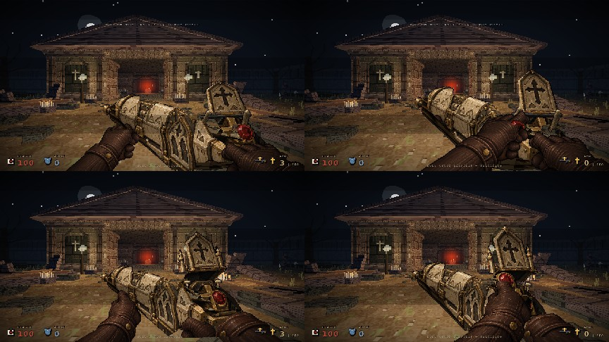
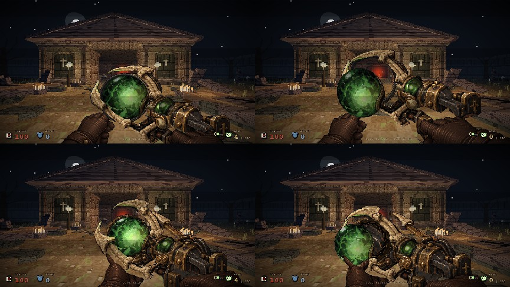

# Holy Cross Launcher and Soul Reaper

The Cross now carries a hinged crown with a detailed underside and a fitted ruby bezel. The support hand reaches from the front vault, lifts the bezel, seats it in a dark metal well, and returns to the vault. The Soul Reaper holds its glass offering between two hinged bone claws. During reload the thumb and two fingertips follow the offering out of the copper cup, uncovering the iron diaphragm and centre fastener.

The hands, spires, braces, bone sections and receiver faces use the existing approved illustration boards. Geometry and fingers move in local weapon space. The Cross's fixed enclosure is constructed once. Both models lower during reload so an approaching enemy remains visible at the aim point.

## In-game comparisons

Each image shows the original build on top and the revision below. The left column shows idle, the right column the midpoint of a real reload.

The audio examples contain real keyboard-triggered reloads captured at the game's master output, with the original first and revised version second. They retain the courtyard ambience and use the same effects volume. The revised Cross combines recorded latch, hinge, lift and seating sounds. The Reaper uses two damped glass resonances excited by the existing recorded impacts.

- [Cross reload comparison](cross-before-after.wav)
- [Soul reload comparison](soul-before-after.wav)

## Verification

Chrome completed both reloads using real input at 1024×768, 1280×720 and 1680×720. Every empty reload conserved ammunition. Between 32% and 62% of reload time, the final framing kept a disk centred on the aim point with a radius of 3% of screen height clear in all 239 sampled presentations at 4:3 and 16:9. The previous candidate covered that disk. Tests also exercised pause, mute, switch and death during playback, and compared 477 poses of unchanged weapons and actions against the starting version.

The enclosing mesh cache matched the approved uncached render in 594 poses. Serial ABBA raster observations used the same starting map in both builds and are recorded with their actual per-run variation. [Machine-readable verification](verification.json)
