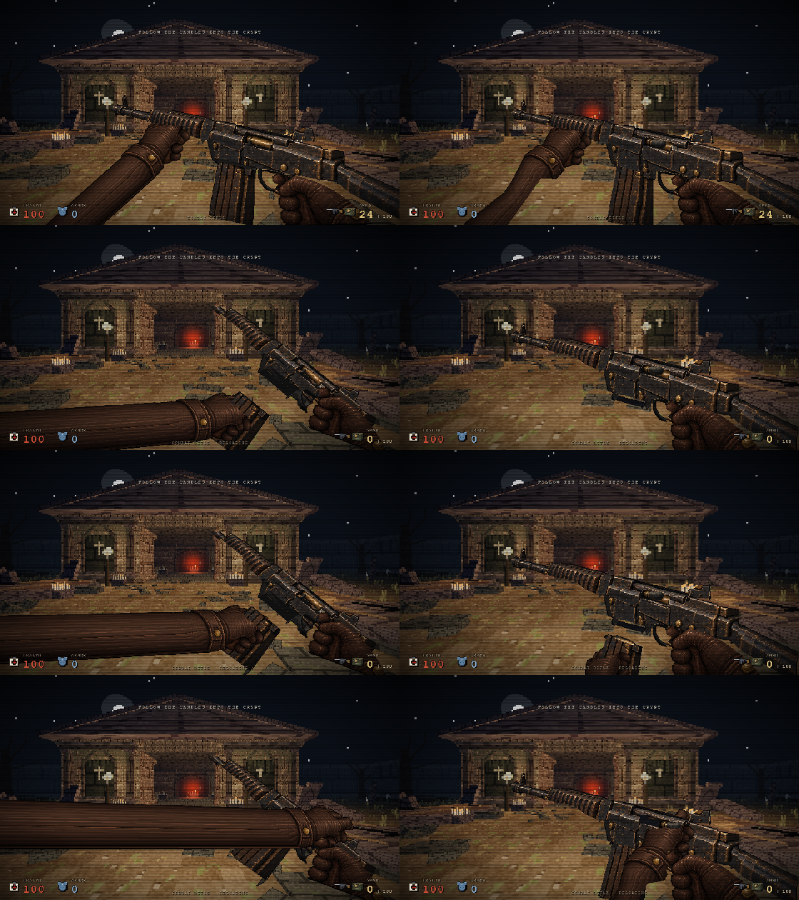

# Combat Rifle

Combat Rifle’ı **3** ile seç. **R** ile doldururken sağ el çelik gövdeyi destekliyor. Sol el eski şarjörü çekip bırakıyor ve ayrı bir şarjörle dönüyor. Sol bilek şarjörü yuvaya oturttuktan sonra kurma koluna gidiyor ve ardından el kundağına dönüyor. İki şarjörün arasında açık yuvayı, kurma kolu geri çekildiğinde de gövde üzerindeki koyu kanalı görebilirsin.

El kundağının kaburgaları, aşınmış mavimsi çelik, kahverengi deri ve pirinç ayrıntılar için mevcut DreamLoop levhasının sol üstündeki görsel kullanıldı. [İlk model hedefi](../../assets/weapon-reference/arsenal-target-2-5-v1.png)

Soldaki önceki sürüm ve sağdaki yeni sürüm yukarıdan aşağı hazır duruşu, eski şarjör çıktıktan sonraki boş yuvayı, yeni şarjörün yükselişini ve kurma kolunu gösteriyor.

Sesli oyun kaydında başlangıçtaki altı mermi fareyle ateşleniyor. **R** sonrasında yalnız kalan 11 yedek mermi silaha geçiyor. Kayıt envanteri ve boş avluyu karşılaştırma için hazırlıyor. [Sesli ateş ve doldurma kaydı](reload.webm)

Nişangâh çevresindeki boşluk, HUD ve sahne hariç sadece çizilmiş silahın görünür pikselleriyle ölçüldü. Üç ekran oranında gerçek fareyle seri ateş ve **R** girdisi kullanıldı. Silahın 24 mermi kapasitesi ve cephanenin oyundaki aktarımı korunuyor. Altı mekanik ses gerçek oyun saatinde kilit, sürtünme, kılavuz, oturma, çekme ve ileri vuruş anlarına bağlı. [Ölçümler ve kayıt koşulları](verification.json)
