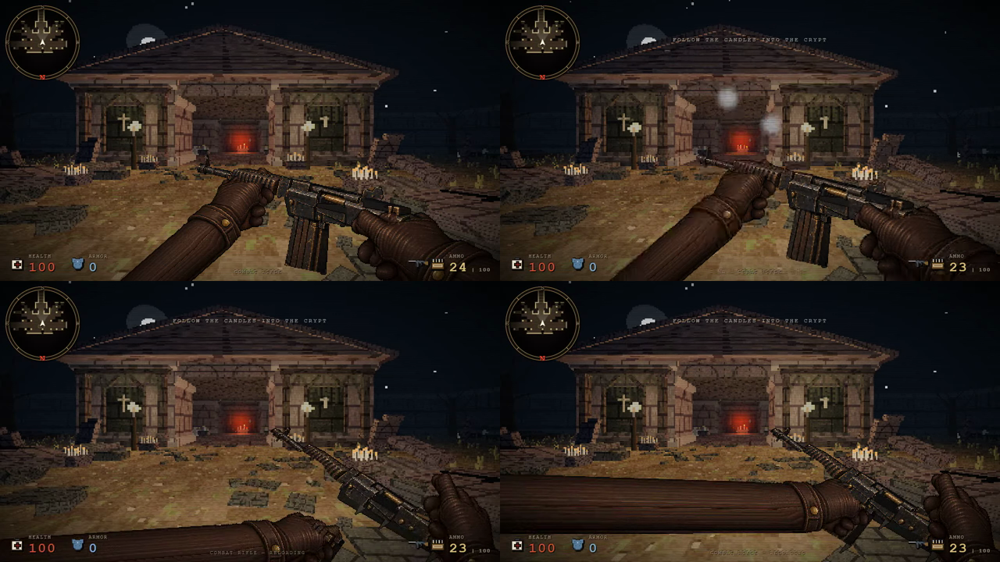

# Combat Rifle reload framing

During the native reload animation, the magazine and loading hand previously dropped almost entirely below the screen. The complete rifle assembly now rises smoothly during inspection, and the shared hand/magazine extraction travel is shorter. Magazine clearance, hand contact and return to the normal pose remain part of the same rig. Weapon statistics, elapsed reload time, ammo transfer and audio timing are unchanged.

The change is limited to `Met.draw` (weapon 2). It does not redesign the approved weapon or hand artwork. Idle poses, the other nine weapons, kicks and finishers remain pixel-identical in the tested pose set.

Exact candidate/main content SHA-256: `d5a41a6872cb7b58f0e7f4b95c58e55d466f520070a64adfa2cf66cc1df564df`; viewmodel source: `e9e098dc1cd5d0627c1ab47c4da255e5bb93f2e581326ceb5a849b60927a95e6`.

## Evidence

- 660 raw/canvas/side-buffer comparisons across 16:9, 4:3, ultrawide and resize: 610 equal; all 50 differences are expected weapon-2 reload poses, with no unexpected differences.
- 3,600 compositor kernel comparisons, including depth and dirty bounds: equal. The compositor itself is unchanged.
- Independent native keyboard-R checks: three aspect ratios × six phases, magazine refill and return to idle passed. The magazine remains close to the lower edge in some phases; the improvement makes the actual loading action readable without a new model or screen-space clamp.
- Short serial ABBA against previous release `9cecdb74…`, six real reloads per build at the same chapter-0 camera: pooled raster CPU 13.93 → 11.81 ms, frame rate 51.05 → 54.66 FPS, frame p95 35.8 → 18.2 ms. Four warm reloads per build gave 13.64 → 11.86 ms raster CPU. No regression was observed in this limited check; these results are not a general performance guarantee.

The [2.757-second actual game clip](rifle-reload-oct24c/rifle-reload.webm) records native firing and keyboard reload with the game's WebAudio output. It was captured from the exact final candidate, with enemies removed for inspection. It is gameplay evidence, not a target illustration. Video/audio synchronization is limited to the recorder's 40 ms video-frame granularity.

Reports and per-file hashes are listed in [provenance](rifle-reload-oct24c/provenance.json). The unchanged-source historical checks retain their original input hashes; they are not relabelled as fresh tests.
