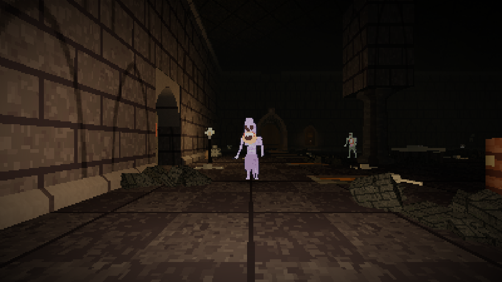
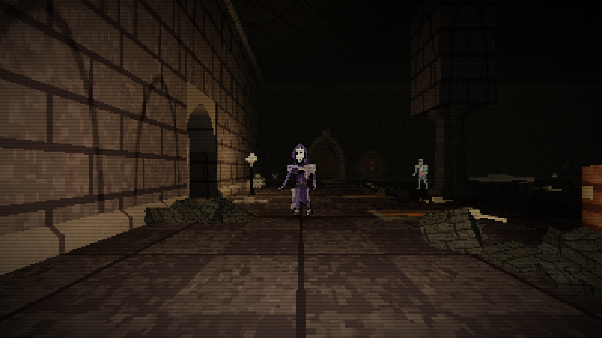
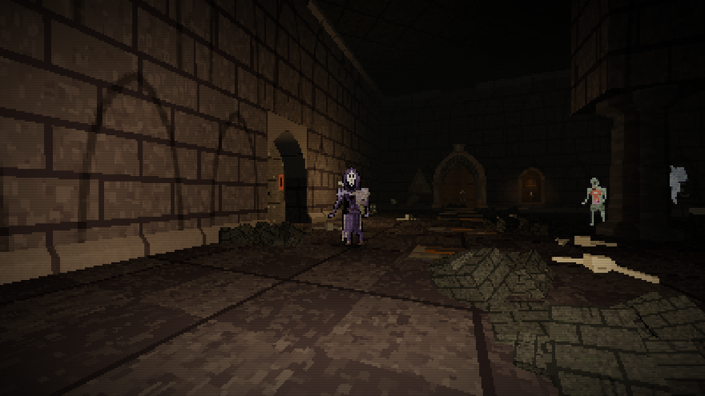
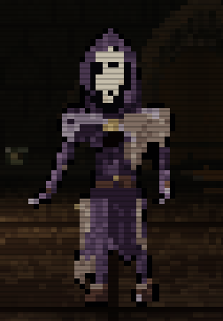
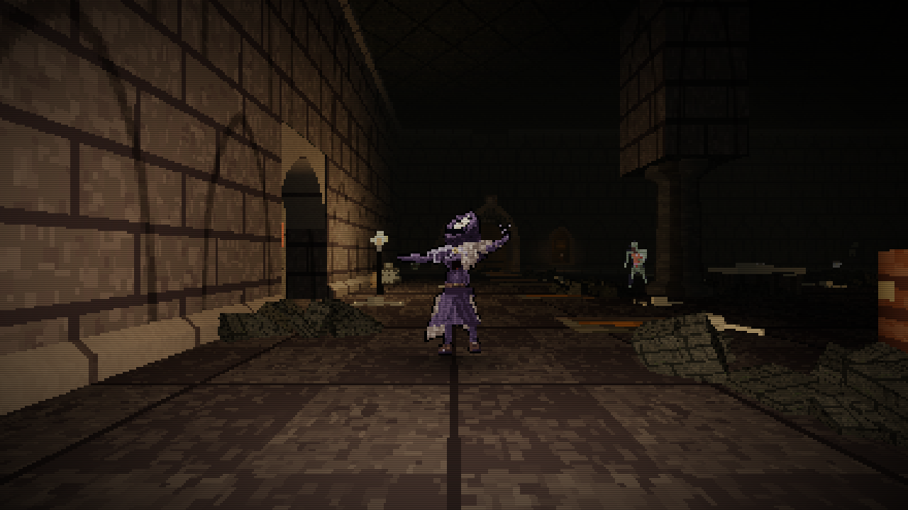

# Screamer

Necropolis’teki Screamer, koyu erik tonunda bir başlık, küçük fildişi maske ve yırtılmış asimetrik bir yas şalı taşıyor. Aşınmış keten etekler, ince bakır toka ve ayrı botlar gölgedeki silueti okunur kılıyor. Yürürken etekleri farklı açılarda hareket ediyor. Yakındaki ölüleri çağırmaya hazırlanırken öne eğiliyor. Çığlık anında başını kaldırıp iki kolunu açıyor.

## Aynı kamera

| Önceki görünüm | Yeni görünüm |
| --- | --- |
|  |  |







Görsel hedef, Necropolis meydanındaki gerçek oyun karesinden yerleşik ImageGen ile hazırlandı. Maske, şal, katlanmış kumaş ve ayakları vurgulayan altı oyun içi deneme aynı kamerada karşılaştırıldı. Önce ve sonra kareleri için HUD ve silah çizimi gizlendi. [DreamLoop hedefi](../../assets/necropolis/screamer-target-nov19.png)

İki sürümde aynı ortaya çıkma koşullarıyla 110 yerel düşman güncellemesi karşılaştırıldı. Çağrı 28. adımda gerçekleşti. Yakındaki zombi aynı konuma yöneldi ve hızlanma etkisini aynı süre aldı. Bekleme, yürüyüş, çığlık, darbe ve kopmuş parça atlasları aynı 68×97 temel çözünürlükte. Aynalı ve hasar varyantları yerel poz önbelleğine ait. [Doğrulama](verification.json)

```sh
node tools/necropolis-screamer-tests.cjs THE-BLACK-SILENCE.html previous.html .dream-loop/screamer-check
```

Görsel karşılaştırma için `previous.html` aynı Necropolis girişini içeren, Screamer değişikliğinden önceki çalıştırılabilir oyun dosyasıdır.
