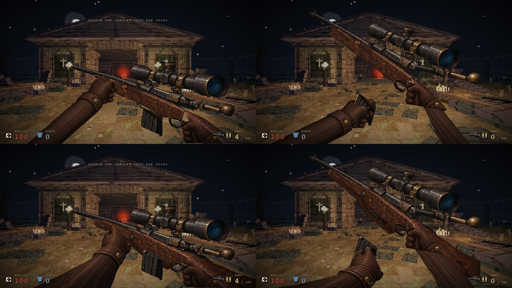

# BMG Sniper

The walnut stock now runs from the fore-end through the wrist and into a rounded heel. The stock stays visible as the firing hand reaches up to work the bolt. The support glove follows the illustrated thumb, brass cuff button and leather seams on the [original Sniper reference](../../assets/weapon-reference/arsenal-target-2-5-v1.png).

On reload the supporting hand takes the fluted box from the rifle. The box tilts slightly in the glove, its feed lips clear the fixed receiver, and both travel back together. The reload uses the existing game clock, ammunition transfer, optic and game audio.

The top row shows the earlier build with the same courtyard and camera. The bottom row shows the revision. In the earlier reload the rear wood terminated against the wrist. The first revision filled that gap but left a visible horizontal cut through the support arm at mid-reload. A second pass corrected the sleeve at the native weapon canvas boundary and removed the internal faces protruding through the stock.

[Full reload frame](magazine-withdrawn.jpg) · [4:3 comparison](reload-wide-and-standard.jpg) · [Ultrawide sequence](ultrawide.jpg)

The comparison sheets come from real fire and R-key reloads in the browser. The fixture supplies ammunition and holds encounters out of the courtyard. A separate Z–R–Z sequence exercises the scope at each viewport size, and resizing back from ultrawide checks the restored weapon raster. [Build identities and test data](verification.json)
