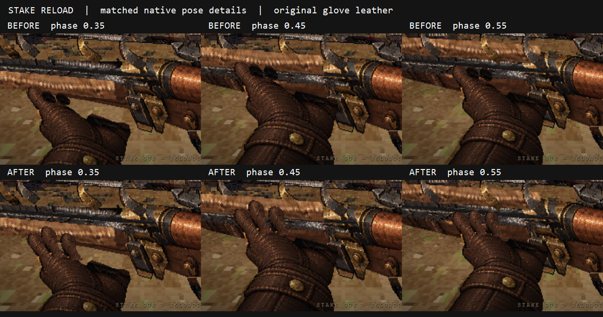

# Stake Gun tutuşu — 19 Kasım

Yeniden doldururken iki yuvarlak parmak kazığın ön yüzünü kavrıyor. Orijinal eldivenden alınan deri dokusu avuçla birleşiyor; biraz daha yüksek duran ilk parmak, kazık yerine otururken kavrayışını gevşetiyor. Hareket, doldurmanın .13–.60 aralığında gerçekleşiyor.

Karşılaştırma, 1280×720 tam ekran görüntülerinden kırpılmış ayrıntıları gösteriyor. .35, .45 ve .55 etiketli sütunlar, oyun sırasında örneklenen .36875, .456 ve .56625 aşamalarının dünya duraklatılarak yeniden gösterildiği kontrollü çekimlerdir.

[Oyun sesiyle 1,38 saniyelik doldurma videosu](stake-native.webm), gerçek `0` ve ardından `R` tuşlarıyla, oyunun kendi zaman akışında kaydedildi. Test kurulumu envanter ve yedek mühimmat sağlıyor, düşmanları kaldırıyor ve altyazıları gizliyor. Kayıt **1 yüklü kazık ve 99 yedekle** bitiyor. Ses ana oyun çıkışından alınmış; video 25 kare/sn.

Doğrulama sonuçları:

- 600 çizim örneğinin 576’sı önceki sürümle birebir eşleşti; 24 fark kazığı taşıma pozlarında görüldü.
- Son kod düzenlemesi, onaylanan görselle 600/600 ham piksel ve canvas örneğinde eşleşti.
- Gerçek girdilerle doldurma, ateş, silah değiştirme, tekme ve önbellek kontrolleri geçti: 40/40 görünür ve geçerli örnek, sıfır hata ve ağ isteği.
- Bağımsız görsel değerlendirme: **7,0 → 8,7/10**.

Dosya özetleri, çekim bilgileri ve ayrıntılı sayımlar: [verification.json](verification.json).
