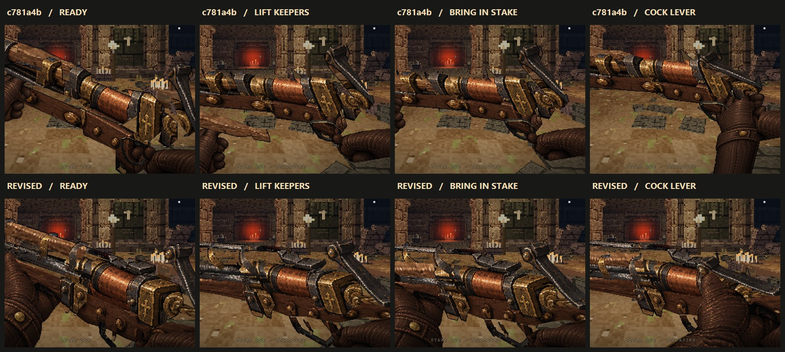
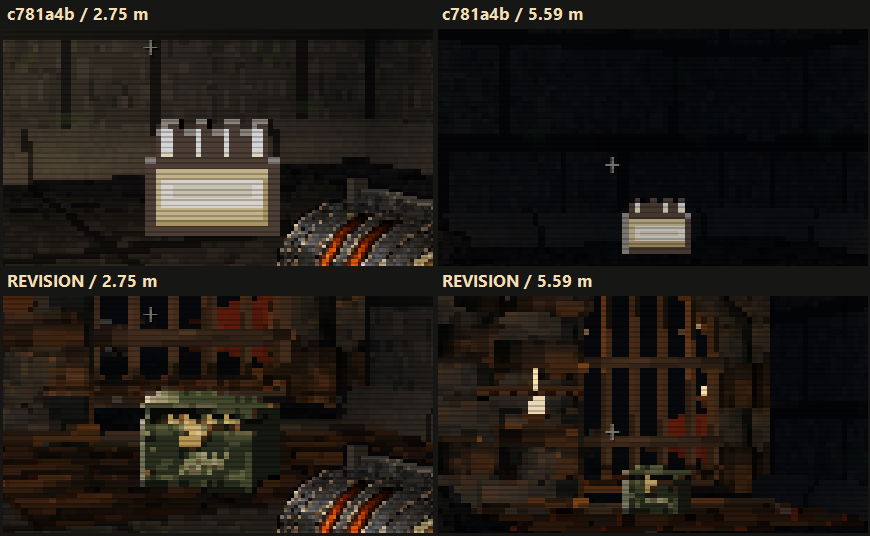

# Kazık Tüfeği ve mühimmat kutusu

Kazık Tüfeği’nde lamine ahşap gövde sağ elin içine kadar uzanıyor. Ateşten sonra yatağın içi boşalıyor. Sol el yeni kazığı öne getiriyor, üç kılavuz kazığı yakalıyor ve bakır hazneye bağlı kol son hareketi tamamlıyor. Metal pim, ahşap sürtünmesi ve mandal sesi bu hareketlerle ayrı ayrı eşleşiyor. Tek atımlık kapasite ve 0,8 saniyelik dolum süresi oyunun kendi değerleri.

[İki atışı ve iki dolumu oyun sesiyle izle](stake-reload.webm)

Klip, yayımlanan tek dosyalı oyundan kaydedildi. HTML dosyasının SHA-256 değeri `fd809a3a410f390e21e9b2e4cc7ebfe2606ba8c346c2bb899062d91fc83a8d6e`. Tarayıcı görüntüsü 25 kare/sn ile, stereo ses doğrudan oyunun ses çıkışından alındı.

Mühimmat kutusunda aralık kapağın altında pirinç kartuşlar, ön yüzde mandal ve üç çizgili envanter işareti var. Yakın ve uzak zindan kameralarında kutu normal aydınlatma ve oyun içi çözünürlükte görünüyor. Nesnenin 0,55 birimlik genişliği, haritadaki yeri ve verdiği 18 mermi korunuyor.

## Referanslar ve kontrol

- Silahın biçimi arşivdeki [cephanelik hedefinin](../../assets/weapon-reference/arsenal-target-6-9-v1.png) sağ altındaki çalışma üzerinden uyarlandı. Mühimmat kutusu için [ayrı görsel](../../assets/dungeon/munition-tin-target.png) hazırlandı ve oyunun piksel paletine işlendi.
- Silahın karşılaştırma görselleri, yayımdakiyle aynı silah kaynağını içeren V5 adayından gerçek ateş ve R girdileriyle 1024×768, 1280×720 ve 1680×720 çözünürlüklerde alındı. Kamera ve envanter karşılaştırma için sabitlendi. Video kaydında test envanteri verildi, avludaki düşmanlar kaldırıldı ve giriş yazıları gizlendi.
- Silahı değiştirerek boş dolumu kesme, tekmeden hazır duruşa dönme, mermi hesabı, diğer silahların görüntüleri ve ses sıralaması tarayıcıda kontrol edildi. Nişangâh çevresindeki mesafe doğrudan çizilmiş silah katmanının alfasından ölçüldü. [Ölçüm ve yapı kimlikleri](verification.json)
