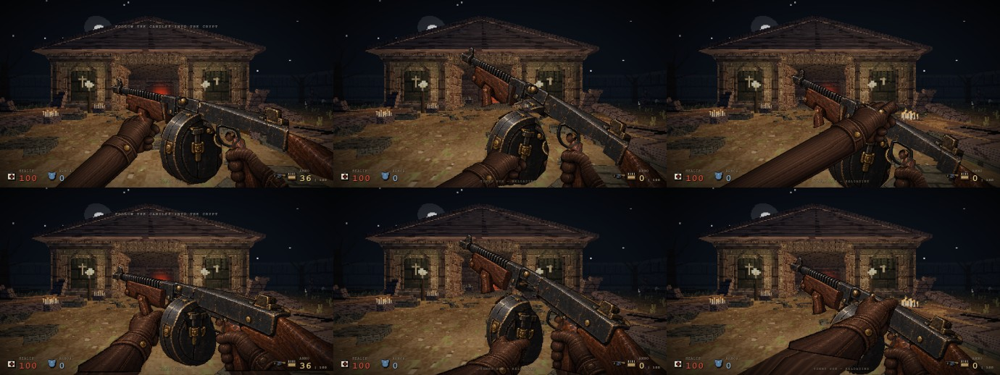

# Tommy Gun

The walnut stock and pistol grip now meet under the receiver. The index finger sits inside the guard, and the support thumb wraps the front grip. All three use the upper-right image on the existing weapons 2–5 reference board.

The support hand carries the drum through a downward arc that exposes the fixed feed opening. The cover, two edge bands, retaining key and feed neck travel together. After seating the drum, the hand pulls the charging stud and returns to the foregrip. Six contacts use the game's recorded mechanical clips and native reload timing.

[Gameplay video with game audio](tommy-reload.webm) · [Reload audio before and after](reload-before-after.wav)

Each contact sheet shows the old model on top and the revision below. The columns show idle, mid-reload and the hand returning from the charging stud. The original full-frame drum withdrawal and revised withdrawal are also available at 1280×720.

[4:3 comparison](1024x768-comparison.jpg) · [Original drum withdrawal](before-drum.jpg) · [Revised drum withdrawal](revised-drum.jpg)

The gameplay video captures real weapon selection, held mouse fire and an R-key reload at 1280×720. The sound comparison was recorded from the game's master output, with the original reload first. QA provided ammunition and removed enemies in the starting courtyard.

Tests exercised fire, switch, kick interruption, native ammo transfer and per-model cache clearing. The other weapons and actions matched the baseline in 537 raw-render and canvas poses. Mean renderer CPU during real reloads was 10.2–11.6 ms for the old build and 10.4–11.9 ms for the revision across two shared-host runs each. [Verification data](verification.json)
