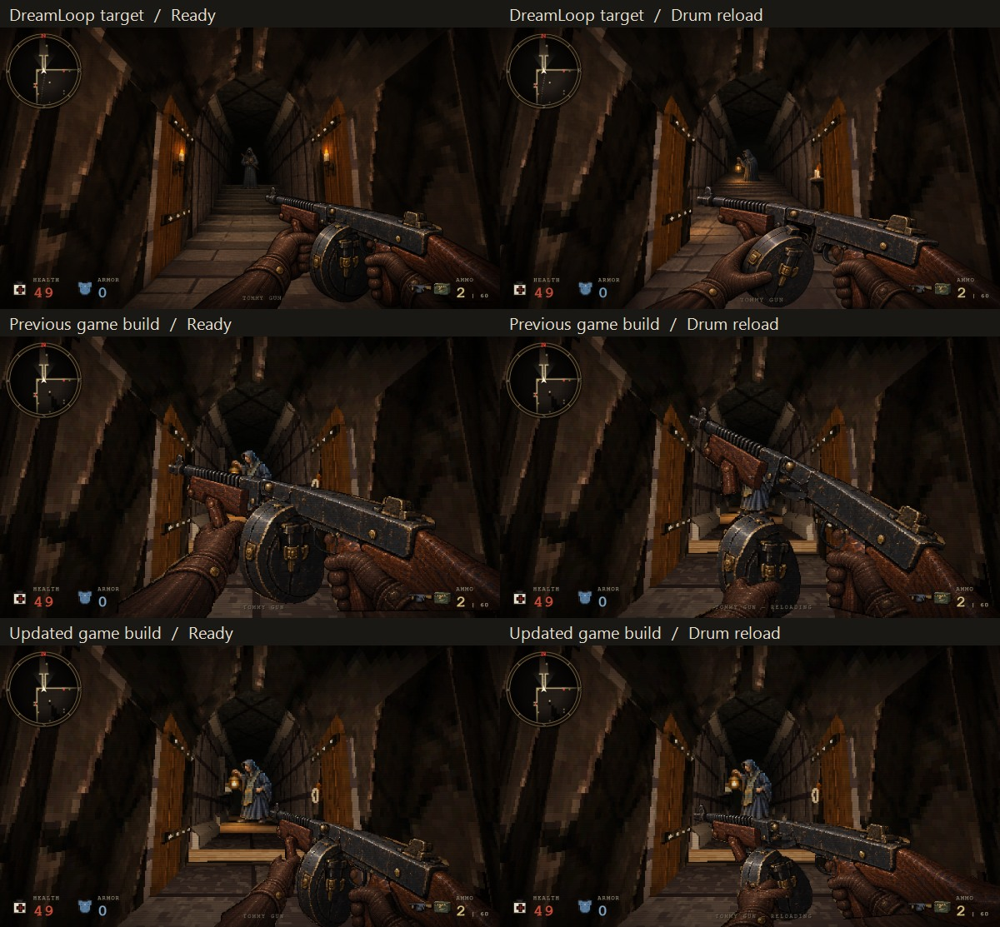

# Tommy Gun in the Necropolis

The camera looks through the Necropolis ossuary door at the lantern keeper. The ready model pivots around its muzzle so the walnut stock tucks toward the shoulder. The support palm follows the removable drum, opens its thumb against the rim, catches the charging stud, and returns to the foregrip. The walnut stock has a curved iron buttplate that can appear near the edge on wider displays.

At 16:9 the muzzle moved from 34.3% across and 47.0% down to 54.4% across and 59.8% down. In the middle of the drum exchange it moved from 38.5% across and 29.8% down to 39.3% across and 60.8% down. The center column stays open above the action.

The two concept frames share the same source screenshot. The before and after game frames use a staged camera and inventory, the same level and lantern encounter, and actual **4**, **E**, **R** and mouse input. The opening and reload captures are at different times in the encounter.

## Verification

Run `node tools/tommy-presentation-tests.cjs THE-BLACK-SILENCE.html .dream-loop/tommy-presentation` to check the ordinary game loop at 4:3, 16:9 and 21:9. It equips the gun, fires at a staged zombie and reloads. The shot dealt 16 damage in each viewport. The muzzle flash matched the barrel within 0.30 logical pixels.

The separate arsenal runtime test covered firing to interrupt a partial reload, switching weapons, cancelling with a kick, conserving ammunition, and restoring the presentation cache. The raw-pixel and canvas comparison exercised 600 poses. All 63 differences belonged to the Tommy Gun. [Capture measurements and verification results](verification.json)
