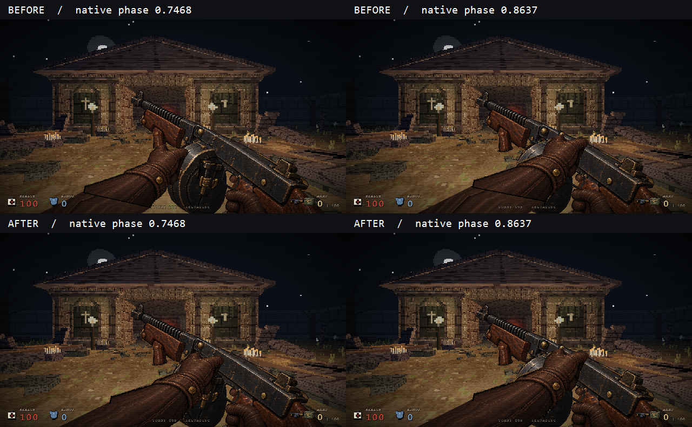

# Tommy reload hand transition

After seating the drum, the support hand now travels directly to the charging stud. Previously it moved back toward the foregrip before reaching upward again, arriving at phase .808 after the stud began moving at .78. The new approach runs from .64 to .78; extraction through .64 and recovery from .808 onward retain their original contact coordinates.

The exposed support sleeve also continues the leather from its own reference artwork. A Tommy-only texture path avoids the source board's dark bottom border and the stretched generic sleeve strip. The hand outline, forearm contour, weapon geometry, drum motion, native charging motion, audio events, ammunition transfer and 1.5-second reload duration are unchanged.

The columns show phases .7468 and .8637. These full-viewport comparisons replay the same poses sampled during an actual R-key reload, with the world paused and reload presentation preserved. Separate unpaused native R runs completed on the baseline and candidate; screenshots alone are not timing or frame-rate evidence.

[Actual Tommy reload with game audio](tommy-native.webm) is a 1.8-second native R-key capture from combined build `65a12987749d90f6ba6d9ddd00eb642266df2f8723c5efa101f2f4c1e4d307d6`. QA supplied the empty weapon and reserve ammunition and removed enemies; animation used the native clock and audio came from the game's post-master output. The clip ends at 36 loaded rounds and 64 reserve.

The accepted weapon-only HTML is `efe7883410a7cc2e0c60b55f07acf150419e4d18becc71b71675d5987bd91533`; its viewmodel source is `0f13e8a24ec2d329343a548a82f0296585f56067ff32daaa9dea30a02b71f0e8`. The baseline is the published `48ca6290ff2ce2d13f9d1d95f4d5759f09b77b38d086a532793c263e977dbbcd` build. These identities describe the isolated comparison, not a later combined release.

[Verification data](verification.json) records 600 raster/canvas cases: 537 exact and 63 expected Tommy-only differences, with zero unexpected differences. The other nine weapons, boots and finishers remained exact. The candidate also passed actual reload, fire, switch cancellation, kick recovery, partial-magazine fire cancellation and cache checks; it loaded 36 rounds from 100 reserve, leaving 64, with 87 of 87 samples finite, ready and visible and no page errors or network requests.

Run `node tools/tommy-hand-transition-tests.cjs` to check the authored contact curves against the built game's native charging interval. No new glove asset or generated target artwork is shipped.
