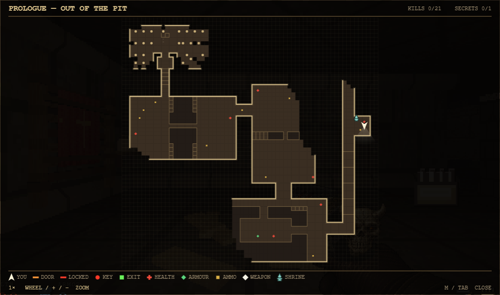

# Finding the active shrine

The teal votive lamp shows where the player will rise. It appears on both the compass and the chart after a checkpoint is lit and its cell has been explored. Lighting another shrine moves the lamp. Continuing a campaign or rising after death points back to the saved shrine.

With **M** open or **Tab** held, the wheel and **+ / −** switch between the whole explored area and two player-centred zoom levels. The map clips terrain to the chart. Closing it restores the compass and the usual wheel weapon selection. The chapter name, counts, legend and controls wrap on narrow displays.

The footer shows **M CLOSE** when the chart is pinned and **RELEASE TAB TO CLOSE** when you are only holding **Tab**. If both are active, **M UNPIN** removes the pin and the chart stays open until you release **Tab**.

[Player-centred chart](map-local.png) · [Compass](compass.png) · [360 × 640 at 2× pixel density](map-compact.png)

The images use the actual offline game. The test surveys a connected route using the game's discovery rays, positions the player by a checkpoint, and walks with W. It keeps the encounters still during comparison. A normal New Game, key and wheel events, two Sewers shrines, death, Continue after reloading the document, and the next chapter exercise the game’s usual state transitions. The compass test checks the lamp’s on-screen coordinates before and after a 90° turn.

[Input and projection checks](verification.json)

Earlier builds showed **M / TAB CLOSE** in all three states. Offline Chrome ran the same 13 checks on the original and updated standalone files using ordinary Prologue input. Both rounds covered chart zoom, pausing with a pinned chart, and loading the same campaign from the title. The updated footer fit at 360×480 and 1280×720. [Chart control results](../verification-data/nov19-map-controls.json)
