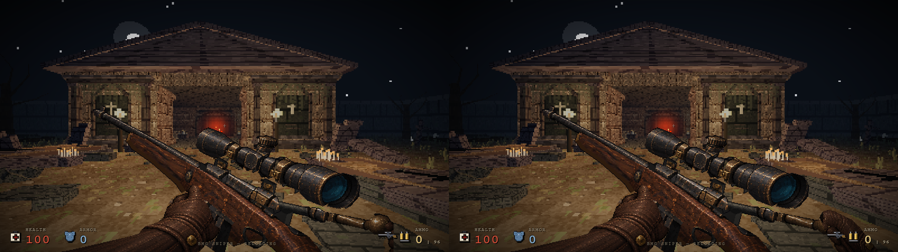
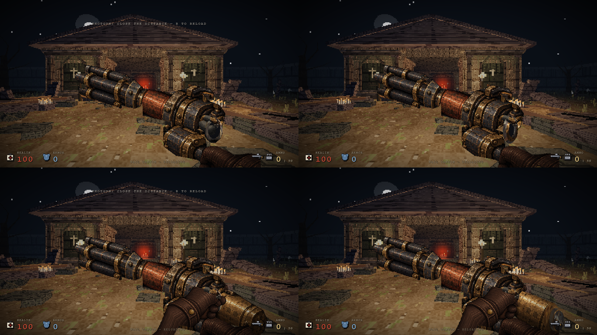

# BMG ve Nail Cannon — 20 Kasım

BMG'nin sağ eli sürgü başını kıvrılmış parmaklarla kavrıyor; bilek iki sürgü hareketinde sağ alta uzanıyor. Nail Cannon'ın kartuşu kademeli metal boyun, pirinç gövde, daralan arka omuz ve grafit kapaktan oluşuyor. Boş yuvanın iç duvarı koyu arka yüzeye açılıyor.

DreamLoop değerlendirmesi: BMG **8,25/10**, Nail Cannon **8,2/10**. Bunlar bağımsız görsel değerlendirme puanlarıdır.

Karşılaştırmalarda solda başlangıç, sağda kabul edilen sürüm yer alır. Tam oyun görünümünde, durdurulmuş sahnede gerçek yeniden doldurma sırasında kaydedilmiş aynı evreler gösterilir: BMG 0,18; Nail üstte 0,38 ve altta 0,78. Kesin evreler doğrulama verisindedir.

Gerçek tuş/fare girdileriyle R, ateş, silah değiştirme, tekme ve kısmi şarjör iptali doğrulandı. BMG **4/96**, Nail Cannon **50/50** ile tamamlandı. QA kurulumu silah ve yedek mühimmat sağladı, düşmanları sahneden çıkardı. BMG'nin üç en-boy oranında gerçek Z → R → Z geçişi ve yeniden boyutlandırma sonrası görünüm dönüşü geçti.

[Sesli BMG kaydı](bmg-native.webm) (2,88 sn) · [Sesli Nail Cannon kaydı](nail-native.webm) (2,46 sn). 5/7 ile silah seçimi, gerçek R hareketi ve oyunun ana ses çıkışı kaydedildi; son karelerde 4/96 ve 50/50 görülür.

[Doğrulama verisi](verification.json): birleşik sürümde 614 durumun 529'u birebir aynı, 85 fark iki silahın amaçlanan bölgelerinde. Nail değişikliği tek başına karşılaştırıldığında 557 durum aynı ve 57 durum Nail'e ait. Dört yerel dürbün katmanı da piksel düzeyinde eşleşti.

Tek Chrome sürecinde ABBA/BAAB sıralaması, sürüm başına dört ayrı bağlam, bağlam başına iki ısınma ve altı ölçülen gerçek R kullanıldı: **24 yeniden doldurma/sürüm**. Paylaşılan Intel UHD 630 makinede ölçülen değerler aşağıda; kampanya FPS'sini temsil etmez.

| Silah | Çizim CPU p50 / p95, ms | RAF p50 / p95, ms |
| --- | --- | --- |
| BMG | 11.00 / 17.00 → 11.40 / 16.40 | 17.60 / 18.30 → 17.50 / 18.20 |
| Nail Cannon | 7.90 / 11.60 → 8.00 / 11.40 | 17.40 / 18.20 → 17.40 / 18.20 |

Kaynak SHA-256: `1dda8b10348ef423ea254617453358f7a4092e09d7ef8e12fbb3bb6cfe834b52`.
