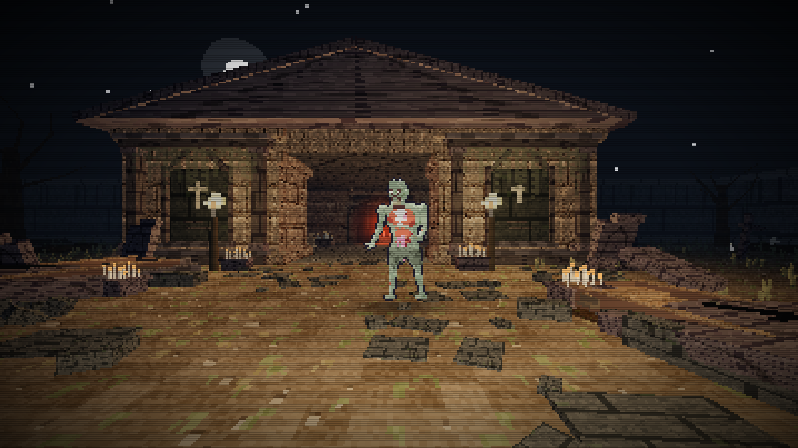
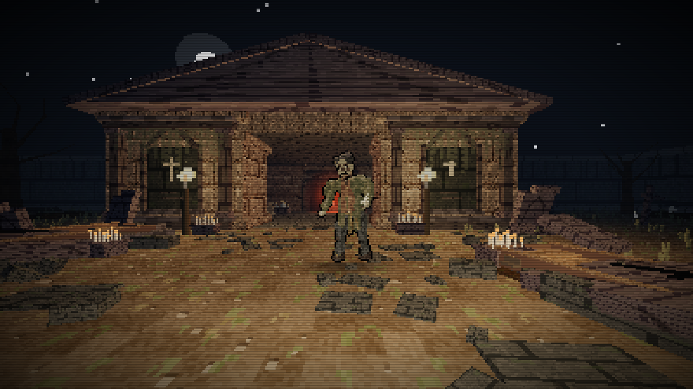
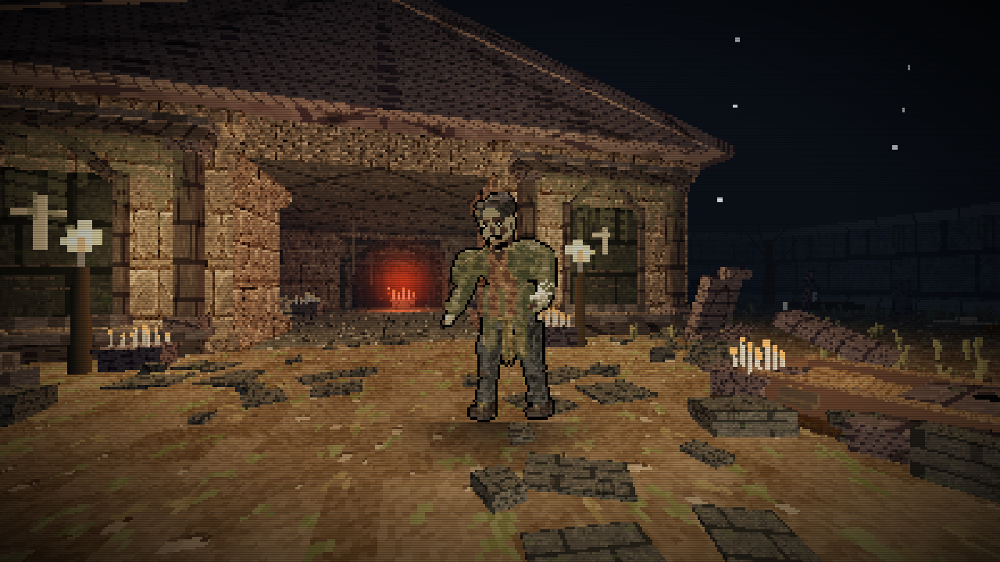
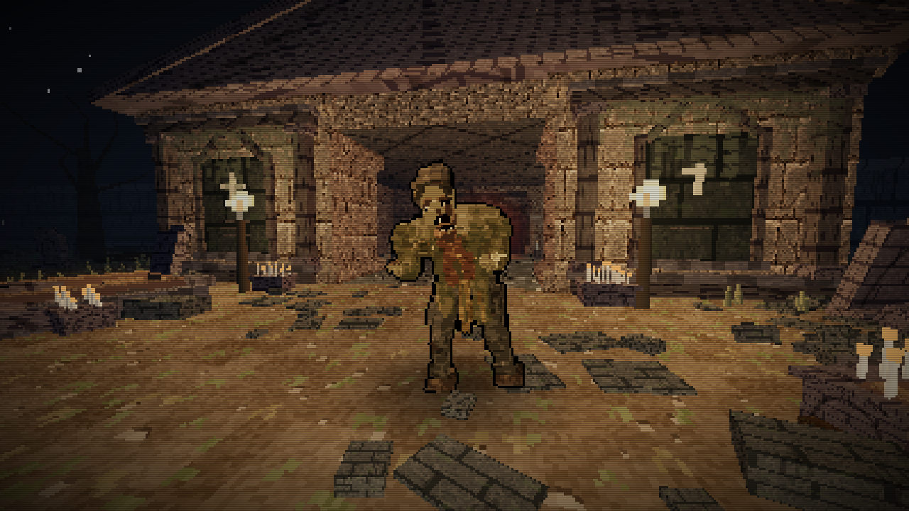
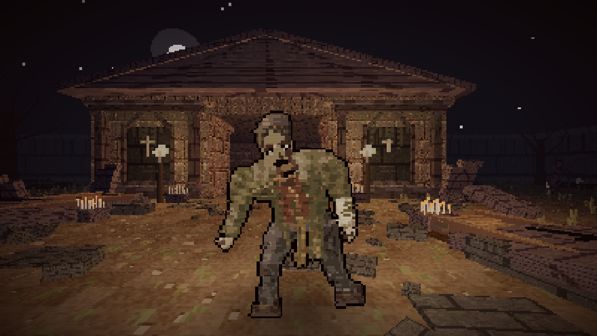

# Groundskeeper Zombie

Standart zombi artık dökülmüş yakalı, asimetrik yırtıkları olan bir iş montu, kömür tonunda pantolon ve ayrı botlar taşıyor. Yüzde çökük göz çukurları, saç çizgisi ve koyu çene gölgesi var. Sağ önkoldaki keten sargı ve yakadaki yıpranmış dikişler yakın karşılaşma sırasında şekli okunur kılıyor. Model, standart zombinin çıktığı bütün bölümlerde kullanılıyor.

| Prologue, önceki model | Prologue, yeni model |
| --- | --- |
|  |  |







Görsel hedef, şapel önündeki aynı oyuncu kamerası kullanılarak ImageGen ile hazırlandı. Oyundaki model, mevcut eklemlere çizilen katmanlardan oluşuyor. [DreamLoop hedefi](../../assets/enemies/groundskeeper-target-nov19.png)

2,08 saniyelik sesli klipte test karşılaşmanın konumunu ve bitirici türünü hazırladı. Hareket gerçek **E** girdisiyle başladı ve oyun motorunda kesintisiz ilerledi. [Mezarlık bekçisinin bitirici klibi](groundskeeper-finisher-native.webm)

Chrome’da sahne 1/60 saniyelik 150 oyun adımı boyunca aynı başlangıç koşullarıyla karşılaştırıldı. İlk yakın saldırı 50. adımda gerçekleşti. Can, saldırı menzili, hareket, bekleme, yürüyüş ve yakın dövüş poz geçişleri eşleşti. Sprite 72×100 çözünürlüğünde ve aynı sayıda önbellek yuvasıyla çalışıyor. Ayrı parça dokuları oyunun mevcut saydamlık kırpmasını ve yeni montun renklerini kullanıyor. [Görsel adayın doğrulaması](verification.json) · [Yayımlanan HTML’nin doğrulaması](../verification-data/nov19-groundskeeper-release.json)

```sh
node tools/groundskeeper-zombie-tests.cjs THE-BLACK-SILENCE.html previous.html .dream-loop/groundskeeper-check
```

`previous.html`, standart zombi modeli değişikliğinden önceki bağımsız oyun dosyasıdır.
